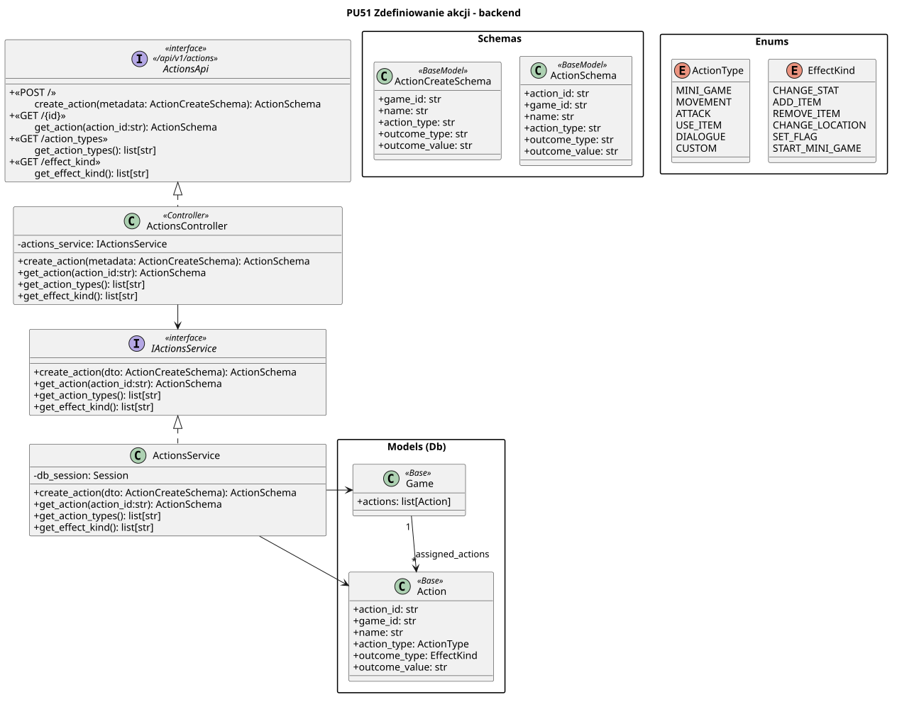

<div hidden>

```
@startuml action-definition
skinparam classAttributeIconSize 0
skinparam packageStyle rectangle
skinparam shadowing false
skinparam roundcorner 4
skinparam linetype polyline
skinparam nodesep 30
skinparam ranksep 40
hide empty members

title PU51 Zdefiniowanie akcji - backend

interface IActionsApi <<interface>>\n<< /api/v1/actions >> {
    + <<POST / >>\n\tcreate_action(metadata: ActionCreateSchema): ActionSchema
    + <<GET /{action_id} >>\n\tget_action(action_id: str): ActionSchema
    + <<GET /action_types >>\n\tget_action_types(): list[str]
    + <<GET /effect_kind >>\n\tget_effect_kind(): list[str]
}

class ActionsController <<Controller>> {
    - actions_service: IActionsService
}

interface IActionsService <<interface>> {
    + create_action(dto: ActionCreateSchema): ActionSchema
    + get_action(action_id: str): ActionSchema
    + get_action_types(): list[str]
    + get_effect_kind(): list[str]
}

class ActionsService <<Service>> {
    - db_session: Session
}

class Action <<Base>>
class Game <<Base>>
class ActionCreateSchema <<BaseModel>>
class ActionSchema <<BaseModel>>
class NotFoundError <<Exception>>
class ConflictError <<Exception>>

ActionsController .u.|> IActionsApi
ActionsController --> IActionsService
ActionsService .u.|> IActionsService
ActionsService --> Action
ActionsService --> Game : sprawdzenie game_id
ActionsService ..> ActionCreateSchema
ActionsService ..> ActionSchema
ActionsService ..> NotFoundError : brak gry / akcji
ActionsService ..> ConflictError : naruszenie ograniczeń bazy

note right of IActionsApi
    201 przy utworzeniu akcji. Niepoprawne action_type
    lub outcome_type (spoza enumów) -> 422.
    Frontend PU51 używa tylko create_action.
end note

note bottom of Action
    Schematy: interfaces.md, encje i enumy: data-model.md
end note
@enduml
```

</div>


