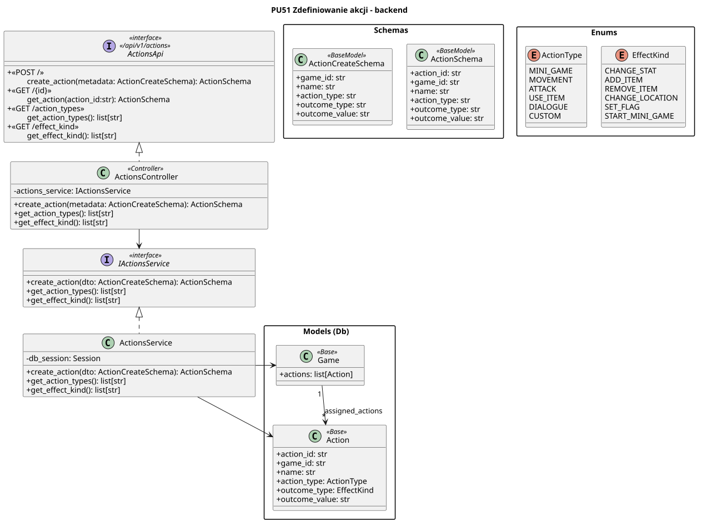

<div hidden>

```

@startuml action-definition-backend
skinparam classAttributeIconSize 0
skinparam packageStyle rectangle
skinparam shadowing false
skinparam roundcorner 4
skinparam nodesep 26
skinparam ranksep 34
skinparam linetype polyline

title PU51 Zdefiniowanie akcji - backend

interface ActionsApi <<interface>>\n<< /api/v1/actions >> {
    + <<POST / >>\n\tcreate_action(metadata: ActionCreateSchema): bool
    + <<GET /action_types>>\n\tget_action_types(): list[str]
+ <<GET /effect_kind>>\n\tget_effect_kind(): list[str]
}

class ActionsController <<Controller>> {
    - actions_service: IActionsService
+ create_action(metadata: ActionCreateSchema): bool
    + get_action_types(): list[str]
+ get_effect_kind(): list[str]
}

interface IActionsService <<interface>> {
+ create_action(dto: ActionCreateSchema): bool
    + get_action_types(): list[str]
+ get_effect_kind(): list[str]

}

class ActionsService {
    - db_session: Session
+ create_action(dto: ActionCreateSchema): bool
    + get_action_types(): list[str]
+ get_effect_kind(): list[str]
}

package "Schemas" {
    class ActionCreateSchema <<BaseModel>> {
+ game_id: str
+ name: str
+ action_type: str
+ outcome_type: str
+ outcome_value: str
    }
}

package "Models (Db)" as models {
    class Game <<Base>> {
        + actions: list[Action]
    }
    
    class Action <<Base>> {
        + game_id: str
+ name: str
+ action_type: ActionType
+ outcome_type: EffectKind
+ outcome_value: str
    }
}

package "Enums"{
    enum ActionType {
      MINI_GAME
MOVEMENT
ATTACK
USE_ITEM
DIALOGUE
CUSTOM
    }
    
    enum EffectKind {
CHANGE_STAT
ADD_ITEM
REMOVE_ITEM
CHANGE_LOCATION
SET_FLAG
START_MINI_GAME
    }
}

ActionsService .up.|> IActionsService
ActionsController .up.|> ActionsApi

ActionsService -right-> Game
ActionsService -right-> Action


ActionsController --> IActionsService


Game "1" --> "*" Action : assigned_actions

```

</div>

