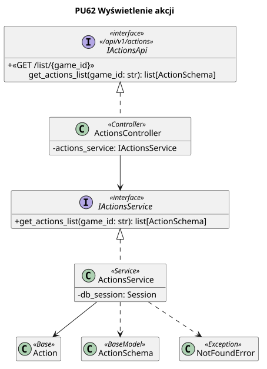

<div hidden>

```
@startuml actions-list
skinparam classAttributeIconSize 0
skinparam packageStyle rectangle
skinparam shadowing false
skinparam roundcorner 4
skinparam linetype polyline
hide empty members

title PU62 Wyświetlenie akcji

interface IActionsApi <<interface>>\n<< /api/v1/actions >> {
    + <<GET /list/{game_id} >>\n\tget_actions_list(game_id: str): list[ActionSchema]
}

class ActionsController <<Controller>> {
    - actions_service: IActionsService
}

interface IActionsService <<interface>> {
    + get_actions_list(game_id: str): list[ActionSchema]
}

class ActionsService <<Service>> {
    - db_session: Session
}


class Action <<Base>>{
}

class ActionSchema <<BaseModel>> {
  
}

class NotFoundError <<Exception>>{

}

ActionsController .u.|> IActionsApi
ActionsController --> IActionsService
ActionsService .u.|> IActionsService
ActionsService --> Action
ActionsService ..> ActionSchema
ActionsService ..> NotFoundError

@enduml

```


</div>

