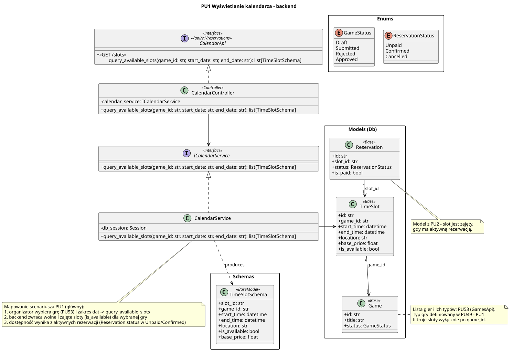

<div hidden>

```
@startuml calendar-backend
skinparam classAttributeIconSize 0
skinparam packageStyle rectangle
skinparam shadowing false
skinparam roundcorner 4
skinparam nodesep 26
skinparam ranksep 34
skinparam linetype polyline

title PU1 Wyświetlanie kalendarza - backend

interface CalendarApi <<interface>>\n<< /api/v1/reservations >> {
    + <<GET /slots >>\n\tquery_available_slots(start_date: datetime, end_date: datetime): list[TimeSlotSchema]
}

class CalendarController <<Controller>> {
    - calendar_service: ICalendarService
    + query_available_slots(start_date: datetime, end_date: datetime): list[TimeSlotSchema]
}

interface ICalendarService <<interface>> {
    + query_available_slots(start_date: datetime, end_date: datetime): list[TimeSlotSchema]
}

class CalendarService {
    - db_session: Session
    + query_available_slots(start_date: datetime, end_date: datetime): list[TimeSlotSchema]
}

package "Schemas" {
    class TimeSlotSchema <<BaseModel>> {
        + slot_id: str
        + game_id: str
        + start_time: datetime
        + end_time: datetime
        + location: str
        + is_available: bool
        + base_price: float
    }
}

package "Models (Db)" as models {
    class Game <<Base>> {
        + id: str
        + title: str
        + status: GameStatus
    }

    class TimeSlot <<Base>> {
        + id: str
        + game_id: str
        + start_time: datetime
        + end_time: datetime
        + location: str
        + base_price: float
        + is_available: bool
    }

    class Reservation <<Base>> {
        + id: str
        + slot_id: str
        + status: ReservationStatus
        + is_paid: bool
    }
}

package "Enums" {
    enum GameStatus {
        Draft
        Submitted
        Rejected
        Approved
    }

    enum ReservationStatus {
        Unpaid
        Confirmed
        Cancelled
    }
}

CalendarController .up.|> CalendarApi
CalendarController --> ICalendarService

CalendarService .up.|> ICalendarService
CalendarService ..> TimeSlotSchema : produces
CalendarService -right-> TimeSlot

TimeSlot "*" --> "1" Game : game_id
Reservation "*" --> "1" TimeSlot : slot_id

note bottom of CalendarService
    Mapowanie scenariusza PU1 (główny):
    1. organizator otwiera kalendarz i wybiera zakres dat -> query_available_slots
    2. backend zwraca wolne i zajęte sloty (is_available) w podanym zakresie
    3. dostępność wynika z aktywnych rezerwacji (Reservation.status w Unpaid/Confirmed)
    4. gra wybierana jest dopiero w PU2 (rezerwacja gry) -
       endpoint nie filtruje po game_id
end note

note right of CalendarApi
    Kontrakt uzgodniony w review PR #73:
    bez game_id (gra znana dopiero w PU2),
    daty jako datetime.
end note

note right of Game
    Sloty należą do gier (typ gry z PU49).
    Kalendarz pokazuje sloty wszystkich gier -
    wybór gry następuje dopiero w PU2.
end note

note bottom of Reservation
    Model z PU2 - slot jest zajęty,
    gdy ma aktywną rezerwację.
end note
@enduml
```

</div>


