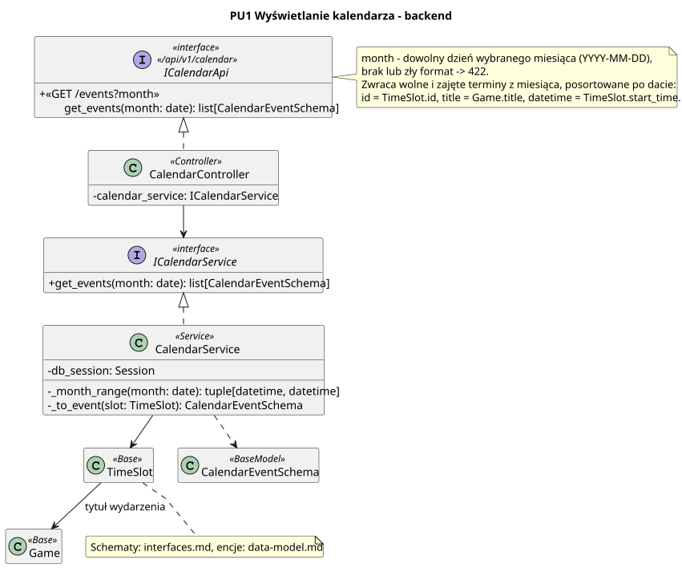

<div hidden>

```
@startuml calendar-backend
skinparam classAttributeIconSize 0
skinparam packageStyle rectangle
skinparam shadowing false
skinparam roundcorner 4
skinparam nodesep 26
skinparam ranksep 34
skinparam linetype polyline

title PU1 Wyświetlanie kalendarza - backend

interface CalendarApi <<interface>>\n<< /api/v1/calendar >> {
    + <<GET /events?month >>\n\tget_events(month: date): list[CalendarEventSchema]
}

class CalendarController <<Controller>> {
    - calendar_service: ICalendarService
    + get_events(month: date): list[CalendarEventSchema]
}

interface ICalendarService <<interface>> {
    + get_events(month: date): list[CalendarEventSchema]
}

class CalendarService {
    - db_session: Session
    + get_events(month: date): list[CalendarEventSchema]
}

package "Schemas" {
    class CalendarEventSchema <<BaseModel>> {
        + id: str
        + title: str
        + datetime: datetime
    }
}

package "Models (Db)" as models {
    class Game <<Base>> {
        + id: str
        + title: str
        + duration_minutes: int
        + status: GameStatus
    }

    class TimeSlot <<Base>> {
        + id: str
        + game_id: str
        + start_time: datetime
        + location: str
        + base_price: float
        + is_available: bool
    }
}

package "Enums" {
    enum GameStatus {
        Draft
        Submitted
        Rejected
        Approved
    }
}

CalendarController .up.|> CalendarApi
CalendarController --> ICalendarService

CalendarService .up.|> ICalendarService
CalendarService ..> CalendarEventSchema : produces
CalendarService -right-> TimeSlot

TimeSlot "*" --> "1" Game : game_id

note bottom of CalendarService
    Mapowanie scenariusza PU1 (główny):
    1. organizator otwiera kalendarz -> get_events(month)
    2. backend zwraca wolne i zajęte terminy z wybranego miesiąca,
       posortowane po dacie
    3. TimeSlot -> CalendarEventSchema:
       id = TimeSlot.id, title = Game.title, datetime = TimeSlot.start_time
end note

note right of CalendarApi
    Kontrakt zgodny z frontendem PU1:
    ICalendarApi.getEvents(month: Date): CalendarEventDTO[]
    (CalendarEventDTO: id, title, datetime).
    month = dowolny dzień miesiąca (YYYY-MM-DD),
    brak lub zły format -> 422.
end note

note right of Game
    Czas trwania wydarzenia wynika z
    Game.duration_minutes (PU49).
end note
@enduml
```

</div>


