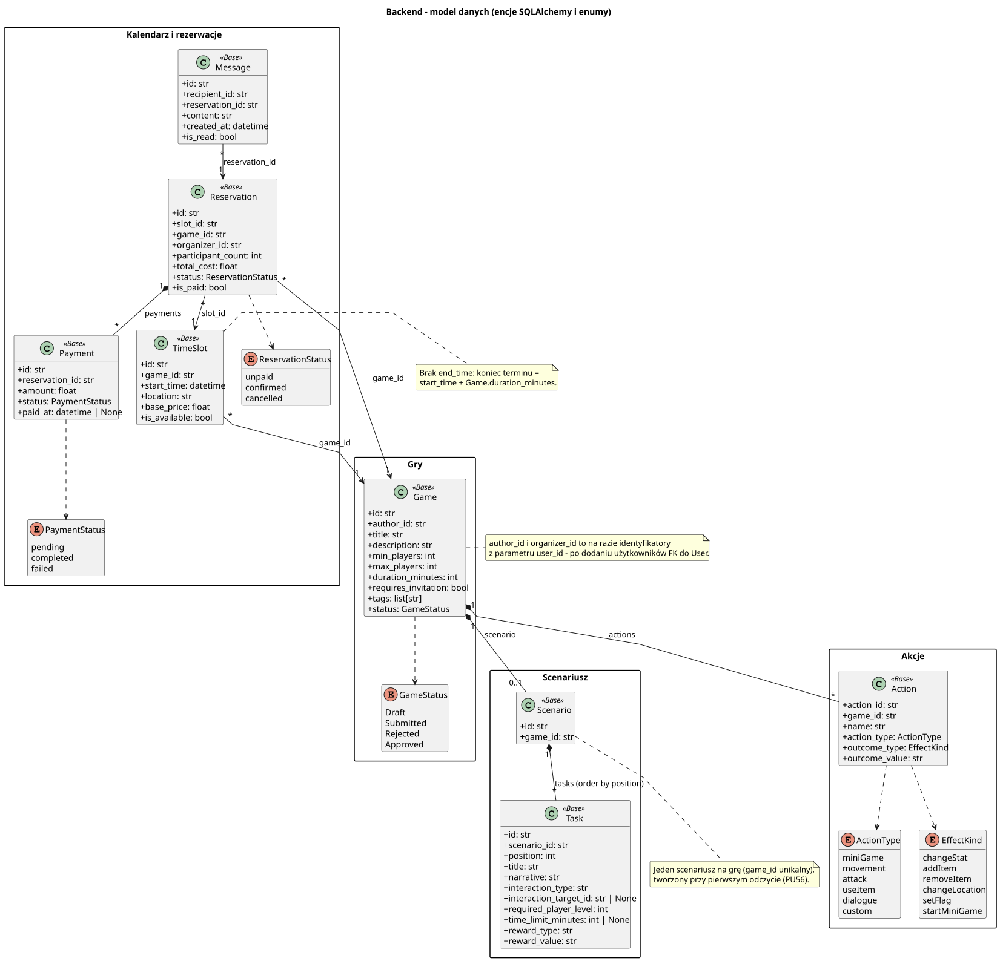

<div hidden>

```
@startuml data-model
skinparam classAttributeIconSize 0
skinparam packageStyle rectangle
skinparam shadowing false
skinparam roundcorner 4
skinparam linetype polyline
skinparam nodesep 30
skinparam ranksep 40
hide empty members

title Backend - model danych (encje SQLAlchemy i enumy)

package "Gry" {
    class Game <<Base>> {
        + id: str
        + author_id: str
        + title: str
        + description: str
        + min_players: int
        + max_players: int
        + duration_minutes: int
        + requires_invitation: bool
        + tags: list[str]
        + status: GameStatus
    }

    enum GameStatus {
        Draft
        Submitted
        Rejected
        Approved
    }
}

package "Scenariusz" {
    class Scenario <<Base>> {
        + id: str
        + game_id: str
    }

    class Task <<Base>> {
        + id: str
        + scenario_id: str
        + position: int
        + title: str
        + narrative: str
        + interaction_type: str
        + interaction_target_id: str | None
        + required_player_level: int
        + time_limit_minutes: int | None
        + reward_type: str
        + reward_value: str
    }
}

package "Akcje" {
    class Action <<Base>> {
        + action_id: str
        + game_id: str
        + name: str
        + action_type: ActionType
        + outcome_type: EffectKind
        + outcome_value: str
    }

    enum ActionType {
        miniGame
        movement
        attack
        useItem
        dialogue
        custom
    }

    enum EffectKind {
        changeStat
        addItem
        removeItem
        changeLocation
        setFlag
        startMiniGame
    }
}

package "Kalendarz i rezerwacje" {
    class TimeSlot <<Base>> {
        + id: str
        + game_id: str
        + start_time: datetime
        + location: str
        + base_price: float
        + is_available: bool
    }

    class Reservation <<Base>> {
        + id: str
        + slot_id: str
        + game_id: str
        + organizer_id: str
        + participant_count: int
        + total_cost: float
        + status: ReservationStatus
        + is_paid: bool
    }

    class Payment <<Base>> {
        + id: str
        + reservation_id: str
        + amount: float
        + status: PaymentStatus
        + paid_at: datetime | None
    }

    class Message <<Base>> {
        + id: str
        + recipient_id: str
        + reservation_id: str
        + content: str
        + created_at: datetime
        + is_read: bool
    }

    enum ReservationStatus {
        unpaid
        confirmed
        cancelled
    }

    enum PaymentStatus {
        pending
        completed
        failed
    }
}

Game ..> GameStatus
Game "1" *-- "0..1" Scenario : scenario
Scenario "1" *-- "*" Task : tasks (order by position)
Game "1" *-- "*" Action : actions
Action ..> ActionType
Action ..> EffectKind
TimeSlot "*" --> "1" Game : game_id
Reservation "*" --> "1" TimeSlot : slot_id
Reservation "*" --> "1" Game : game_id
Reservation "1" *-- "*" Payment : payments
Message "*" --> "1" Reservation : reservation_id
Reservation ..> ReservationStatus
Payment ..> PaymentStatus

note right of Game
    author_id i organizer_id to na razie identyfikatory
    z parametru user_id - po dodaniu użytkowników FK do User.
end note

note right of TimeSlot
    Brak end_time: koniec terminu =
    start_time + Game.duration_minutes.
end note

note bottom of Scenario
    Jeden scenariusz na grę (game_id unikalny),
    tworzony przy pierwszym odczycie (PU56).
end note
@enduml
```

</div>


