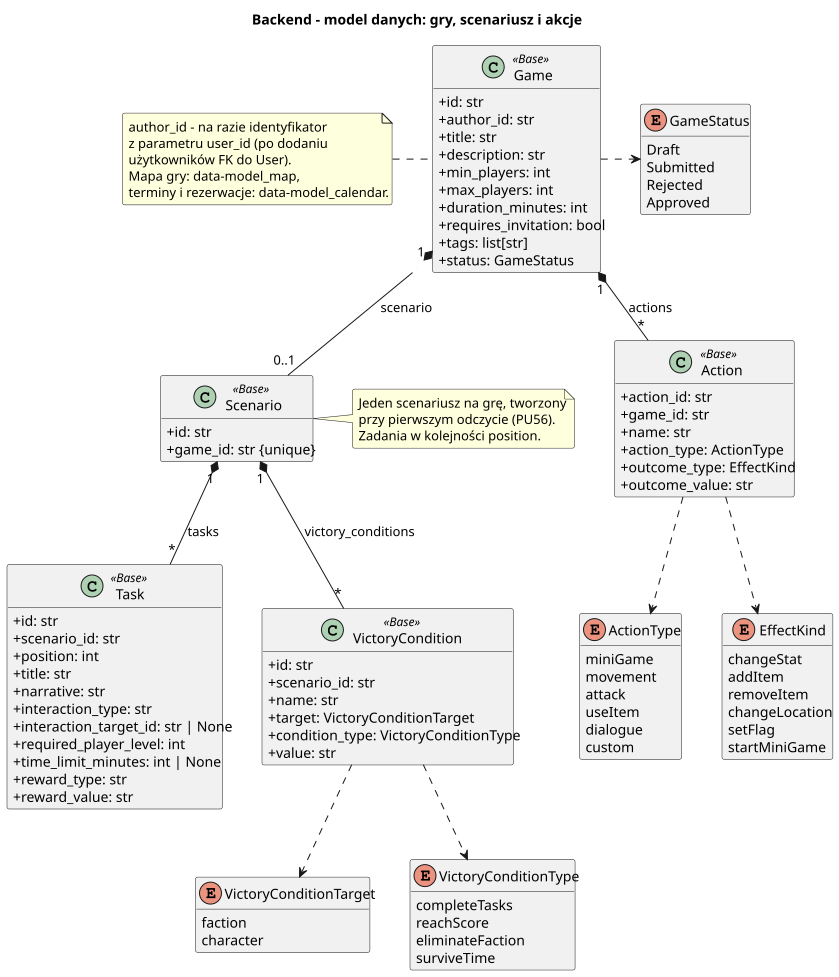
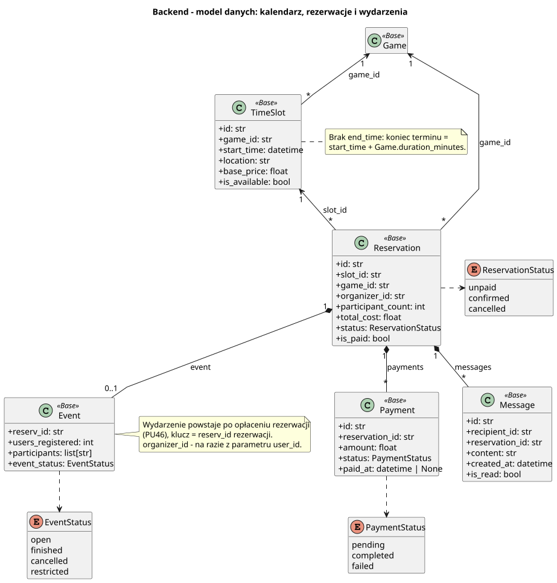
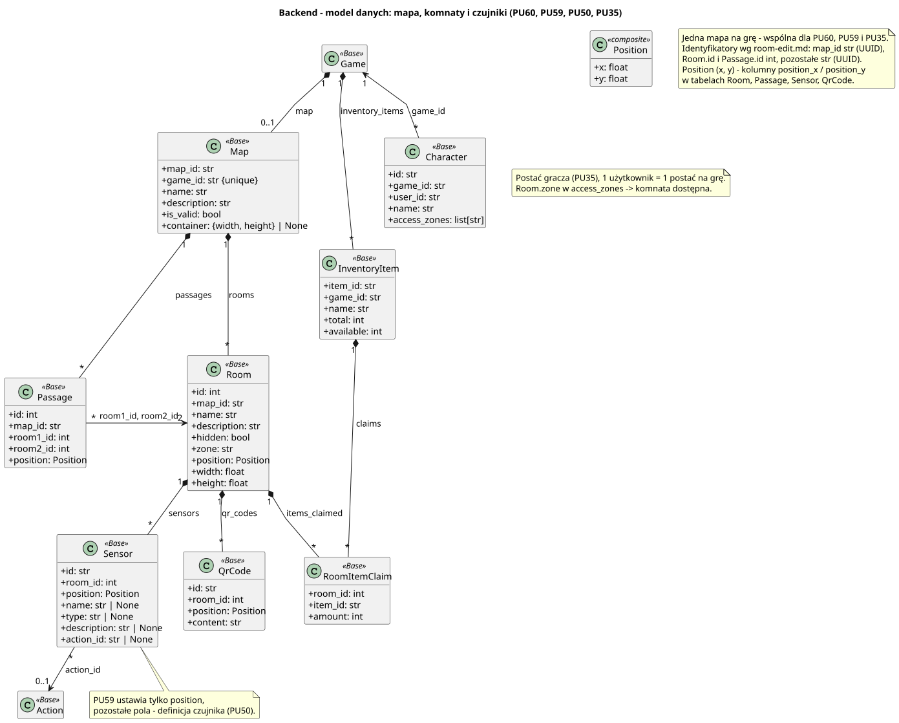

# Model danych backendu

Encje SQLAlchemy i enumy, pogrupowane jak w [modelu struktury logicznej](../logic_structure_backend.md). Schematy API: [interfejsy backendu](interfaces.md).
Encja z innego diagramu jest pokazana jako pusta klasa.

## Gry, scenariusz i akcje

<div hidden>

```
@startuml data-model
skinparam classAttributeIconSize 0
skinparam packageStyle rectangle
skinparam shadowing false
skinparam roundcorner 4
skinparam linetype polyline
skinparam nodesep 40
skinparam ranksep 50
hide empty members

title Backend - model danych: gry, scenariusz i akcje

class Game <<Base>> {
    + id: str
    + author_id: str
    + title: str
    + description: str
    + min_players: int
    + max_players: int
    + duration_minutes: int
    + requires_invitation: bool
    + tags: list[str]
    + status: GameStatus
}

class Scenario <<Base>> {
    + id: str
    + game_id: str {unique}
}

class Task <<Base>> {
    + id: str
    + scenario_id: str
    + position: int
    + title: str
    + narrative: str
    + interaction_type: str
    + interaction_target_id: str | None
    + required_player_level: int
    + time_limit_minutes: int | None
    + reward_type: str
    + reward_value: str
}

class VictoryCondition <<Base>> {
    + id: str
    + scenario_id: str
    + name: str
    + target: VictoryConditionTarget
    + condition_type: VictoryConditionType
    + value: str
}

class Action <<Base>> {
    + action_id: str
    + game_id: str
    + name: str
    + action_type: ActionType
    + outcome_type: EffectKind
    + outcome_value: str
}

enum GameStatus {
    Draft
    Submitted
    Rejected
    Approved
}

enum VictoryConditionTarget {
    faction
    character
}

enum VictoryConditionType {
    completeTasks
    reachScore
    eliminateFaction
    surviveTime
}

enum ActionType {
    miniGame
    movement
    attack
    useItem
    dialogue
    custom
}

enum EffectKind {
    changeStat
    addItem
    removeItem
    changeLocation
    setFlag
    startMiniGame
}

Game "1" *-- "0..1" Scenario : scenario
Game "1" *-- "*" Action : actions
Scenario "1" *-- "*" Task : tasks
Scenario "1" *-- "*" VictoryCondition : victory_conditions

Game .r.> GameStatus
VictoryCondition ..> VictoryConditionTarget
VictoryCondition ..> VictoryConditionType
Action ..> ActionType
Action ..> EffectKind

note right of Scenario
    Jeden scenariusz na grę, tworzony
    przy pierwszym odczycie (PU56).
    Zadania w kolejności position.
end note

note left of Game
    author_id - na razie identyfikator
    z parametru user_id (po dodaniu
    użytkowników FK do User).
    Mapa gry: data-model_map,
    terminy i rezerwacje: data-model_calendar.
end note
@enduml
```

</div>



## Kalendarz, rezerwacje i wydarzenia

<div hidden>

```
@startuml data-model_calendar
skinparam classAttributeIconSize 0
skinparam packageStyle rectangle
skinparam shadowing false
skinparam roundcorner 4
skinparam linetype polyline
skinparam nodesep 40
skinparam ranksep 50
hide empty members

title Backend - model danych: kalendarz, rezerwacje i wydarzenia

class Game <<Base>>

class TimeSlot <<Base>> {
    + id: str
    + game_id: str
    + start_time: datetime
    + location: str
    + base_price: float
    + is_available: bool
}

class Reservation <<Base>> {
    + id: str
    + slot_id: str
    + game_id: str
    + organizer_id: str
    + participant_count: int
    + total_cost: float
    + status: ReservationStatus
    + is_paid: bool
}

class Payment <<Base>> {
    + id: str
    + reservation_id: str
    + amount: float
    + status: PaymentStatus
    + paid_at: datetime | None
}

class Message <<Base>> {
    + id: str
    + recipient_id: str
    + reservation_id: str
    + content: str
    + created_at: datetime
    + is_read: bool
}

class Event <<Base>> {
    + reserv_id: str
    + users_registered: int
    + participants: list[str]
    + event_status: EventStatus
}

enum ReservationStatus {
    unpaid
    confirmed
    cancelled
}

enum PaymentStatus {
    pending
    completed
    failed
}

enum EventStatus {
    open
    finished
    cancelled
    restricted
}

TimeSlot "*" -u-> "1" Game : game_id
Reservation "*" -u-> "1" TimeSlot : slot_id
Reservation "*" -u-> "1" Game : game_id
Reservation "1" *-- "*" Payment : payments
Reservation "1" *-- "*" Message : messages
Reservation "1" *-- "0..1" Event : event

Reservation .r.> ReservationStatus
Payment ..> PaymentStatus
Event ..> EventStatus

note right of TimeSlot
    Brak end_time: koniec terminu =
    start_time + Game.duration_minutes.
end note

note right of Event
    Wydarzenie powstaje po opłaceniu rezerwacji
    (PU46), klucz = reserv_id rezerwacji.
    organizer_id - na razie z parametru user_id.
end note
@enduml
```

</div>



## Mapa, komnaty i czujniki (PU60, PU59, PU50, PU35)

<div hidden>

```
@startuml data-model_map
skinparam classAttributeIconSize 0
skinparam packageStyle rectangle
skinparam shadowing false
skinparam roundcorner 4
skinparam linetype polyline
skinparam nodesep 40
skinparam ranksep 50
hide empty members

title Backend - model danych: mapa, komnaty i czujniki (PU60, PU59, PU50, PU35)

class Game <<Base>>
class Action <<Base>>

class Map <<Base>> {
    + map_id: str
    + game_id: str {unique}
    + name: str
    + description: str
    + is_valid: bool
    + container: {width, height} | None
}

class Room <<Base>> {
    + id: int
    + map_id: str
    + name: str
    + description: str
    + hidden: bool
    + zone: str
    + position: Position
    + width: float
    + height: float
}

class Passage <<Base>> {
    + id: int
    + map_id: str
    + room1_id: int
    + room2_id: int
    + position: Position
}

class Position <<composite>> {
    + x: float
    + y: float
}

class InventoryItem <<Base>> {
    + item_id: str
    + game_id: str
    + name: str
    + total: int
    + available: int
}

class RoomItemClaim <<Base>> {
    + room_id: int
    + item_id: str
    + amount: int
}

class Sensor <<Base>> {
    + id: str
    + room_id: int
    + position: Position
    + name: str | None
    + type: str | None
    + description: str | None
    + action_id: str | None
}

class QrCode <<Base>> {
    + id: str
    + room_id: int
    + position: Position
    + content: str
}

class Character <<Base>> {
    + id: str
    + game_id: str
    + user_id: str
    + name: str
    + access_zones: list[str]
}

Game "1" *-- "0..1" Map : map
Game "1" *-- "*" InventoryItem : inventory_items
Character "*" -u-> "1" Game : game_id
Map "1" *-- "*" Room : rooms
Map "1" *-- "*" Passage : passages
Passage "*" -r-> "2" Room : room1_id, room2_id
Room "1" *-- "*" Sensor : sensors
Room "1" *-- "*" QrCode : qr_codes
Room "1" *-- "*" RoomItemClaim : items_claimed
InventoryItem "1" *-- "*" RoomItemClaim : claims
Sensor "*" --> "0..1" Action : action_id

note as N_Map
    Jedna mapa na grę - wspólna dla PU60, PU59 i PU35.
    Identyfikatory wg room-edit.md: map_id str (UUID),
    Room.id i Passage.id int, pozostałe str (UUID).
    Position (x, y) - kolumny position_x / position_y
    w tabelach Room, Passage, Sensor, QrCode.
end note

note as N_Character
    Postać gracza (PU35), 1 użytkownik = 1 postać na grę.
    Room.zone w access_zones -> komnata dostępna.
end note

note bottom of Sensor
    PU59 ustawia tylko position,
    pozostałe pola - definicja czujnika (PU50).
end note
@enduml
```

</div>


