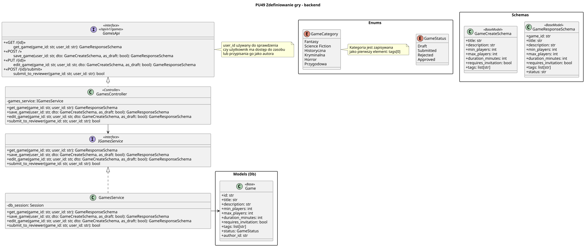

<div hidden>

```
@startuml game-definition
skinparam classAttributeIconSize 0
skinparam packageStyle rectangle
skinparam shadowing false
skinparam roundcorner 4
skinparam linetype polyline
skinparam nodesep 30
skinparam ranksep 40
hide empty members

title PU49 Zdefiniowanie gry - backend

interface IGamesApi <<interface>>\n<< /api/v1/games >> {
    + <<GET /{game_id} >>\n\tget_game(game_id: str, user_id: str): GameResponseSchema
    + <<POST / >>\n\tsave_game(user_id: str, metadata: GameCreateSchema, as_draft: bool = True): GameResponseSchema
    + <<PUT /{game_id} >>\n\tedit_game(game_id: str, user_id: str, metadata: GameCreateSchema, as_draft: bool = True): GameResponseSchema
    + <<POST /{game_id}/submit >>\n\tsubmit_to_reviewer(game_id: str, user_id: str): bool
}

class GamesController <<Controller>> {
    - games_service: IGamesService
}

interface IGamesService <<interface>> {
    + get_game(game_id: str, user_id: str): GameResponseSchema
    + save_game(user_id: str, dto: GameCreateSchema, as_draft: bool): GameResponseSchema
    + edit_game(game_id: str, user_id: str, dto: GameCreateSchema, as_draft: bool): GameResponseSchema
    + submit_to_reviewer(game_id: str, user_id: str): bool
}

class GamesService <<Service>> {
    - db_session: Session
    - _map_to_response(game: Game): GameResponseSchema
}

class Game <<Base>>
class GameCreateSchema <<BaseModel>>
class GameResponseSchema <<BaseModel>>
class NotFoundError <<Exception>>
class ConflictError <<Exception>>

GamesController .u.|> IGamesApi
GamesController --> IGamesService
GamesService .u.|> IGamesService
GamesService --> Game
GamesService ..> GameCreateSchema
GamesService ..> GameResponseSchema
GamesService ..> NotFoundError : gra nie istnieje\nalbo jest cudza
GamesService ..> ConflictError : ponowne wysłanie,\nedycja zatwierdzonej

note right of IGamesApi
    user_id (query) - autor gry albo sprawdzenie dostępu,
    do czasu logowania wysyłany przez frontend z ENV.
    as_draft = True -> status Draft, False -> Submitted.
end note

note bottom of Game
    Schematy: interfaces.md, encje: data-model.md
end note
@enduml
```

</div>


