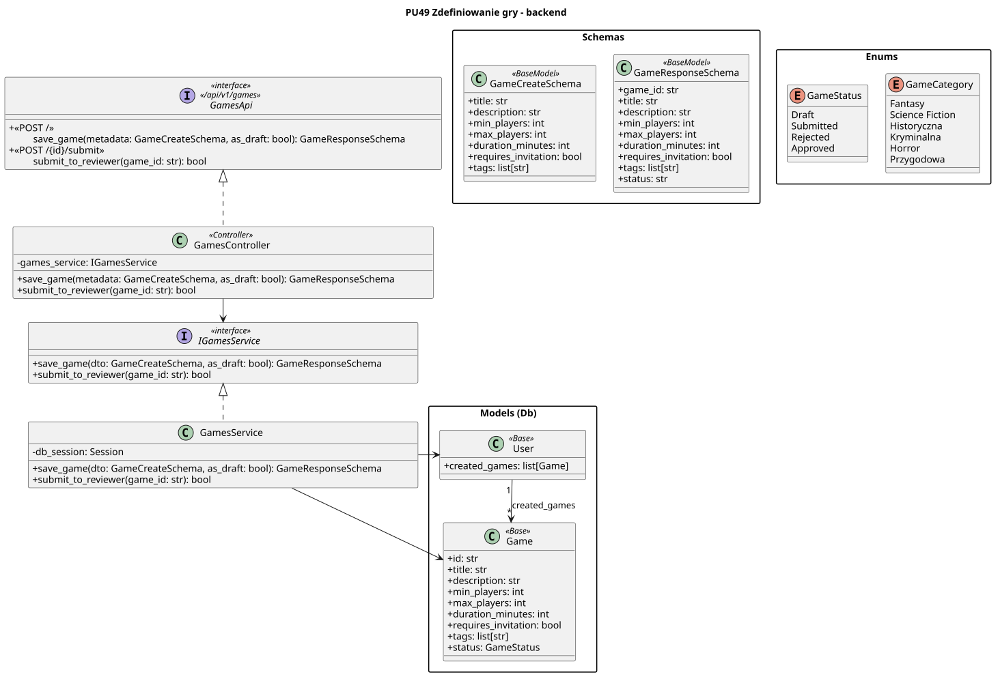

<div hidden>

```

@startuml game-definition-backend
skinparam classAttributeIconSize 0
skinparam packageStyle rectangle
skinparam shadowing false
skinparam roundcorner 4
skinparam nodesep 26
skinparam ranksep 34
skinparam linetype polyline

title PU49 Zdefiniowanie gry - backend

interface GamesApi <<interface>>\n<< /api/v1/games >> {
    + <<POST / >>\n\tsave_game(metadata: GameCreateSchema, as_draft: bool): GameResponseSchema
    + <<POST /{id}/submit >>\n\tsubmit_to_reviewer(game_id: str): bool
}

class GamesController <<Controller>> {
    - games_service: IGamesService
    + save_game(metadata: GameCreateSchema, as_draft: bool): GameResponseSchema
    + submit_to_reviewer(game_id: str): bool
}

interface IGamesService <<interface>> {
    + save_game(dto: GameCreateSchema, as_draft: bool): GameResponseSchema
    + submit_to_reviewer(game_id: str): bool
}

class GamesService {
    - db_session: Session
    + save_game(dto: GameCreateSchema, as_draft: bool): GameResponseSchema
    + submit_to_reviewer(game_id: str): bool
}

package "Schemas" {
    class GameCreateSchema <<BaseModel>> {
        + title: str
        + description: str
        + min_players: int
        + max_players: int
        + duration_minutes: int
        + requires_invitation: bool
        + tags: list[str]
    }
    
    class GameResponseSchema <<BaseModel>> {
        + game_id: str
        + title: str
        + description: str
        + min_players: int
        + max_players: int
        + duration_minutes: int
        + requires_invitation: bool
        + tags: list[str]
        + status: str
    }
}

package "Models (Db)" as models {
    class Game <<Base>> {
        + id: str
        + title: str
        + description: str
        + min_players: int
        + max_players: int
        + duration_minutes: int
        + requires_invitation: bool
        + tags: list[str]
        + status: GameStatus
    }
    
    class User <<Base>> {
        + created_games: list[Game]
    }
}

package "Enums"{
    enum GameStatus {
        Draft
        Submitted
        Rejected
        Approved
    }
    
    enum GameCategory {
        Fantasy
        Science Fiction
        Historyczna
        Kryminalna
        Horror
        Przygodowa
    }
}

GamesService .up.|> IGamesService
GamesController .up.|> GamesApi

GamesService -right-> Game
GamesService -right-> User


GamesController --> IGamesService


User "1" --> "*" Game : created_games
```

</div>


