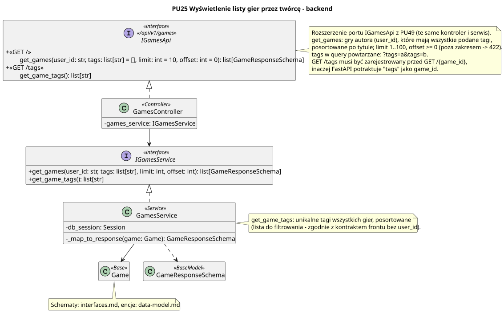

<div hidden>

```
@startuml game-list
skinparam classAttributeIconSize 0
skinparam packageStyle rectangle
skinparam shadowing false
skinparam roundcorner 4
skinparam linetype polyline
skinparam nodesep 30
skinparam ranksep 40
hide empty members

title PU25 Wyświetlenie listy gier przez twórcę - backend

interface IGamesApi <<interface>>\n<< /api/v1/games >> {
    + <<GET / >>\n\tget_games(user_id: str, tags: list[str] = [], limit: int = 10, offset: int = 0): list[GameResponseSchema]
    + <<GET /tags >>\n\tget_game_tags(): list[str]
}

class GamesController <<Controller>> {
    - games_service: IGamesService
}

interface IGamesService <<interface>> {
    + get_games(user_id: str, tags: list[str], limit: int, offset: int): list[GameResponseSchema]
    + get_game_tags(): list[str]
}

class GamesService <<Service>> {
    - db_session: Session
    - _map_to_response(game: Game): GameResponseSchema
}

class Game <<Base>>
class GameResponseSchema <<BaseModel>>

GamesController .u.|> IGamesApi
GamesController --> IGamesService
GamesService .u.|> IGamesService
GamesService --> Game
GamesService ..> GameResponseSchema

note right of IGamesApi
    Rozszerzenie portu IGamesApi z PU49 (te same kontroler i serwis).
    get_games: gry autora (user_id), które mają wszystkie podane tagi,
    posortowane po tytule; limit 1..100, offset >= 0 (poza zakresem -> 422).
    tags w query powtarzane: ?tags=a&tags=b.
    GET /tags musi być zarejestrowany przed GET /{game_id},
    inaczej FastAPI potraktuje "tags" jako game_id.
end note

note right of GamesService
    get_game_tags: unikalne tagi wszystkich gier, posortowane
    (lista do filtrowania - zgodnie z kontraktem frontu bez user_id).
end note

note bottom of Game
    Schematy: interfaces.md, encje: data-model.md
end note
@enduml
```

</div>


