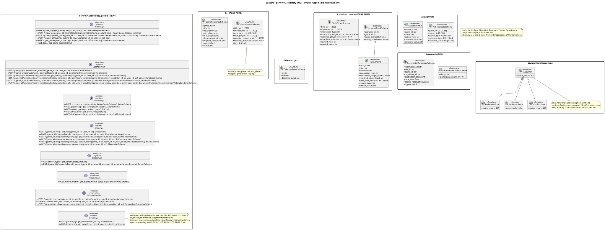
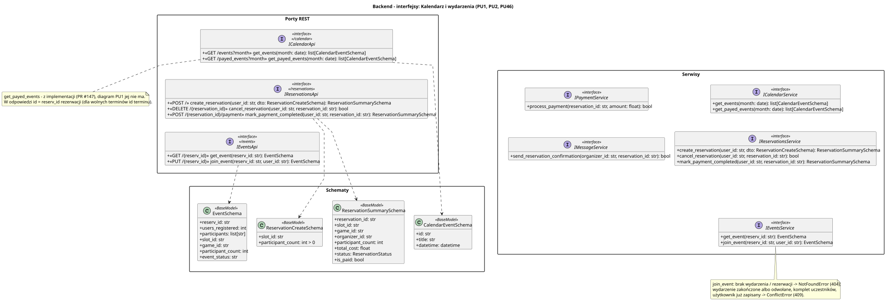
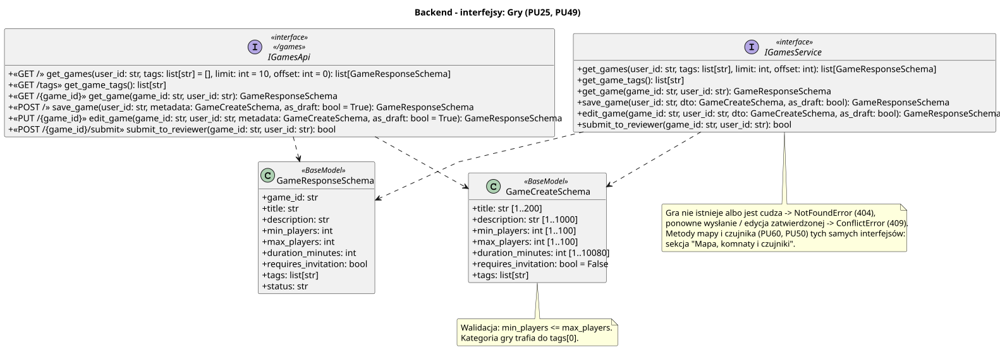
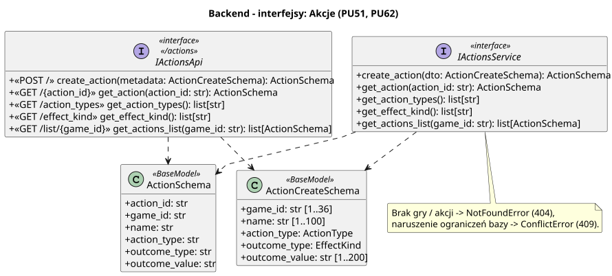
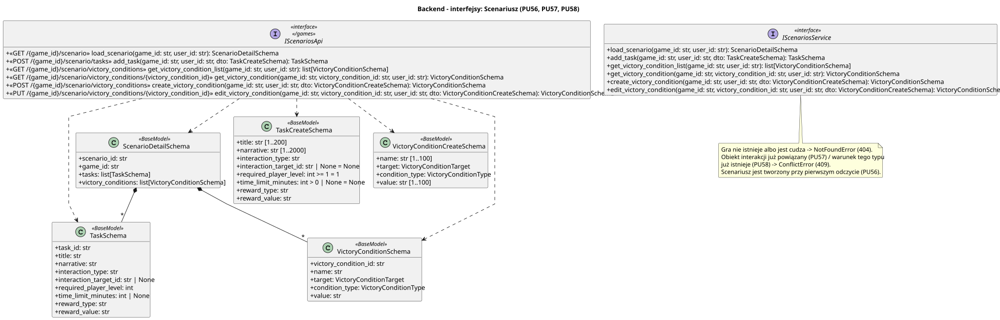
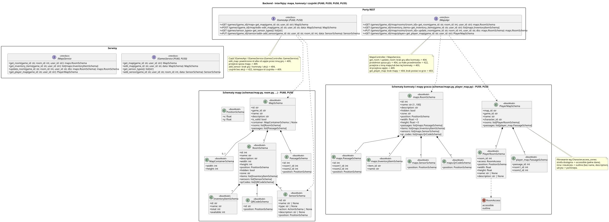

# Interfejsy backendu

Jedno źródło prawdy dla interfejsów backendu: porty REST (`IXxxApi`, realizowane przez kontrolery), interfejsy serwisów (`IXxxService`), schematy API (`XxxSchema`) i wyjątki - zebrane ze wszystkich PU i pogrupowane jak w [modelu struktury logicznej](../logic_structure_backend.md).
Wszystkie ścieżki mają prefiks `/api/v1`. Encje i enumy bazy danych: [model danych](data-model.md).

## Wyjątki i zasady wspólne

<div hidden>

```
@startuml interfaces
skinparam classAttributeIconSize 0
skinparam packageStyle rectangle
skinparam shadowing false
skinparam roundcorner 4
skinparam linetype polyline
skinparam nodesep 30
skinparam ranksep 40
hide empty members

title Backend - wyjątki (core/exceptions) i zasady wspólne dla portów

class AppError <<Exception>> {
    + status_code = 400
}
class ForbiddenError <<Exception>> {
    + status_code = 403
}
class NotFoundError <<Exception>> {
    + status_code = 404
}
class ConflictError <<Exception>> {
    + status_code = 409
}
ForbiddenError -u-|> AppError
NotFoundError -u-|> AppError
class UnprocessableContentError <<Exception>> {
    + status_code = 422
}
ConflictError -u-|> AppError
UnprocessableContentError -u-|> AppError

note right of AppError
    Jeden handler (register_exception_handlers) zamienia AppError
    na odpowiedź {detail} ze status_code.
    Błędy walidacji schematów zwraca FastAPI jako 422.
end note

note as N_Rules
    Każdy port IXxxApi realizuje kontroler XxxController, który dostaje
    IXxxService przez Depends i woła metody o tych samych nazwach.
    user_id to parametr zapytania - do czasu logowania podawany przez frontend.
    Schematy są w snake_case - frontend mapuje je na DTO w camelCase.
end note
@enduml
```

</div>



## Kalendarz i wydarzenia (PU1, PU2, PU46)

<div hidden>

```
@startuml interfaces_calendar
skinparam classAttributeIconSize 0
skinparam packageStyle rectangle
skinparam shadowing false
skinparam roundcorner 4
skinparam linetype polyline
skinparam nodesep 30
skinparam ranksep 40
hide empty members

title Backend - interfejsy: Kalendarz i wydarzenia (PU1, PU2, PU46)

package "Porty REST" as R {
    interface ICalendarApi <<interface>>\n<< /calendar >> {
        + <<GET /events?month>> get_events(month: date): list[CalendarEventSchema]
        + <<GET /payed_events?month>> get_payed_events(month: date): list[CalendarEventSchema]
    }
    interface IReservationsApi <<interface>>\n<< /reservations >> {
        + <<POST />> create_reservation(user_id: str, dto: ReservationCreateSchema): ReservationSummarySchema
        + <<DELETE /{reservation_id}>> cancel_reservation(user_id: str, reservation_id: str): bool
        + <<POST /{reservation_id}/payment>> mark_payment_completed(user_id: str, reservation_id: str): ReservationSummarySchema
    }
    interface IEventsApi <<interface>>\n<< /events >> {
        + <<GET /{reserv_id}>> get_event(reserv_id: str): EventSchema
        + <<PUT /{reserv_id}>> join_event(reserv_id: str, user_id: str): EventSchema
    }
}

package "Serwisy" as S {
    interface ICalendarService <<interface>> {
        + get_events(month: date): list[CalendarEventSchema]
        + get_payed_events(month: date): list[CalendarEventSchema]
    }
    interface IReservationsService <<interface>> {
        + create_reservation(user_id: str, dto: ReservationCreateSchema): ReservationSummarySchema
        + cancel_reservation(user_id: str, reservation_id: str): bool
        + mark_payment_completed(user_id: str, reservation_id: str): ReservationSummarySchema
    }
    interface IPaymentService <<interface>> {
        + process_payment(reservation_id: str, amount: float): bool
    }
    interface IMessageService <<interface>> {
        + send_reservation_confirmation(organizer_id: str, reservation_id: str): bool
    }
    interface IEventsService <<interface>> {
        + get_event(reserv_id: str): EventSchema
        + join_event(reserv_id: str, user_id: str): EventSchema
    }
}

package "Schematy" as D {
    class CalendarEventSchema <<BaseModel>> {
        + id: str
        + title: str
        + datetime: datetime
    }
    class ReservationCreateSchema <<BaseModel>> {
        + slot_id: str
        + participant_count: int > 0
    }
    class ReservationSummarySchema <<BaseModel>> {
        + reservation_id: str
        + slot_id: str
        + game_id: str
        + organizer_id: str
        + participant_count: int
        + total_cost: float
        + status: ReservationStatus
        + is_paid: bool
    }
    class EventSchema <<BaseModel>> {
        + reserv_id: str
        + users_registered: int
        + participants: list[str]
        + slot_id: str
        + game_id: str
        + participant_count: int
        + event_status: str
    }
}

ICalendarApi ..> CalendarEventSchema
IReservationsApi ..> ReservationCreateSchema
IReservationsApi ..> ReservationSummarySchema
IEventsApi ..> EventSchema

note bottom of ICalendarApi
    get_payed_events - z implementacji (PR #147), diagram PU1 jej nie ma.
    W odpowiedzi id = reserv_id rezerwacji (dla wolnych terminów id terminu).
end note
note bottom of IEventsService
    join_event: brak wydarzenia / rezerwacji -> NotFoundError (404);
    wydarzenie zakończone albo odwołane, komplet uczestników,
    użytkownik już zapisany -> ConflictError (409).
end note

R -[hidden]d- S
S -[hidden]d- D
ICalendarApi -[hidden]d- IReservationsApi
IReservationsApi -[hidden]d- IEventsApi
ICalendarService -[hidden]d- IReservationsService
IReservationsService -[hidden]d- IEventsService
IPaymentService -[hidden]d- IMessageService
@enduml
```

</div>



## Gry (PU25, PU49)

<div hidden>

```
@startuml interfaces_games
skinparam classAttributeIconSize 0
skinparam packageStyle rectangle
skinparam shadowing false
skinparam roundcorner 4
skinparam linetype polyline
skinparam nodesep 30
skinparam ranksep 40
hide empty members

title Backend - interfejsy: Gry (PU25, PU49)

interface IGamesApi <<interface>>\n<< /games >> {
    + <<GET />> get_games(user_id: str, tags: list[str] = [], limit: int = 10, offset: int = 0): list[GameResponseSchema]
    + <<GET /tags>> get_game_tags(): list[str]
    + <<GET /{game_id}>> get_game(game_id: str, user_id: str): GameResponseSchema
    + <<POST />> save_game(user_id: str, metadata: GameCreateSchema, as_draft: bool = True): GameResponseSchema
    + <<PUT /{game_id}>> edit_game(game_id: str, user_id: str, metadata: GameCreateSchema, as_draft: bool = True): GameResponseSchema
    + <<POST /{game_id}/submit>> submit_to_reviewer(game_id: str, user_id: str): bool
}

interface IGamesService <<interface>> {
    + get_games(user_id: str, tags: list[str], limit: int, offset: int): list[GameResponseSchema]
    + get_game_tags(): list[str]
    + get_game(game_id: str, user_id: str): GameResponseSchema
    + save_game(user_id: str, dto: GameCreateSchema, as_draft: bool): GameResponseSchema
    + edit_game(game_id: str, user_id: str, dto: GameCreateSchema, as_draft: bool): GameResponseSchema
    + submit_to_reviewer(game_id: str, user_id: str): bool
}

class GameCreateSchema <<BaseModel>> {
    + title: str [1..200]
    + description: str [1..1000]
    + min_players: int [1..100]
    + max_players: int [1..100]
    + duration_minutes: int [1..10080]
    + requires_invitation: bool = False
    + tags: list[str]
}
class GameResponseSchema <<BaseModel>> {
    + game_id: str
    + title: str
    + description: str
    + min_players: int
    + max_players: int
    + duration_minutes: int
    + requires_invitation: bool
    + tags: list[str]
    + status: str
}

IGamesApi ..> GameCreateSchema
IGamesApi ..> GameResponseSchema
IGamesService ..> GameCreateSchema
IGamesService ..> GameResponseSchema

note bottom of GameCreateSchema
    Walidacja: min_players <= max_players.
    Kategoria gry trafia do tags[0].
end note
note bottom of IGamesService
    Gra nie istnieje albo jest cudza -> NotFoundError (404),
    ponowne wysłanie / edycja zatwierdzonej -> ConflictError (409).
    Metody mapy i czujnika (PU60, PU50) tych samych interfejsów:
    sekcja "Mapa, komnaty i czujniki".
end note
@enduml
```

</div>



## Akcje (PU51, PU62)

<div hidden>

```
@startuml interfaces_actions
skinparam classAttributeIconSize 0
skinparam packageStyle rectangle
skinparam shadowing false
skinparam roundcorner 4
skinparam linetype polyline
skinparam nodesep 30
skinparam ranksep 40
hide empty members

title Backend - interfejsy: Akcje (PU51, PU62)

interface IActionsApi <<interface>>\n<< /actions >> {
    + <<POST />> create_action(metadata: ActionCreateSchema): ActionSchema
    + <<GET /{action_id}>> get_action(action_id: str): ActionSchema
    + <<GET /action_types>> get_action_types(): list[str]
    + <<GET /effect_kind>> get_effect_kind(): list[str]
    + <<GET /list/{game_id}>> get_actions_list(game_id: str): list[ActionSchema]
}

interface IActionsService <<interface>> {
    + create_action(dto: ActionCreateSchema): ActionSchema
    + get_action(action_id: str): ActionSchema
    + get_action_types(): list[str]
    + get_effect_kind(): list[str]
    + get_actions_list(game_id: str): list[ActionSchema]
}

class ActionCreateSchema <<BaseModel>> {
    + game_id: str [1..36]
    + name: str [1..100]
    + action_type: ActionType
    + outcome_type: EffectKind
    + outcome_value: str [1..200]
}
class ActionSchema <<BaseModel>> {
    + action_id: str
    + game_id: str
    + name: str
    + action_type: str
    + outcome_type: str
    + outcome_value: str
}

IActionsApi ..> ActionCreateSchema
IActionsApi ..> ActionSchema
IActionsService ..> ActionCreateSchema
IActionsService ..> ActionSchema

note bottom of IActionsService
    Brak gry / akcji -> NotFoundError (404),
    naruszenie ograniczeń bazy -> ConflictError (409).
end note
@enduml
```

</div>



## Scenariusz (PU56, PU57, PU58)

<div hidden>

```
@startuml interfaces_scenario
skinparam classAttributeIconSize 0
skinparam packageStyle rectangle
skinparam shadowing false
skinparam roundcorner 4
skinparam linetype polyline
skinparam nodesep 30
skinparam ranksep 40
hide empty members

title Backend - interfejsy: Scenariusz (PU56, PU57, PU58)

interface IScenariosApi <<interface>>\n<< /games >> {
    + <<GET /{game_id}/scenario>> load_scenario(game_id: str, user_id: str): ScenarioDetailSchema
    + <<POST /{game_id}/scenario/tasks>> add_task(game_id: str, user_id: str, dto: TaskCreateSchema): TaskSchema
    + <<GET /{game_id}/scenario/victory_conditions>> get_victory_condition_list(game_id: str, user_id: str): list[VictoryConditionSchema]
    + <<GET /{game_id}/scenario/victory_conditions/{victory_condition_id}>> get_victory_condition(game_id: str, victory_condition_id: str, user_id: str): VictoryConditionSchema
    + <<POST /{game_id}/scenario/victory_conditions>> create_victory_condition(game_id: str, user_id: str, dto: VictoryConditionCreateSchema): VictoryConditionSchema
    + <<PUT /{game_id}/scenario/victory_conditions/{victory_condition_id}>> edit_victory_condition(game_id: str, victory_condition_id: str, user_id: str, dto: VictoryConditionCreateSchema): VictoryConditionSchema
}

interface IScenariosService <<interface>> {
    + load_scenario(game_id: str, user_id: str): ScenarioDetailSchema
    + add_task(game_id: str, user_id: str, dto: TaskCreateSchema): TaskSchema
    + get_victory_condition_list(game_id: str, user_id: str): list[VictoryConditionSchema]
    + get_victory_condition(game_id: str, victory_condition_id: str, user_id: str): VictoryConditionSchema
    + create_victory_condition(game_id: str, user_id: str, dto: VictoryConditionCreateSchema): VictoryConditionSchema
    + edit_victory_condition(game_id: str, victory_condition_id: str, user_id: str, dto: VictoryConditionCreateSchema): VictoryConditionSchema
}

class ScenarioDetailSchema <<BaseModel>> {
    + scenario_id: str
    + game_id: str
    + tasks: list[TaskSchema]
    + victory_conditions: list[VictoryConditionSchema]
}
class TaskSchema <<BaseModel>> {
    + task_id: str
    + title: str
    + narrative: str
    + interaction_type: str
    + interaction_target_id: str | None
    + required_player_level: int
    + time_limit_minutes: int | None
    + reward_type: str
    + reward_value: str
}
class TaskCreateSchema <<BaseModel>> {
    + title: str [1..200]
    + narrative: str [1..2000]
    + interaction_type: str
    + interaction_target_id: str | None = None
    + required_player_level: int >= 1 = 1
    + time_limit_minutes: int > 0 | None = None
    + reward_type: str
    + reward_value: str
}
class VictoryConditionCreateSchema <<BaseModel>> {
    + name: str [1..100]
    + target: VictoryConditionTarget
    + condition_type: VictoryConditionType
    + value: str [1..100]
}
class VictoryConditionSchema <<BaseModel>> {
    + victory_condition_id: str
    + name: str
    + target: VictoryConditionTarget
    + condition_type: VictoryConditionType
    + value: str
}

ScenarioDetailSchema *-- "*" TaskSchema
ScenarioDetailSchema *-- "*" VictoryConditionSchema
IScenariosApi ..> ScenarioDetailSchema
IScenariosApi ..> TaskCreateSchema
IScenariosApi ..> TaskSchema
IScenariosApi ..> VictoryConditionCreateSchema
IScenariosApi ..> VictoryConditionSchema

note bottom of IScenariosService
    Gra nie istnieje albo jest cudza -> NotFoundError (404).
    Obiekt interakcji już powiązany (PU57) / warunek tego typu
    już istnieje (PU58) -> ConflictError (409).
    Scenariusz jest tworzony przy pierwszym odczycie (PU56).
end note
@enduml
```

</div>



## Mapa, komnaty i czujniki (PU60, PU59, PU50, PU35)

<div hidden>

```
@startuml interfaces_map
skinparam classAttributeIconSize 0
skinparam packageStyle rectangle
skinparam shadowing false
skinparam roundcorner 4
skinparam linetype polyline
skinparam nodesep 30
skinparam ranksep 40
hide empty members

title Backend - interfejsy: mapa, komnaty i czujniki (PU60, PU59, PU50, PU35)

package "Porty REST" as R {
    interface "IGamesApi (PU60, PU50)" as IGamesApiMap <<interface>> {
        + <<GET /games/{game_id}/map>> get_map(game_id: str, user_id: str): MapSchema
        + <<POST /games/{game_id}/map/edit>> edit_map(game_id: str, user_id: str, data: MapSchema): MapSchema
        + <<GET /games/sensor_types>> get_sensor_types(): list[str]
        + <<PUT /games/{game_id}/sensor/add>> add_sensor(game_id: str, user_id: str, room_id: int, data: SensorSchema): SensorSchema
    }
    interface IMapsApi <<interface>> {
        + <<GET /games/{game_id}/map/rooms/{room_id}>> get_room(game_id: str, room_id: int, user_id: str): maps.RoomSchema
        + <<GET /games/{game_id}/inventory_items>> get_inventory_items(game_id: str, user_id: str): list[maps.InventoryItemSchema]
        + <<PUT /games/{game_id}/map/rooms/{room_id}>> update_room(game_id: str, room_id: int, user_id: str, dto: maps.RoomSchema): maps.RoomSchema
        + <<GET /games/{game_id}/map/player>> get_player_map(game_id: str, user_id: str): PlayerMapSchema
    }
}

package "Serwisy" as S {
    interface "IGamesService (PU60, PU50)" as IGamesServiceMap <<interface>> {
        + get_map(game_id: str, user_id: str): MapSchema
        + edit_map(game_id: str, user_id: str, data: MapSchema): MapSchema
        + get_sensor_types(): list[str]
        + add_sensor(game_id: str, user_id: str, room_id: int, data: SensorSchema): SensorSchema
    }
    interface IMapsService <<interface>> {
        + get_room(game_id: str, room_id: int, user_id: str): maps.RoomSchema
        + get_inventory_items(game_id: str, user_id: str): list[maps.InventoryItemSchema]
        + update_room(game_id: str, room_id: int, user_id: str, dto: maps.RoomSchema): maps.RoomSchema
        + get_player_map(game_id: str, user_id: str): PlayerMapSchema
    }
}

package "Schematy mapy (schemas/map.py, room.py, ...) - PU60, PU50" as D1 {
    class MapSchema <<BaseModel>> {
        + id: str
        + game_id: str
        + name: str
        + description: str
        + is_valid: bool
        + container: MapContainerSchema | None
        + rooms: list[RoomSchema]
        + passages: list[PassageSchema]
    }
    class MapContainerSchema <<BaseModel>> {
        + width: int
        + height: int
    }
    class RoomSchema <<BaseModel>> {
        + id: int
        + name: str
        + description: str
        + width: int
        + height: int
        + position: PositionSchema
        + hidden: bool
        + zone: str
        + items: list[InventoryItemSchema]
        + sensors: list[SensorSchema]
        + qrCodes: list[QRCodeSchema]
    }
    class PassageSchema <<BaseModel>> {
        + id: int
        + room1_id: int
        + room2_id: int
        + position: PositionSchema
    }
    class InventoryItemSchema <<BaseModel>> {
        + id: str
        + name: str
        + total: int
        + available: int
    }
    class SensorSchema <<BaseModel>> {
        + id: str
        + name: str | None
        + type: str | None
        + action: ActionSchema | None
        + description: str | None
        + position: PositionSchema
    }
    class QRCodeSchema <<BaseModel>> {
        + id: str
        + position: PositionSchema
    }
    class PositionSchema <<BaseModel>> {
        + x: float
        + y: float
    }
}

package "Schematy komnaty i mapy gracza (schemas/maps.py, player_map.py) - PU59, PU35" as D2 {
    class "maps.RoomSchema" as M_Room <<BaseModel>> {
        + id: int
        + name: str [1..100]
        + description: str
        + hidden: bool
        + zone: str
        + position: PositionSchema
        + width: float > 0
        + height: float > 0
        + passages: list[maps.PassageSchema]
        + items: list[maps.InventoryItemSchema]
        + sensors: list[maps.SensorSchema]
        + qr_codes: list[maps.QrCodeSchema]
    }
    class "maps.PassageSchema" as M_Passage <<BaseModel>> {
        + id: int
        + room1_id: int
        + room2_id: int
        + position: PositionSchema
    }
    class "maps.InventoryItemSchema" as M_Item <<BaseModel>> {
        + item_id: str
        + name: str
    }
    class "maps.SensorSchema" as M_Sensor <<BaseModel>> {
        + position: PositionSchema
    }
    class "maps.QrCodeSchema" as M_Qr <<BaseModel>> {
        + position: PositionSchema
    }
    class PlayerMapSchema <<BaseModel>> {
        + map_id: str
        + game_id: str
        + name: str
        + character_id: str
        + rooms: list[PlayerRoomSchema]
        + passages: list[player_map.PassageSchema]
    }
    class PlayerRoomSchema <<BaseModel>> {
        + room_id: int
        + access: RoomAccess
        + position: PositionSchema
        + width: float
        + height: float
        + name: str | None
        + description: str | None
    }
    class "player_map.PassageSchema" as P_Passage <<BaseModel>> {
        + passage_id: int
        + room1_id: int
        + room2_id: int
    }
    enum RoomAccess {
        accessible
        outline
    }
}

MapSchema *-- "0..1" MapContainerSchema
MapSchema *-- "*" RoomSchema
MapSchema *-- "*" PassageSchema
RoomSchema *-- "*" InventoryItemSchema
RoomSchema *-- "*" SensorSchema
RoomSchema *-- "*" QRCodeSchema
M_Room *-- "*" M_Passage
M_Room *-- "*" M_Item
M_Room *-- "*" M_Sensor
M_Room *-- "*" M_Qr
PlayerMapSchema *-- "*" PlayerRoomSchema
PlayerMapSchema *-- "*" P_Passage
PlayerRoomSchema ..> RoomAccess
IGamesApiMap ..> MapSchema
IGamesApiMap ..> SensorSchema
IMapsApi ..> M_Room
IMapsApi ..> PlayerMapSchema

note bottom of IGamesApiMap
    Część IGamesApi / IGamesService (GamesController, GamesService).
    edit_map: powtórzone id albo id zajęte przez inną grę -> 409,
    przejście spoza mapy -> 409.
    add_sensor: brak gry / komnaty / akcji -> 404,
    czujnik bez akcji -> 422, istniejące id czujnika -> 409.
end note
note bottom of IMapsApi
    MapsController / MapsService.
    get_room / update_room: brak gry albo komnaty -> 404,
    przedmiot spoza gry -> 404, za mało przedmiotów -> 422,
    przejście z inną mapą lub bez tej komnaty -> 403,
    id przejścia zajęte -> 409.
    get_player_map: brak mapy -> 404, brak postaci w grze -> 403.
end note
note bottom of PlayerMapSchema
    Filtrowanie wg Character.access_zones:
    strefa dostępna -> accessible (pełne dane),
    inna i nieukryta -> outline (bez name, description),
    ukryta -> pominięta.
end note

R -[hidden]d- S
S -[hidden]d- D1
D1 -[hidden]r- D2
@enduml
```

</div>


