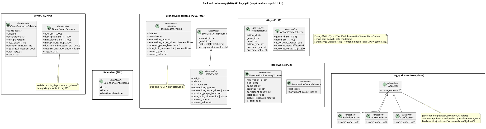

<div hidden>

```
@startuml interfaces
skinparam classAttributeIconSize 0
skinparam packageStyle rectangle
skinparam shadowing false
skinparam roundcorner 4
skinparam nodesep 26
skinparam ranksep 34
skinparam linetype polyline

title Specyfikacja interfejsów (backend)

package "Data Transfer Schemas (Pydantic Models)" {
    class GameCreateSchema <<BaseModel>> {
        + title: str
        + description: str
        + min_players: int
        + max_players: int
        + duration_minutes: int
        + requires_invitation: bool = false
        + tags: list[str]
    }

    class GameResponseSchema <<BaseModel>> {
        + game_id: str
        + title: str
        + description: str
        + min_players: int
        + max_players: int
        + duration_minutes: int
        + requires_invitation: bool
        + tags: list[str]
        + status: ReservationStatus
    }

    class ActionCreateSchema <<BaseModel>> {
        + game_id: str
        + name: str
        + action_type: str
        + outcome_type: str
        + outcome_value: str
    }

    class TaskCreateSchema <<BaseModel>> {
        + title: str
        + narrative: str
        + interaction_type: str
        + interaction_target_id: str | None = None
        + required_player_level: int = 1
        + time_limit_minutes: int | None = None
        + reward_type: str
        + reward_value: str
    }

    class TaskSchema <<BaseModel>> {
        + task_id: str
        + title: str
        + narrative: str
        + interaction_type: str
        + interaction_target_id: str | None
        + required_player_level: int
        + time_limit_minutes: int | None
        + reward_type: str
        + reward_value: str
    }

    class ScenarioDetailSchema <<BaseModel>> {
        + scenario_id: str
        + game_id: str
        + tasks: list[TaskSchema]
        + victory_conditions: list[str]
    }

    class CalendarEventSchema <<BaseModel>> {
        + id: str
        + title: str
        + datetime: datetime
    }

    class ReservationCreateSchema <<BaseModel>> {
        + slot_id: str
        + game_id: str
        + participant_count: int
    }

    class ReservationSummarySchema <<BaseModel>> {
        + reservation_id: str
        + slot_id: str
        + game_id: str
        + organizer_id: str
        + participant_count: int
        + total_cost: float
        + status: ReservationStatus
        + is_paid: bool
    }
}

package "Services (Application Business Logic)" {
    class GamesService {
        - db_session: Session
        + save_game(dto: GameCreateSchema, as_draft: bool): GameResponseSchema
        + submit_to_reviewer(game_id: str): bool
    }

    class ActionsService {
        - db_session: Session
        + get_action_types(): list[str]
        + create_action(dto: ActionCreateSchema): str
    }

    class ScenariosService {
        - db_session: Session
        + load_scenario(game_id: str, user_id: str): ScenarioDetailSchema
        + add_task(game_id: str, dto: TaskCreateSchema): bool
    }

    class CalendarService {
        - db_session: Session
        + get_events(month: date): list[CalendarEventSchema]
    }

    class ReservationsService {
        - db_session: Session
        - payment_service: IPaymentService
        - message_service: IMessageService
        + create_reservation(user_id: str, dto: ReservationCreateSchema): ReservationSummarySchema
        + cancel_reservation(user_id: str, reservation_id: str): bool
        + mark_payment_completed(user_id: str, reservation_id: str): ReservationSummarySchema
    }
}

GamesService ..> GameCreateSchema : consumes
GamesService ..> GameResponseSchema : produces
ActionsService ..> ActionCreateSchema : consumes
ScenariosService ..> ScenarioDetailSchema : produces
ScenarioDetailSchema *-- TaskSchema
ScenariosService ..> TaskCreateSchema : consumes
CalendarService ..> CalendarEventSchema : produces
ReservationsService ..> ReservationCreateSchema : consumes
ReservationsService ..> ReservationSummarySchema : produces

@enduml
```

</div>


