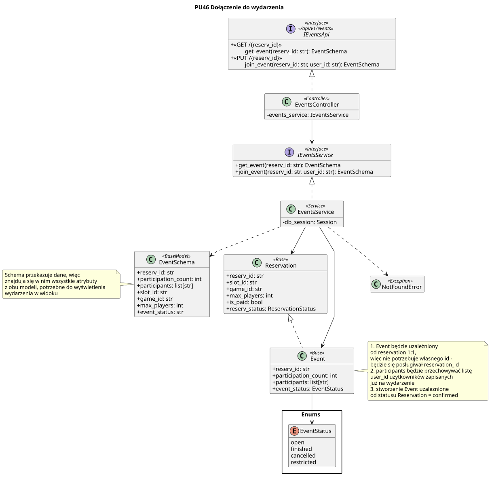

<div hidden>


```
@startuml join-event
skinparam classAttributeIconSize 0
skinparam packageStyle rectangle
skinparam shadowing false
skinparam roundcorner 4
skinparam linetype polyline
hide empty members

title PU46 Dołączenie do wydarzenia

interface IEventsApi <<interface>>\n<< /api/v1/events >> {
    + <<GET /{reserv_id} >>\n\tget_event(reserv_id: str): EventSchema
    + <<PUT /{reserv_id} >>\n \tjoin_event(reserv_id: str, user_id: str): EventSchema
}

class EventsController <<Controller>> {
    - events_service: IEventsService
}

interface IEventsService <<interface>> {
    + get_event(reserv_id: str): EventSchema
    + join_event(reserv_id: str, user_id: str): EventSchema
}

class EventsService <<Service>> {
    - db_session: Session
}

package "Enums" {
  enum EventStatus{
    open
    finished
    cancelled
    restricted
  }
}

class Event <<Base>>{
  + reserv_id: str
  + participation_count: int
  + participants: list[str]
  + event_status: EventStatus
}
class Reservation <<Base>>{
  + reserv_id: str
  + slot_id: str
  + game_id: str
  + max_players: int
  + is_paid: bool
  + reserv_status: ReservationStatus
}

class EventSchema <<BaseModel>> {
  + reserv_id: str
  + participation_count: int
  + participants: list[str]
  + slot_id: str
  + game_id: str
  + max_players: int
  + event_status: str
}

class NotFoundError <<Exception>>{

}


Event --> EventStatus
Event .u.|> Reservation

EventsController .u.|> IEventsApi
EventsController --> IEventsService
EventsService .u.|> IEventsService
EventsService --> Event
EventsService --> Reservation 
EventsService ..> EventSchema
EventsService ..> NotFoundError

note left of EventSchema
  Schema przekazuje dane, więc 
  znajduja się w nim wszystkie atrybuty
  z obu modeli, potrzebne do wyświetlenia 
  wydarzenia w widoku
end note

note right of Event
  1. Event będzie uzależniony 
  od reservation 1:1,
  więc nie potrzebuje własnego id -
  będzie się posługiwał reservation_id
  2. participants będzie przechowywać listę 
  user_id użytkowników zapisanych 
  już na wydarzenie
  3. stworzenie Event uzaleznione
  od statusu Reservation = confirmed
end note


@enduml
```


</div>

