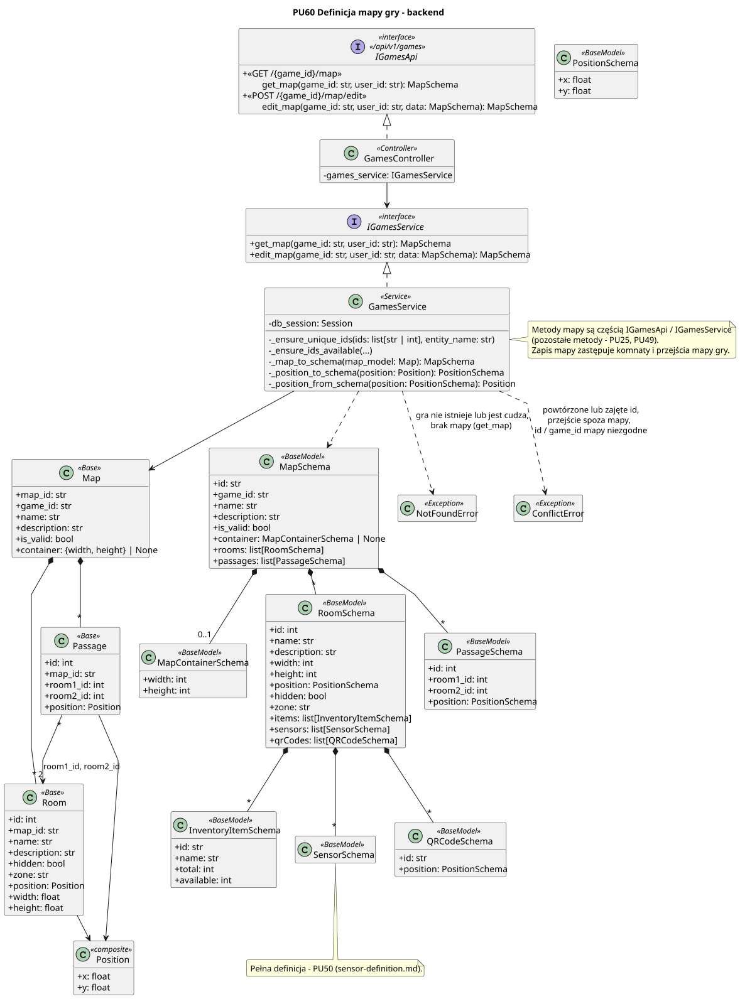

<div hidden>

```
@startuml map-definition
skinparam classAttributeIconSize 0
skinparam packageStyle rectangle
skinparam shadowing false
skinparam roundcorner 4
skinparam linetype polyline
skinparam nodesep 30
skinparam ranksep 40
hide empty members

title PU60 Definicja mapy gry - backend

interface IMapsApi <<interface>> \n<< /api/v1/games >> {
    + <<GET /{game_id}/map >>\n\tget_map(game_id: str, user_id: str) : MapSchema
    + <<POST /{game_id}/map/edit >>\n\tedit_map(game_id: str, user_id: str, data: MapSchema) : MapSchema
}

class MapsController implements IMapsApi {
    - maps_service: IMapsService
}

interface IMapsService <<interface>> {
    + get_map(game_id: str, user_id: str) : MapSchema
    + edit_map(game_id: str, user_id: str, data: MapSchema) : MapSchema
}

MapsController --> IMapsService

class MapsService implements IMapsService {
}

class Map <<BaseModel>> {
    + id: int
    + name: str
    + description: str
    + rooms: Room[]
    + passages: Passage[]
}

class MapSchema {
    + id: int
    + name: str
    + description: str
    + rooms: RoomSchema[]
    + passages: PassageSchema[]
}

class InventoryItem <<BaseModel>> {
    + id: int
    + name: str
    + total: number
    + available: number
}

class Room <<BaseModel>> {
    + id: int
    + name: str
    + description: str
    + hidden: bool
    + zone: str
    + items: InventoryItem[]
    + sensors: Sensor[]
    + qrCodes: QrCode[]
}

class Sensor <<BaseModel>> {
    + id: int
    + position: Position
}

class QrCode <<BaseModel>> {
    + id: int
    + position: Position
    + content: str
}

class RoomSchema {
    + id: int
    + name: str
    + description: str
    + hidden: bool
    + zone: str
    + items: InventoryItemSchema[]
    + sensors: SensorSchema[]
    + qrCodes: QrCodeSchema[]
}

class SensorSchema {
    + id: int
    + position: Position
}

class QrCodeSchema {
    + id: int
    + position: Position
}

class InventoryItemSchema {
    + id: int
    + name: str
}

class Position <<BaseModel>> {
    + x: number
    + y: number
}

class PositionSchema {
    + x: number
    + y: number
}

class Passage <<BaseModel>> {
    + id: int
    + room1Id: int
    + room2Id: int
}

class PassageSchema {
    + id: int
    + room1Id: int
    + room2Id: int
}

class NotFoundException <<Exception>> {

}

class DataIncorrectException <<Exception>> {

}

class SaveFailedException <<Exception>> {

}

MapsService --> Map
MapsService ..> MapSchema
MapsService ..> NotFoundException : Gra nie istnieje lub twórca nie ma do niej dostępu
MapsService ..> DataIncorrectException : Niepoprawne dane
MapsService ..> SaveFailedException : Zapisanie danych nie powiodło się

@enduml
```

</div>


