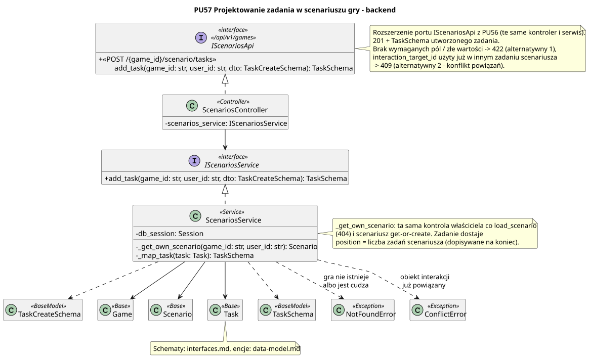

<div hidden>

```
@startuml new-task
skinparam classAttributeIconSize 0
skinparam packageStyle rectangle
skinparam shadowing false
skinparam roundcorner 4
skinparam linetype polyline
skinparam nodesep 30
skinparam ranksep 40
hide empty members

title PU57 Projektowanie zadania w scenariuszu gry - backend

interface IScenariosApi <<interface>>\n<< /api/v1/games >> {
    + <<POST /{game_id}/scenario/tasks >>\n\tadd_task(game_id: str, user_id: str, dto: TaskCreateSchema): TaskSchema
}

class ScenariosController <<Controller>> {
    - scenarios_service: IScenariosService
}

interface IScenariosService <<interface>> {
    + add_task(game_id: str, user_id: str, dto: TaskCreateSchema): TaskSchema
}

class ScenariosService <<Service>> {
    - db_session: Session
    - _get_own_scenario(game_id: str, user_id: str): Scenario
    - _map_task(task: Task): TaskSchema
}

class TaskCreateSchema <<BaseModel>> {
    + title: str [1..200]
    + narrative: str [1..2000]
    + interaction_type: str
    + interaction_target_id: str | None = None
    + required_player_level: int >= 1 = 1
    + time_limit_minutes: int > 0 | None = None
    + reward_type: str
    + reward_value: str
}

class Game <<Base>>
class Scenario <<Base>>
class Task <<Base>>
class TaskSchema <<BaseModel>>
class NotFoundError <<Exception>>
class ConflictError <<Exception>>

ScenariosController .u.|> IScenariosApi
ScenariosController --> IScenariosService
ScenariosService .u.|> IScenariosService
ScenariosService --> Game
ScenariosService --> Scenario
ScenariosService --> Task
ScenariosService ..> TaskCreateSchema
ScenariosService ..> TaskSchema
ScenariosService ..> NotFoundError : gra nie istnieje\nalbo jest cudza
ScenariosService ..> ConflictError : obiekt interakcji\njuż powiązany

note right of IScenariosApi
    Rozszerzenie portu IScenariosApi z PU56 (te same kontroler i serwis).
    201 + TaskSchema utworzonego zadania.
    Brak wymaganych pól / złe wartości -> 422 (alternatywny 1),
    interaction_target_id użyty już w innym zadaniu scenariusza
    -> 409 (alternatywny 2 - konflikt powiązań).
end note

note right of ScenariosService
    _get_own_scenario: ta sama kontrola właściciela co load_scenario
    (404) i scenariusz get-or-create. Zadanie dostaje
    position = liczba zadań scenariusza (dopisywane na koniec).
end note

note bottom of Task
    Schematy: interfaces.md, encje: data-model.md.
    TaskCreateSchema po implementacji przenosi Architekt do interfaces.md.
end note
@enduml
```

</div>


