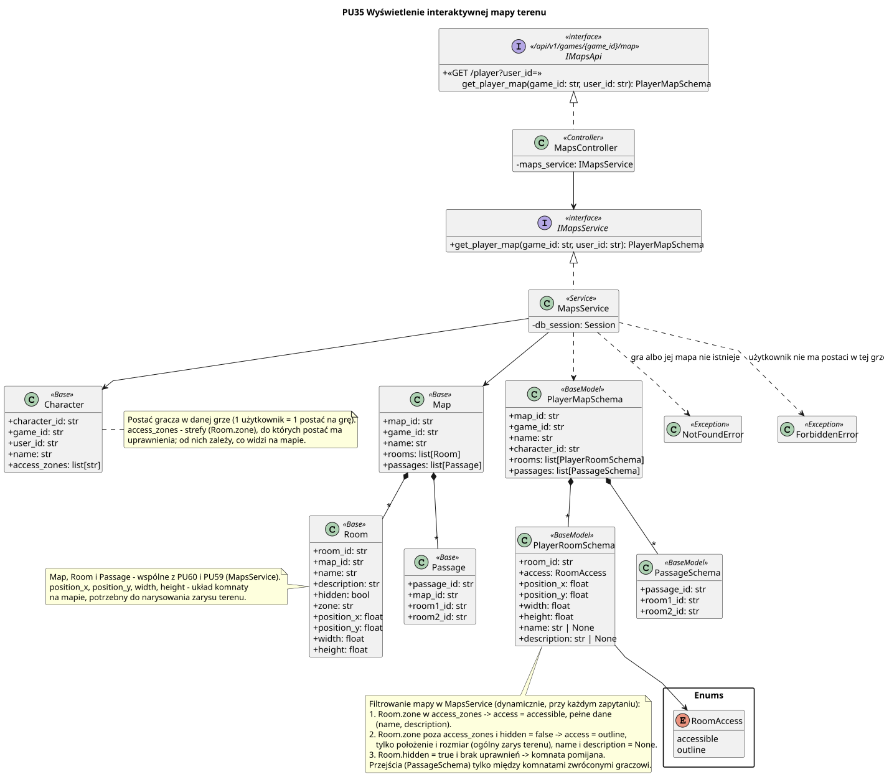

<div hidden>

```
@startuml player-map
skinparam classAttributeIconSize 0
skinparam packageStyle rectangle
skinparam shadowing false
skinparam roundcorner 4
skinparam linetype polyline
hide empty members

title PU35 Wyświetlenie interaktywnej mapy terenu

interface IMapsApi <<interface>>\n<< /api/v1/games/{game_id}/map >> {
    + <<GET /player?user_id= >>\n\tget_player_map(game_id: str, user_id: str): PlayerMapSchema
}

class MapsController <<Controller>> {
    - maps_service: IMapsService
}

interface IMapsService <<interface>> {
    + get_player_map(game_id: str, user_id: str): PlayerMapSchema
}

class MapsService <<Service>> {
    - db_session: Session
}

package "Enums" {
  enum RoomAccess {
    accessible
    outline
  }
}

class Map <<Base>> {
  + map_id: str
  + game_id: str
  + name: str
  + rooms: list[Room]
  + passages: list[Passage]
}

class Room <<Base>> {
  + room_id: str
  + map_id: str
  + name: str
  + description: str
  + hidden: bool
  + zone: str
  + position_x: float
  + position_y: float
  + width: float
  + height: float
}

class Passage <<Base>> {
  + passage_id: str
  + map_id: str
  + room1_id: str
  + room2_id: str
}

class Character <<Base>> {
  + character_id: str
  + game_id: str
  + user_id: str
  + name: str
  + access_zones: list[str]
}

class PlayerMapSchema <<BaseModel>> {
  + map_id: str
  + game_id: str
  + name: str
  + character_id: str
  + rooms: list[PlayerRoomSchema]
  + passages: list[PassageSchema]
}

class PlayerRoomSchema <<BaseModel>> {
  + room_id: str
  + access: RoomAccess
  + position_x: float
  + position_y: float
  + width: float
  + height: float
  + name: str | None
  + description: str | None
}

class PassageSchema <<BaseModel>> {
  + passage_id: str
  + room1_id: str
  + room2_id: str
}

class NotFoundError <<Exception>>
class ForbiddenError <<Exception>>

MapsController .u.|> IMapsApi
MapsController --> IMapsService
MapsService .u.|> IMapsService
MapsService --> Map
MapsService --> Character
MapsService ..> PlayerMapSchema
MapsService ..> NotFoundError : gra albo jej mapa nie istnieje
MapsService ..> ForbiddenError : użytkownik nie ma postaci w tej grze

Map *-- "*" Room
Map *-- "*" Passage
PlayerMapSchema *-- "*" PlayerRoomSchema
PlayerMapSchema *-- "*" PassageSchema
PlayerRoomSchema --> RoomAccess

note right of Character
  Postać gracza w danej grze (1 użytkownik = 1 postać na grę).
  access_zones - strefy (Room.zone), do których postać ma
  uprawnienia; od nich zależy, co widzi na mapie.
end note

note bottom of PlayerRoomSchema
  Filtrowanie mapy w MapsService (dynamicznie, przy każdym zapytaniu):
  1. Room.zone w access_zones -> access = accessible, pełne dane
     (name, description).
  2. Room.zone poza access_zones i hidden = false -> access = outline,
     tylko położenie i rozmiar (ogólny zarys terenu), name i description = None.
  3. Room.hidden = true i brak uprawnień -> komnata pomijana.
  Przejścia (PassageSchema) tylko między komnatami zwróconymi graczowi.
end note

note left of Room
  Map, Room i Passage - wspólne z PU60 i PU59 (MapsService).
  position_x, position_y, width, height - układ komnaty
  na mapie, potrzebny do narysowania zarysu terenu.
end note

@enduml
```

</div>


