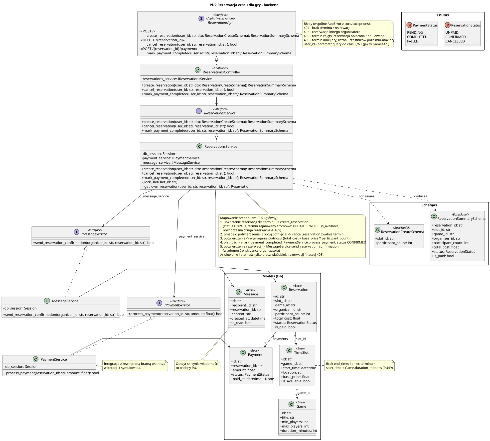

<div hidden>

```
@startuml reservation-backend
skinparam classAttributeIconSize 0
skinparam packageStyle rectangle
skinparam shadowing false
skinparam roundcorner 4
skinparam nodesep 26
skinparam ranksep 34
skinparam linetype polyline

title PU2 Rezerwacja czasu dla gry - backend

interface ReservationsApi <<interface>>\n<< /api/v1/reservations >> {
    + <<POST / >>\n\tcreate_reservation(user_id: str, dto: ReservationCreateSchema): ReservationSummarySchema
    + <<DELETE /{reservation_id} >>\n\tcancel_reservation(user_id: str, reservation_id: str): bool
    + <<POST /{reservation_id}/payment >>\n\tmark_payment_completed(user_id: str, reservation_id: str): ReservationSummarySchema
}

class ReservationsController <<Controller>> {
    - reservations_service: IReservationsService
    + create_reservation(user_id: str, dto: ReservationCreateSchema): ReservationSummarySchema
    + cancel_reservation(user_id: str, reservation_id: str): bool
    + mark_payment_completed(user_id: str, reservation_id: str): ReservationSummarySchema
}

interface IReservationsService <<interface>> {
    + create_reservation(user_id: str, dto: ReservationCreateSchema): ReservationSummarySchema
    + cancel_reservation(user_id: str, reservation_id: str): bool
    + mark_payment_completed(user_id: str, reservation_id: str): ReservationSummarySchema
}

class ReservationsService {
    - db_session: Session
    - payment_service: IPaymentService
    - message_service: IMessageService
    + create_reservation(user_id: str, dto: ReservationCreateSchema): ReservationSummarySchema
    + cancel_reservation(user_id: str, reservation_id: str): bool
    + mark_payment_completed(user_id: str, reservation_id: str): ReservationSummarySchema
    - _lock_slot(slot_id: str)
    - _get_own_reservation(user_id: str, reservation_id: str): Reservation
}

interface IPaymentService <<interface>> {
    + process_payment(reservation_id: str, amount: float): bool
}

class PaymentService {
    - db_session: Session
    + process_payment(reservation_id: str, amount: float): bool
}

interface IMessageService <<interface>> {
    + send_reservation_confirmation(organizer_id: str, reservation_id: str): bool
}

class MessageService {
    - db_session: Session
    + send_reservation_confirmation(organizer_id: str, reservation_id: str): bool
}

package "Schemas" {
    class ReservationCreateSchema <<BaseModel>> {
        + slot_id: str
        + participant_count: int
    }

    class ReservationSummarySchema <<BaseModel>> {
        + reservation_id: str
        + slot_id: str
        + game_id: str
        + organizer_id: str
        + participant_count: int
        + total_cost: float
        + status: ReservationStatus
        + is_paid: bool
    }
}

package "Models (Db)" as models {
    class Reservation <<Base>> {
        + id: str
        + slot_id: str
        + game_id: str
        + organizer_id: str
        + participant_count: int
        + total_cost: float
        + status: ReservationStatus
        + is_paid: bool
    }

    class Payment <<Base>> {
        + id: str
        + reservation_id: str
        + amount: float
        + status: PaymentStatus
        + paid_at: datetime | None
    }

    class Message <<Base>> {
        + id: str
        + recipient_id: str
        + reservation_id: str
        + content: str
        + created_at: datetime
        + is_read: bool
    }

    class TimeSlot <<Base>> {
        + id: str
        + game_id: str
        + start_time: datetime
        + location: str
        + base_price: float
        + is_available: bool
    }

    class Game <<Base>> {
        + id: str
        + title: str
        + min_players: int
        + max_players: int
        + duration_minutes: int
    }
}

package "Enums" {
    enum ReservationStatus {
        UNPAID
        CONFIRMED
        CANCELLED
    }

    enum PaymentStatus {
        PENDING
        COMPLETED
        FAILED
    }
}

ReservationsController .up.|> ReservationsApi
ReservationsController --> IReservationsService

ReservationsService .up.|> IReservationsService
ReservationsService --> IPaymentService : payment_service
ReservationsService --> IMessageService : message_service

PaymentService .up.|> IPaymentService
PaymentService -right-> Payment
MessageService .up.|> IMessageService
MessageService -right-> Message

ReservationsService -right-> Reservation
ReservationsService ..> ReservationCreateSchema : consumes
ReservationsService ..> ReservationSummarySchema : produces

Reservation "*" --> "1" TimeSlot : slot_id
Reservation "1" --> "*" Payment : payments
TimeSlot "*" --> "1" Game : game_id

note bottom of ReservationsService
    Mapowanie scenariusza PU2 (główny):
    1. utworzenie rezerwacji dla terminu -> create_reservation
       (status UNPAID, termin zajmowany atomowo: UPDATE ... WHERE is_available,
       równoczesna druga rezerwacja -> 409)
    2. prośba o potwierdzenie (z opcją cofnięcia) -> cancel_reservation zwalnia termin
    3. potwierdzenie -> wymaganie płatności (total_cost = base_price * participant_count)
    4. płatność -> mark_payment_completed: PaymentService.process_payment, status CONFIRMED
    5. potwierdzenie rezerwacji -> MessageService.send_reservation_confirmation
       (wiadomość w skrzynce organizatora)
    Anulowanie i płatność tylko przez właściciela rezerwacji (inaczej 403).
end note

note right of ReservationsApi
    Błędy (wspólne AppError z core/exceptions):
    404 - brak terminu / rezerwacji
    403 - rezerwacja innego organizatora
    409 - termin zajęty, rezerwacja opłacona / anulowana
    400 - termin innej gry, liczba uczestników poza min-max gry
    user_id - parametr query do czasu JWT (jak w GamesApi)
end note

note right of TimeSlot
    Brak end_time: koniec terminu =
    start_time + Game.duration_minutes (PU49).
end note

note right of PaymentService
    Integracja z zewnętrzną bramą płatniczą -
    w iteracji 1 symulowana.
end note

note bottom of Message
    Odczyt skrzynki wiadomości
    to osobny PU.
end note
@enduml
```

</div>


