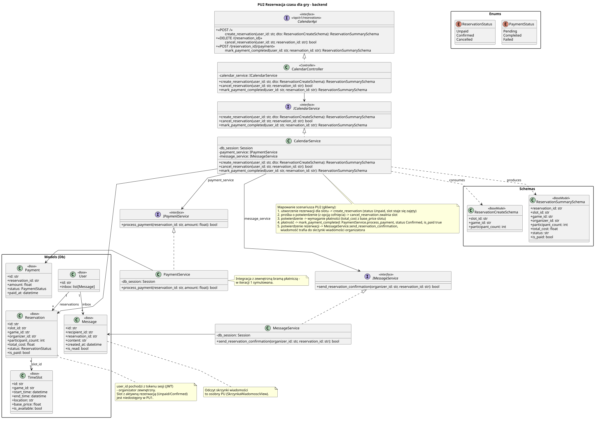

<div hidden>

```
@startuml reservation-backend
skinparam classAttributeIconSize 0
skinparam packageStyle rectangle
skinparam shadowing false
skinparam roundcorner 4
skinparam nodesep 26
skinparam ranksep 34
skinparam linetype polyline

title PU2 Rezerwacja czasu dla gry - backend

interface CalendarApi <<interface>>\n<< /api/v1/reservations >> {
    + <<POST / >>\n\tcreate_reservation(user_id: str, dto: ReservationCreateSchema): ReservationSummarySchema
    + <<DELETE /{reservation_id} >>\n\tcancel_reservation(user_id: str, reservation_id: str): bool
    + <<POST /{reservation_id}/payment >>\n\tmark_payment_completed(user_id: str, reservation_id: str): ReservationSummarySchema
}

class CalendarController <<Controller>> {
    - calendar_service: ICalendarService
    + create_reservation(user_id: str, dto: ReservationCreateSchema): ReservationSummarySchema
    + cancel_reservation(user_id: str, reservation_id: str): bool
    + mark_payment_completed(user_id: str, reservation_id: str): ReservationSummarySchema
}

interface ICalendarService <<interface>> {
    + create_reservation(user_id: str, dto: ReservationCreateSchema): ReservationSummarySchema
    + cancel_reservation(user_id: str, reservation_id: str): bool
    + mark_payment_completed(user_id: str, reservation_id: str): ReservationSummarySchema
}

class CalendarService {
    - db_session: Session
    - payment_service: IPaymentService
    - message_service: IMessageService
    + create_reservation(user_id: str, dto: ReservationCreateSchema): ReservationSummarySchema
    + cancel_reservation(user_id: str, reservation_id: str): bool
    + mark_payment_completed(user_id: str, reservation_id: str): ReservationSummarySchema
}

interface IPaymentService <<interface>> {
    + process_payment(reservation_id: str, amount: float): bool
}

class PaymentService {
    - db_session: Session
    + process_payment(reservation_id: str, amount: float): bool
}

interface IMessageService <<interface>> {
    + send_reservation_confirmation(organizer_id: str, reservation_id: str): bool
}

class MessageService {
    - db_session: Session
    + send_reservation_confirmation(organizer_id: str, reservation_id: str): bool
}

package "Schemas" {
    class ReservationCreateSchema <<BaseModel>> {
        + slot_id: str
        + game_id: str
        + participant_count: int
    }

    class ReservationSummarySchema <<BaseModel>> {
        + reservation_id: str
        + slot_id: str
        + game_id: str
        + organizer_id: str
        + participant_count: int
        + total_cost: float
        + status: str
        + is_paid: bool
    }
}

package "Models (Db)" as models {
    class Reservation <<Base>> {
        + id: str
        + slot_id: str
        + game_id: str
        + organizer_id: str
        + participant_count: int
        + total_cost: float
        + status: ReservationStatus
        + is_paid: bool
    }

    class Payment <<Base>> {
        + id: str
        + reservation_id: str
        + amount: float
        + status: PaymentStatus
        + paid_at: datetime
    }

    class Message <<Base>> {
        + id: str
        + recipient_id: str
        + reservation_id: str
        + content: str
        + created_at: datetime
        + is_read: bool
    }

    class TimeSlot <<Base>> {
        + id: str
        + game_id: str
        + start_time: datetime
        + end_time: datetime
        + location: str
        + base_price: float
        + is_available: bool
    }

    class User <<Base>> {
        + id: str
        + inbox: list[Message]
    }
}

package "Enums" {
    enum ReservationStatus {
        Unpaid
        Confirmed
        Cancelled
    }

    enum PaymentStatus {
        Pending
        Completed
        Failed
    }
}

CalendarController .up.|> CalendarApi
CalendarController --> ICalendarService

CalendarService .up.|> ICalendarService
CalendarService --> IPaymentService : payment_service
CalendarService --> IMessageService : message_service

PaymentService .up.|> IPaymentService
PaymentService -right-> Payment
MessageService .up.|> IMessageService
MessageService -right-> Message

CalendarService -right-> Reservation
CalendarService ..> ReservationCreateSchema : consumes
CalendarService ..> ReservationSummarySchema : produces

Reservation "*" --> "1" TimeSlot : slot_id
User "1" --> "*" Reservation : reservations
User "1" --> "*" Message : inbox

note bottom of CalendarService
    Mapowanie scenariusza PU2 (główny):
    1. utworzenie rezerwacji dla slotu -> create_reservation (status Unpaid, slot staje się zajęty)
    2. prośba o potwierdzenie (z opcją cofnięcia) -> cancel_reservation zwalnia slot
    3. potwierdzenie -> wymaganie płatności (total_cost z base_price slotu)
    4. płatność -> mark_payment_completed: PaymentService.process_payment, status Confirmed, is_paid true
    5. potwierdzenie rezerwacji -> MessageService.send_reservation_confirmation,
       wiadomość trafia do skrzynki wiadomości organizatora
end note

note right of PaymentService
    Integracja z zewnętrzną bramą płatniczą -
    w iteracji 1 symulowana.
end note

note bottom of Message
    Odczyt skrzynki wiadomości
    to osobny PU (SkrzynkaWiadomosciView).
end note

note bottom of Reservation
    user_id pochodzi z tokenu sesji (JWT)
    - organizator zewnętrzny.
    Slot z aktywną rezerwacją (Unpaid/Confirmed)
    jest niedostępny w PU1.
end note
@enduml
```

</div>


