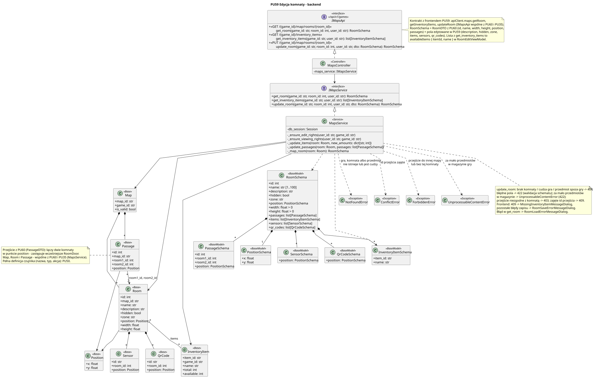

<div hidden>

```
@startuml room-edit
skinparam classAttributeIconSize 0
skinparam packageStyle rectangle
skinparam shadowing false
skinparam roundcorner 4
skinparam linetype polyline
skinparam nodesep 30
skinparam ranksep 40
hide empty members

title PU59 Edycja komnaty - backend

interface IMapsApi <<interface>>\n<< /api/v1/games >> {
    + <<GET /{game_id}/map/rooms/{room_id} >>\n\tget_room(game_id: str, room_id: int, user_id: str): RoomSchema
    + <<GET /{game_id}/inventory_items >>\n\tget_inventory_items(game_id: str, user_id: str): list[InventoryItemSchema]
    + <<PUT /{game_id}/map/rooms/{room_id} >>\n\tupdate_room(game_id: str, room_id: int, user_id: str, dto: RoomSchema): RoomSchema
}

class MapsController <<Controller>> {
    - maps_service: IMapsService
}

interface IMapsService <<interface>> {
    + get_room(game_id: str, room_id: int, user_id: str): RoomSchema
    + get_inventory_items(game_id: str, user_id: str): list[InventoryItemSchema]
    + update_room(game_id: str, room_id: int, user_id: str, dto: RoomSchema): RoomSchema
}

class MapsService <<Service>> {
    - db_session: Session
    - _check_items_available(game_id: str, items: list[InventoryItemSchema])
    - _map_room(room: Room): RoomSchema
}

class Map <<Base>> {
    + map_id: str
    + game_id: str
    + is_valid: bool
}

class Room <<Base>> {
    + id: int
    + map_id: str
    + name: str
    + description: str
    + hidden: bool
    + zone: str
    + position: Position
    + width: float
    + height: float
}

class Passage <<Base>> {
    + id: int
    + map_id: str
    + room1_id: int
    + room2_id: int
    + position: Position
}

class Position <<Base>> {
    + x: float
    + y: float
}

class InventoryItem <<Base>> {
    + item_id: str
    + game_id: str
    + name: str
    + total: int
    + available: int
}

class Sensor <<Base>> {
    + id: str
    + room_id: int
    + position: Position
}

class QrCode <<Base>> {
    + id: str
    + room_id: int
    + position: Position
}

class RoomSchema <<BaseModel>> {
    + id: int
    + name: str [1..100]
    + description: str
    + hidden: bool
    + zone: str
    + position: PositionSchema
    + width: float > 0
    + height: float > 0
    + passages: list[PassageSchema]
    + items: list[InventoryItemSchema]
    + sensors: list[SensorSchema]
    + qr_codes: list[QrCodeSchema]
}

class PassageSchema <<BaseModel>> {
    + id: int
    + room1_id: int
    + room2_id: int
    + position: PositionSchema
}

class PositionSchema <<BaseModel>> {
    + x: float
    + y: float
}

class InventoryItemSchema <<BaseModel>> {
    + item_id: str
    + name: str
}

class SensorSchema <<BaseModel>> {
    + position: PositionSchema
}

class QrCodeSchema <<BaseModel>> {
    + position: PositionSchema
}

class NotFoundError <<Exception>>
class ConflictError <<Exception>>

MapsController .u.|> IMapsApi
MapsController --> IMapsService
MapsService .u.|> IMapsService
MapsService --> Map
MapsService --> Room
MapsService --> InventoryItem
MapsService ..> RoomSchema
MapsService ..> InventoryItemSchema
MapsService ..> NotFoundError : gra, mapa albo komnata\nnie istnieje lub jest cudza
MapsService ..> ConflictError : code = item_unavailable\n(przedmiotu brak w magazynie)

Map *-- "*" Room
Map *-- "*" Passage
Room *-- "*" Sensor
Room *-- "*" QrCode
Room "*" o-- "*" InventoryItem : items
Passage "*" --> "2" Room : room1_id, room2_id
Room --> Position
Passage --> Position

RoomSchema *-- "*" PassageSchema
RoomSchema *-- "*" InventoryItemSchema
RoomSchema *-- "*" SensorSchema
RoomSchema *-- "*" QrCodeSchema
RoomSchema *-- "1" PositionSchema

note right of IMapsApi
    Kontrakt z frontendem PU59: apiClient.maps.getRoom,
    getInventoryItems, updateRoom (IMapsApi wspólne z PU60 i PU35).
    RoomSchema = RoomDTO z PU60 (id, name, width, height, position,
    passages) + pola edytowane w PU59 (description, hidden, zone,
    items, sensors, qr_codes). Lista z get_inventory_items to
    availableItems { itemId, name } w RoomEditViewModel.
end note

note bottom of MapsService
    update_room: brak komnaty / cudza gra -> NotFoundError (404);
    błędne pola -> 422 (walidacja schematu); przedmiot z items
    niedostępny w magazynie (available = 0) -> ConflictError (409,
    item_unavailable) -> MissingInventoryItemMessageDialog;
    inny błąd zapisu -> 500 -> RoomSaveErrorMessageDialog.
    Błąd w get_room -> RoomLoadErrorMessageDialog.
end note

note left of Passage
    Przejście z PU60 (PassageDTO): łączy dwie komnaty
    w punkcie position - zastępuje wcześniejsze RoomDoor.
    Map, Room i Passage - wspólne z PU60 i PU35 (MapsService).
    Pełna definicja czujnika (nazwa, typ, akcja): PU50.
end note
@enduml
```

</div>


