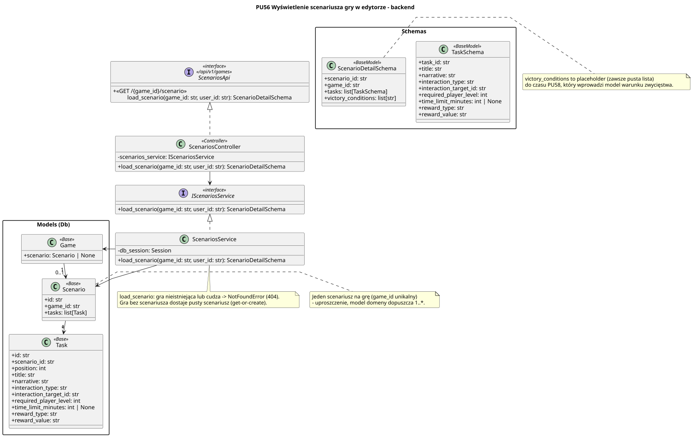

<div hidden>

```
@startuml scenario-editor-backend
skinparam classAttributeIconSize 0
skinparam packageStyle rectangle
skinparam shadowing false
skinparam roundcorner 4
skinparam nodesep 26
skinparam ranksep 34
skinparam linetype polyline

title PU56 Wyświetlenie scenariusza gry w edytorze - backend

interface ScenariosApi <<interface>>\n<< /api/v1/games >> {
    + <<GET /{game_id}/scenario >>\n\tload_scenario(game_id: str, user_id: str): ScenarioDetailSchema
}

class ScenariosController <<Controller>> {
    - scenarios_service: IScenariosService
    + load_scenario(game_id: str, user_id: str): ScenarioDetailSchema
}

interface IScenariosService <<interface>> {
    + load_scenario(game_id: str, user_id: str): ScenarioDetailSchema
}

class ScenariosService {
    - db_session: Session
    + load_scenario(game_id: str, user_id: str): ScenarioDetailSchema
}

package "Schemas" {
    class ScenarioDetailSchema <<BaseModel>> {
        + scenario_id: str
        + game_id: str
        + tasks: list[TaskSchema]
        + victory_conditions: list[str]
    }

    class TaskSchema <<BaseModel>> {
        + task_id: str
        + title: str
        + narrative: str
        + interaction_type: str
        + interaction_target_id: str | None
        + required_player_level: int
        + time_limit_minutes: int | None
        + reward_type: str
        + reward_value: str
    }
}

package "Models (Db)" as models {
    class Game <<Base>> {
        + scenario: Scenario | None
    }

    class Scenario <<Base>> {
        + id: str
        + game_id: str
        + tasks: list[Task]
    }

    class Task <<Base>> {
        + id: str
        + scenario_id: str
        + position: int
        + title: str
        + narrative: str
        + interaction_type: str
        + interaction_target_id: str | None
        + required_player_level: int
        + time_limit_minutes: int | None
        + reward_type: str
        + reward_value: str
    }
}

ScenariosService .up.|> IScenariosService
ScenariosController .up.|> ScenariosApi

ScenariosController --> IScenariosService
ScenariosService -right-> Game
ScenariosService -right-> Scenario

Game "1" --> "0..1" Scenario
Scenario "1" --> "*" Task

note bottom of ScenariosService
    load_scenario: gra nieistniejąca lub cudza -> NotFoundError (404).
    Zadania z PU57 trafiają pod ten sam prefiks: POST /{game_id}/scenario/tasks.
    Gra bez scenariusza dostaje pusty scenariusz (get-or-create).
end note

note right of Scenario
    Jeden scenariusz na grę (game_id unikalny)
    - uproszczenie, model domeny dopuszcza 1..*.
end note

note right of ScenarioDetailSchema
    victory_conditions to placeholder (zawsze pusta lista)
    do czasu PU58, który wprowadzi model warunku zwycięstwa.
end note
@enduml
```

</div>


