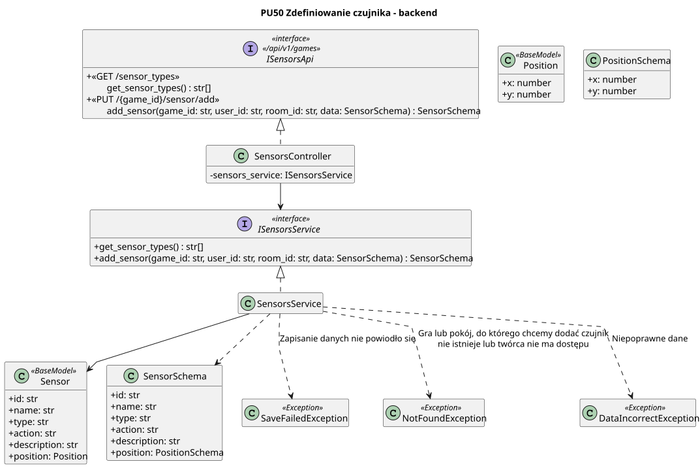

<div hidden>

```
@startuml sensor-definition
skinparam classAttributeIconSize 0
skinparam packageStyle rectangle
skinparam shadowing false
skinparam roundcorner 4
skinparam linetype polyline
skinparam nodesep 30
skinparam ranksep 40
hide empty members

title PU50 Dodanie czujnika - backend

interface IGamesApi <<interface>>\n<< /api/v1/games >> {
    + <<GET /sensor_types >>\n\tget_sensor_types(): list[str]
    + <<PUT /{game_id}/sensor/add >>\n\tadd_sensor(game_id: str, user_id: str, room_id: int, data: SensorSchema): SensorSchema
}

class GamesController <<Controller>> {
    - games_service: IGamesService
}

interface IGamesService <<interface>> {
    + get_sensor_types(): list[str]
    + add_sensor(game_id: str, user_id: str, room_id: int, data: SensorSchema): SensorSchema
}

class GamesService <<Service>> {
    - db_session: Session
    - _sensor_to_schema(sensor: Sensor): SensorSchema
    - _position_from_schema(position: PositionSchema): Position
}

class Sensor <<Base>> {
    + id: str
    + room_id: int
    + position: Position
    + name: str | None
    + type: str | None
    + description: str | None
    + action_id: str | None
}

class Room <<Base>> {
    + id: int
    + map_id: str
}

class Action <<Base>> {
    + action_id: str
    + game_id: str
}

class Position <<composite>> {
    + x: float
    + y: float
}

class SensorSchema <<BaseModel>> {
    + id: str
    + name: str | None
    + type: str | None
    + action: ActionSchema | None
    + description: str | None
    + position: PositionSchema
}

class ActionSchema <<BaseModel>> {
    + action_id: str
    + game_id: str
    + name: str
    + action_type: str
    + outcome_type: str
    + outcome_value: str
}

class PositionSchema <<BaseModel>> {
    + x: float
    + y: float
}

class NotFoundError <<Exception>>
class ConflictError <<Exception>>
class UnprocessableContentError <<Exception>>

GamesController .u.|> IGamesApi
GamesController --> IGamesService
GamesService .u.|> IGamesService
GamesService --> Sensor
GamesService ..> SensorSchema
GamesService ..> NotFoundError : gra (cudza), komnata\nalbo akcja nie istnieje
GamesService ..> UnprocessableContentError : czujnik bez akcji
GamesService ..> ConflictError : akcja z innej gry,\nczujnik o tym id istnieje

Room *-- "*" Sensor
Sensor "*" --> "0..1" Action : action_id
Sensor --> Position
SensorSchema *-- "0..1" ActionSchema
SensorSchema *-- "1" PositionSchema

note right of GamesService
    Metody czujnika są częścią IGamesApi / IGamesService.
    Komnata (room_id) musi należeć do mapy tej gry.
end note
@enduml
```

</div>


