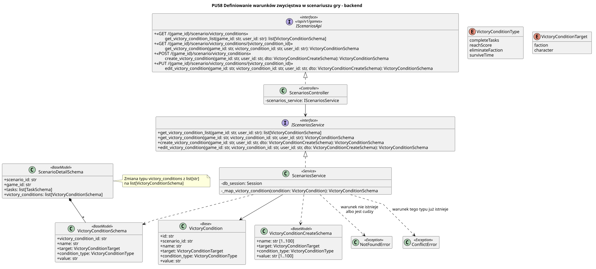

<div hidden>

```
@startuml VictoryCondition-definition
skinparam classAttributeIconSize 0
skinparam packageStyle rectangle
skinparam shadovictoryg false
skinparam roundcorner 4
skinparam linetype polyline
skinparam nodesep 30
skinparam ranksep 40
hide empty members

title PU58 Definiowanie warunków zwycięstwa w scenariuszu gry - backend

interface IScenariosApi <<interface>>\n<< /api/v1/games >> {
    +<<GET /{game_id}/scenario/victory_conditions>>\n\tget_victory_condition_list(game_id: str, user_id: str): list[VictoryConditionSchema]
    + <<GET /{game_id}/scenario/victory_conditions/{victory_condition_id} >>\n\tget_victory_condition(game_id: str, victory_condition_id: str, user_id: str): VictoryConditionSchema
    + <<POST /{game_id}/scenario/victory_conditions >>\n\tcreate_victory_condition(game_id: str, user_id: str, dto: VictoryConditionCreateSchema): VictoryConditionSchema
    + <<PUT /{game_id}/scenario/victory_conditions/{victory_condition_id}>>\n\tedit_victory_condition(game_id: str, victory_condition_id: str, user_id: str, dto: VictoryConditionCreateSchema): VictoryConditionSchema
}

class ScenariosController <<Controller>> {
    - scenarios_service: IScenariosService
}

interface IScenariosService <<interface>> {
    +get_victory_condition_list(game_id: str, user_id: str): list[VictoryConditionSchema]
    +get_victory_condition(game_id: str, victory_condition_id: str, user_id: str): VictoryConditionSchema
    +create_victory_condition(game_id: str, user_id: str, dto: VictoryConditionCreateSchema): VictoryConditionSchema
    +edit_victory_condition(game_id: str, victory_condition_id: str, user_id: str, dto: VictoryConditionCreateSchema): VictoryConditionSchema
}

class ScenariosService <<Service>> {
    - db_session: Session
    -_map_victory_condition(condition: VictoryCondition): VictoryConditionSchema
}

class VictoryCondition <<Base>> {
    id: str
    scenario_id: str
    name: str
    target: VictoryConditionTarget
    condition_type: VictoryConditionType
    value: str
}

class VictoryConditionCreateSchema <<BaseModel>> {
    name: str [1..100]
    target: VictoryConditionTarget
    condition_type: VictoryConditionType
    value: str [1..100]
}

class VictoryConditionSchema <<BaseModel>> {
    id: str
    name: str
    target: VictoryConditionTarget
    condition_type: VictoryConditionType
    value: str
}

enum VictoryConditionType {
    completeTasks
    reachScore
    eliminateFaction
    surviveTime
}

enum VictoryConditionTarget {
    faction
    character
}

class NotFoundError <<Exception>>
class ConflictError <<Exception>>

ScenariosController .u.|> IScenariosApi
ScenariosController --> IScenariosService
ScenariosService .u.|> IScenariosService
ScenariosService --> VictoryCondition
ScenariosService ..> VictoryConditionCreateSchema
ScenariosService ..> VictoryConditionSchema
ScenariosService ..> NotFoundError : warunek nie istnieje\nalbo jest cudzy
ScenariosService ..> ConflictError : warunek tego typu już istnieje


@enduml
```

</div>

