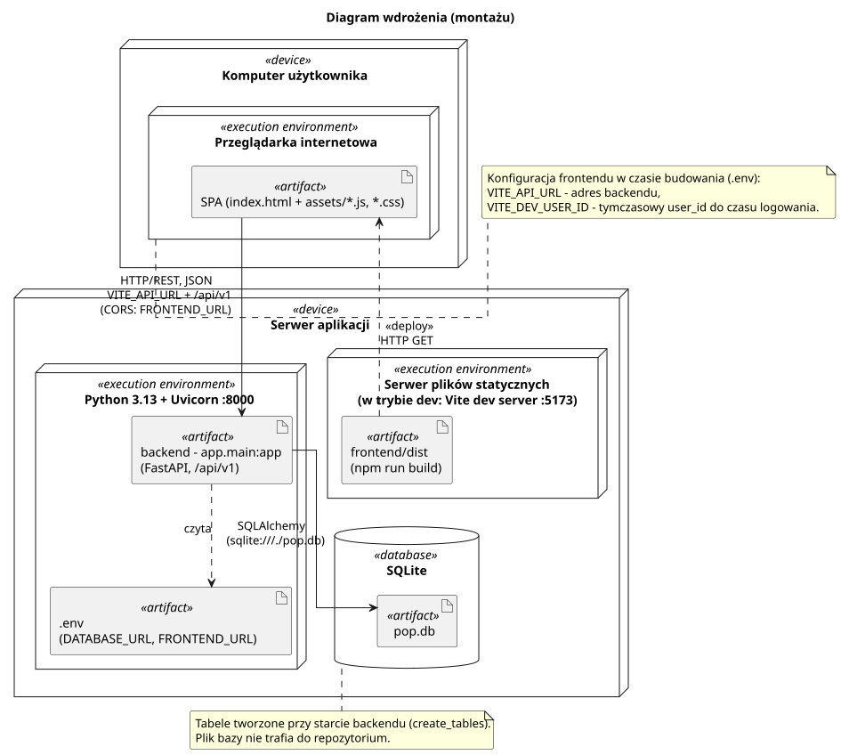

<div hidden>

```
@startuml deployment
skinparam componentStyle uml2
skinparam packageStyle rectangle
skinparam shadowing false
skinparam roundcorner 4
skinparam linetype ortho
skinparam nodesep 40
skinparam ranksep 60

title Diagram wdrożenia (montażu)

node "Komputer użytkownika" <<device>> as N_Client {
    node "Przeglądarka internetowa" <<execution environment>> as N_Browser {
        artifact "SPA (index.html + assets/*.js, *.css)" <<artifact>> as A_Spa
    }
}

node "Serwer aplikacji" <<device>> as N_Server {
    node "Serwer plików statycznych\n(w trybie dev: Vite dev server :5173)" <<execution environment>> as N_Static {
        artifact "frontend/dist\n(npm run build)" <<artifact>> as A_Dist
    }

    node "Python 3.13 + Uvicorn :8000" <<execution environment>> as N_Python {
        artifact "backend - app.main:app\n(FastAPI, /api/v1)" <<artifact>> as A_Api
        artifact ".env\n(DATABASE_URL, FRONTEND_URL)" <<artifact>> as A_Env
    }

    database "SQLite" <<database>> as N_Db {
        artifact "pop.db" <<artifact>> as A_Db
    }
}

A_Dist ..> A_Spa : <<deploy>>\nHTTP GET
A_Spa --> A_Api : HTTP/REST, JSON\nVITE_API_URL + /api/v1\n(CORS: FRONTEND_URL)
A_Api --> A_Db : SQLAlchemy\n(sqlite:///./pop.db)
A_Api ..> A_Env : czyta

note right of N_Browser
    Konfiguracja frontendu w czasie budowania (.env):
    VITE_API_URL - adres backendu,
    VITE_DEV_USER_ID - tymczasowy user_id do czasu logowania.
end note

note bottom of N_Db
    Tabele tworzone przy starcie backendu (create_tables).
    Plik bazy nie trafia do repozytorium.
end note
@enduml
```

</div>


