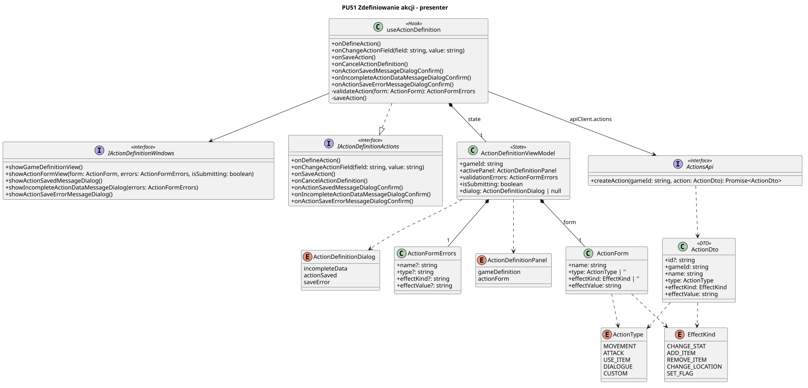

<div hidden>

```
@startuml
title PU51 Zdefiniowanie akcji - prezenter

skinparam classAttributeIconSize 0
skinparam shadowing false

interface IActionDefinitionWindows <<interface>> {
  +showGameDefinitionView()
  +showActionFormView(form: ActionForm, errors: ActionFormErrors, isSubmitting: boolean)
  +showActionSavedMessageDialog()
  +showIncompleteActionDataMessageDialog(errors: ActionFormErrors)
  +showActionSaveErrorMessageDialog()
}

interface IActionDefinitionActions <<interface>> {
  +onDefineAction()
  +onChangeActionField(field: string, value: string)
  +onSaveAction()
  +onCancelActionDefinition()
  +onActionSavedMessageDialogConfirm()
  +onIncompleteActionDataMessageDialogConfirm()
  +onActionSaveErrorMessageDialogConfirm()
}

enum ActionType {
  MOVEMENT
  ATTACK
  USE_ITEM
  DIALOGUE
  CUSTOM
}

enum EffectKind {
  CHANGE_STAT
  ADD_ITEM
  REMOVE_ITEM
  CHANGE_LOCATION
  SET_FLAG
}

enum ActionDefinitionPanel {
  gameDefinition
  actionForm
}

enum ActionDefinitionDialog {
  incompleteData
  actionSaved
  saveError
}


class useActionDefinition <<Hook>> {
  +onDefineAction()
  +onChangeActionField(field: string, value: string)
  +onSaveAction()
  +onCancelActionDefinition()
  +onActionSavedMessageDialogConfirm()
  +onIncompleteActionDataMessageDialogConfirm()
  +onActionSaveErrorMessageDialogConfirm()
  -validateAction(form: ActionForm): ActionFormErrors
  -saveAction()
}

interface ActionsApi <<interface>> {
  +createAction(gameId: string, action: ActionDto): Promise<ActionDto>
}

class ActionDefinitionViewModel <<State>> {
  +gameId: string
  +activePanel: ActionDefinitionPanel
  +validationErrors: ActionFormErrors
  +isSubmitting: boolean
  +dialog: ActionDefinitionDialog | null
}

class ActionForm {
  +name: string
  +type: ActionType | ''
  +effectKind: EffectKind | ''
  +effectValue: string
}

class ActionFormErrors {
  +name?: string
  +type?: string
  +effectKind?: string
  +effectValue?: string
}

class ActionDto <<DTO>> {
  +id?: string
  +gameId: string
  +name: string
  +type: ActionType
  +effectKind: EffectKind
  +effectValue: string
}

useActionDefinition --> IActionDefinitionWindows
useActionDefinition ..|> IActionDefinitionActions
useActionDefinition --> ActionsApi : apiClient.actions
useActionDefinition *-- "1" ActionDefinitionViewModel : state

ActionDefinitionViewModel *-- "1" ActionForm : form
ActionDefinitionViewModel *-- "1" ActionFormErrors
ActionDefinitionViewModel ..> ActionDefinitionPanel
ActionDefinitionViewModel ..> ActionDefinitionDialog

ActionForm ..> ActionType
ActionForm ..> EffectKind
ActionsApi ..> ActionDto
ActionDto ..> ActionType
ActionDto ..> EffectKind


@enduml
```
</div>

