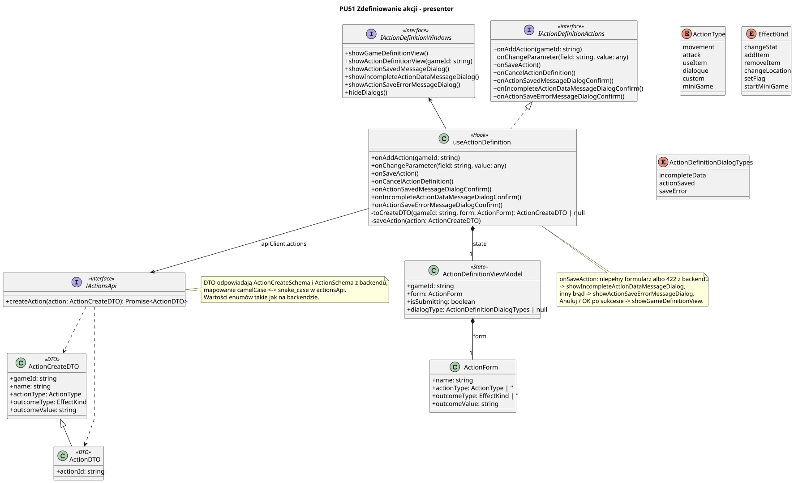

<div hidden>

```
@startuml action-definition-presenter
skinparam classAttributeIconSize 0
skinparam packageStyle rectangle
skinparam shadowing false
skinparam roundcorner 4
skinparam linetype polyline

title PU51 Zdefiniowanie akcji - presenter

class useActionDefinition <<Hook>> {
    + onAddAction(gameId: string)
    + onChangeParameter(field: string, value: any)
    + onSaveAction()
    + onIncompleteActionDataMessageDialogConfirm()
    + onActionSaveErrorMessageDialogConfirm()
    - toCreateDTO(gameId: string, form: ActionForm): ActionCreateDTO | null
    - saveAction(action: ActionCreateDTO)
}

interface IActionDefinitionActions <<interface>> {
    + onAddAction(gameId: string)
    + onChangeParameter(field: string, value: any)
    + onSaveAction()
    + onIncompleteActionDataMessageDialogConfirm()
    + onActionSaveErrorMessageDialogConfirm()
}

interface IActionDefinitionWindows <<interface>> {
    + showActionDefinitionView(gameId: string)
    + showActionSavedMessageDialog()
    + showIncompleteActionDataMessageDialog()
    + showActionSaveErrorMessageDialog()
    + hideDialogs()
}

interface IActionsApi <<interface>> {
    + createAction(action: ActionCreateDTO): Promise<ActionDTO>
}

class ActionDefinitionViewModel <<State>> {
    + gameId: string
    + form: ActionForm
    + isSubmitting: boolean
    + dialogType: ActionDefinitionDialogTypes | null
}

class ActionForm {
    + name: string
    + actionType: ActionType | ''
    + outcomeType: EffectKind | ''
    + outcomeValue: string
}

class ActionCreateDTO <<DTO>> {
    + gameId: string
    + name: string
    + actionType: ActionType
    + outcomeType: EffectKind
    + outcomeValue: string
}

class ActionDTO <<DTO>> {
    + actionId: string
}

enum ActionType {
    movement
    attack
    useItem
    dialogue
    custom
    miniGame
}

enum EffectKind {
    changeStat
    addItem
    removeItem
    changeLocation
    setFlag
    startMiniGame
}

enum ActionDefinitionDialogTypes {
    incompleteData
    actionSaved
    saveError
}

useActionDefinition .u.|> IActionDefinitionActions
useActionDefinition -u-> IActionDefinitionWindows
useActionDefinition --> IActionsApi : apiClient.actions
useActionDefinition *-- "1" ActionDefinitionViewModel : state
ActionDefinitionViewModel *-- "1" ActionForm : form
ActionDTO -u-|> ActionCreateDTO
IActionsApi ..> ActionCreateDTO
IActionsApi ..> ActionDTO

note bottom of useActionDefinition
    onSaveAction: niepełny formularz albo 422 z backendu
    -> showIncompleteActionDataMessageDialog,
    inny błąd -> showActionSaveErrorMessageDialog.
end note

note right of IActionsApi
    DTO odpowiadają ActionCreateSchema i ActionSchema z backendu,
    mapowanie camelCase <-> snake_case w actionsApi.
    Wartości enumów takie jak na backendzie.
end note
@enduml
```

</div>


