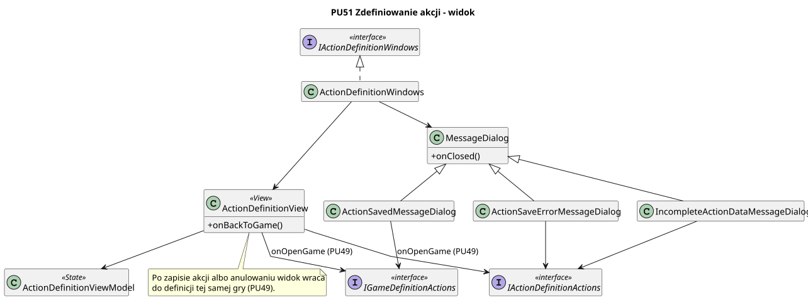

<div hidden>

```
@startuml action-definition-view
skinparam classAttributeIconSize 0
skinparam packageStyle rectangle
skinparam shadowing false
skinparam roundcorner 4
skinparam linetype polyline

title PU51 Zdefiniowanie akcji - widok

class GameDefinitionView {
    + onDefineActionClick()
}

class ActionDefinitionView {
    + show(form: ActionForm, isSubmitting: boolean)
    + onFieldChange(field: string, value: string)
    + onSaveAndCloseClick()
    + onCancelClick()
}

class MessageDialog {
    + show(title: string, message: string)
    + onOkClick()
}

interface IActionDefinitionActions <<interface>> {
    + onAddAction(gameId: string)
    + onChangeParameter(field: string, value: any)
    + onSaveAction()
    + onCancelActionDefinition()
    + onActionSavedMessageDialogConfirm()
    + onIncompleteActionDataMessageDialogConfirm()
    + onActionSaveErrorMessageDialogConfirm()
}

interface IActionDefinitionWindows <<interface>> {
    + showGameDefinitionView()
    + showActionDefinitionView(gameId: string)
    + showActionSavedMessageDialog()
    + showIncompleteActionDataMessageDialog()
    + showActionSaveErrorMessageDialog()
    + hideDialogs()
}

class ActionDefinitionWindows

ActionDefinitionWindows .u.|> IActionDefinitionWindows
ActionDefinitionWindows --> GameDefinitionView
ActionDefinitionWindows --> ActionDefinitionView
ActionDefinitionWindows --> MessageDialog

GameDefinitionView --> IActionDefinitionActions : "Zdefiniuj akcję"
ActionDefinitionView --> IActionDefinitionActions
MessageDialog --> IActionDefinitionActions

GameDefinitionView ..> ActionDefinitionView : "Zdefiniuj akcję"

note right of GameDefinitionView
    Powrót trafia do /creator/games/new - otwarcie tej samej gry
    wymaga wczytania gry po id w PU49 (TODO).
end note
@enduml
```

</div>


