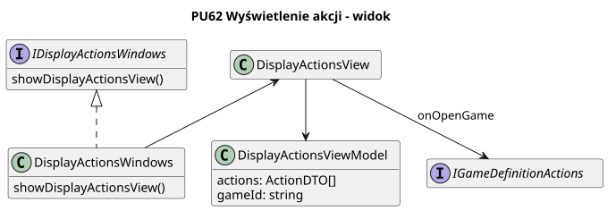

```
@startuml
skinparam classAttributeIconSize 0
skinparam nodesep 30
skinparam ranksep 40
hide empty members

title PU62 Wyświetlenie akcji - widok

class view as "DisplayActionsView"
interface game_definition_actions as "IGameDefinitionActions"

view --> game_definition_actions : onOpenGame

class windows as "DisplayActionsWindows" {
    showDisplayActionsView()
}
interface iwindows as "IDisplayActionsWindows" {
    showDisplayActionsView()
}

windows .u.|> iwindows
windows -u-> view

class vm as "DisplayActionsViewModel" {
    actions: ActionDTO[]
    gameId: string
}

view --> vm
@enduml
```


