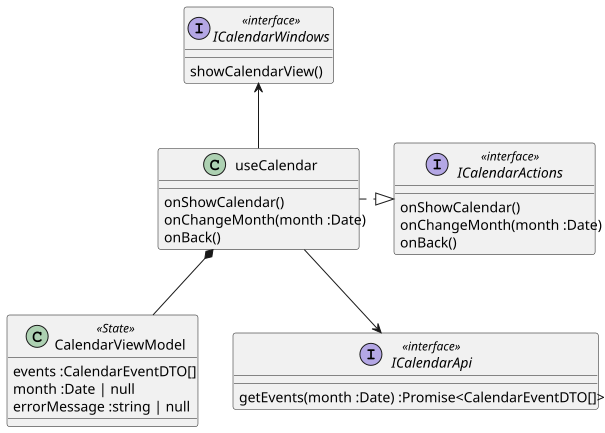

<div hidden>

```
@startuml calendar-presenter
skinparam classAttributeIconSize 0
skinparam packageStyle rectangle
skinparam shadowing false
skinparam roundcorner 4
skinparam linetype polyline
skinparam nodesep 30
skinparam ranksep 40
hide empty members

title PU1 Wyświetlanie kalendarza - presenter

interface ICalendarActions <<interface>> {
    + onShowCalendar()
    + onChangeMonth(month: Date)
    + onBack()
}

interface ICalendarWindows <<interface>> {
    + showCalendarView()
}

class useCalendar <<Hook>>

class CalendarViewModel <<State>> {
    + events: CalendarEventDTO[*]
    + month: Date | null
    + errorMessage: string | null
}

interface ICalendarApi <<interface>>
class CalendarEventDTO <<DTO>>

useCalendar .u.|> ICalendarActions
useCalendar -u-> ICalendarWindows
useCalendar *-- "1" CalendarViewModel : state
CalendarViewModel ..> CalendarEventDTO : events
useCalendar --> ICalendarApi : apiClient.calendar\ngetEvents

note right of useCalendar
    onChangeMonth woła kalendarz przy każdym pokazanym
    miesiącu (także przy pierwszym wyświetleniu), więc dane
    pobiera tylko CalendarView - inne widoki wołają jedynie
    onShowCalendar. Odpowiedzi dla miesiąca, z którego
    użytkownik już przeszedł, są ignorowane.
end note

note bottom of ICalendarApi
    DTO i porty API: interfaces.md
end note
@enduml
```

</div>


