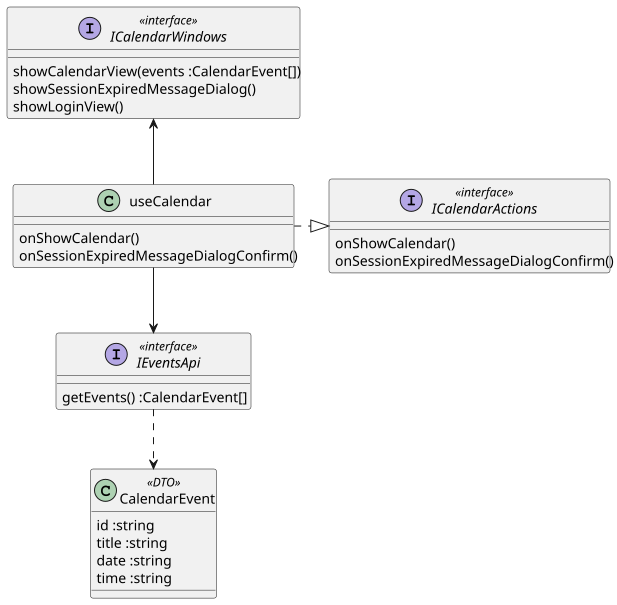

@startuml
class useCalendar {
onShowCalendar()
onSessionExpiredMessageDialogConfirm()
}

interface ICalendarActions <<interface>> {
onShowCalendar()
onSessionExpiredMessageDialogConfirm()
}

useCalendar .|> ICalendarActions

useCalendar --> IEventsApi
useCalendar -u-> ICalendarWindows

interface IEventsApi <<interface>> {
getEvents() :CalendarEvent[]
}

interface ICalendarWindows <<interface>> {
showCalendarView(events :CalendarEvent[])
showSessionExpiredMessageDialog()
showLoginView()
}

class CalendarEvent <<DTO>> {
id :string
title :string
date :string
time :string
}

IEventsApi ..> CalendarEvent
@enduml

