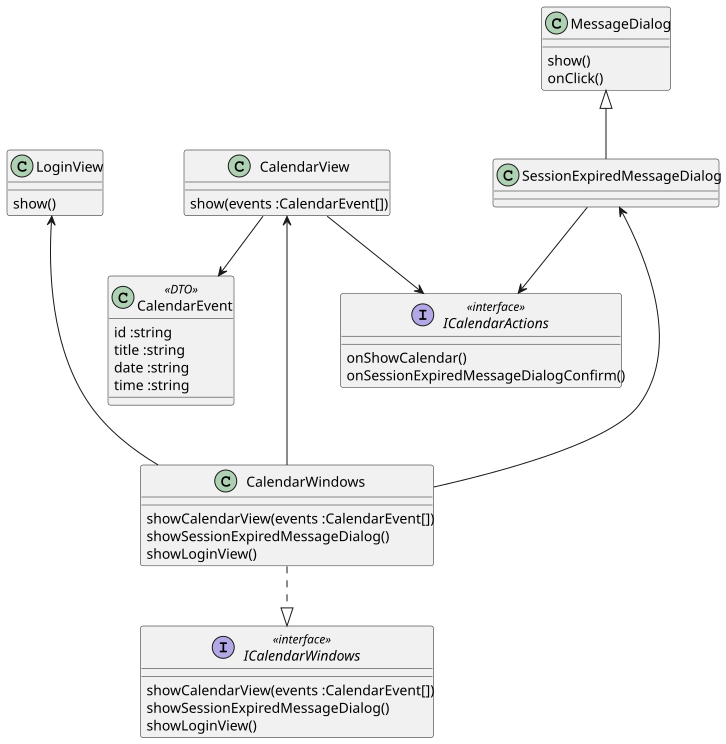

@startuml
class CalendarView {
show(events :CalendarEvent[])
}

class MessageDialog {
show()
onClick()
}

class SessionExpiredMessageDialog
SessionExpiredMessageDialog -u-|> MessageDialog

class LoginView {
show()
}

interface ICalendarActions <<interface>> {
onShowCalendar()
onSessionExpiredMessageDialogConfirm()
}

ICalendarActions <-u- CalendarView
ICalendarActions <-u- SessionExpiredMessageDialog

CalendarView --> CalendarEvent

class CalendarEvent <<DTO>> {
id :string
title :string
date :string
time :string
}

interface ICalendarWindows <<interface>> {
showCalendarView(events :CalendarEvent[])
showSessionExpiredMessageDialog()
showLoginView()
}

class CalendarWindows {
showCalendarView(events :CalendarEvent[])
showSessionExpiredMessageDialog()
showLoginView()
}

CalendarWindows .d.|> ICalendarWindows
CalendarWindows --u-> CalendarView
CalendarWindows --u-> SessionExpiredMessageDialog
CalendarWindows --u-> LoginView
@enduml

