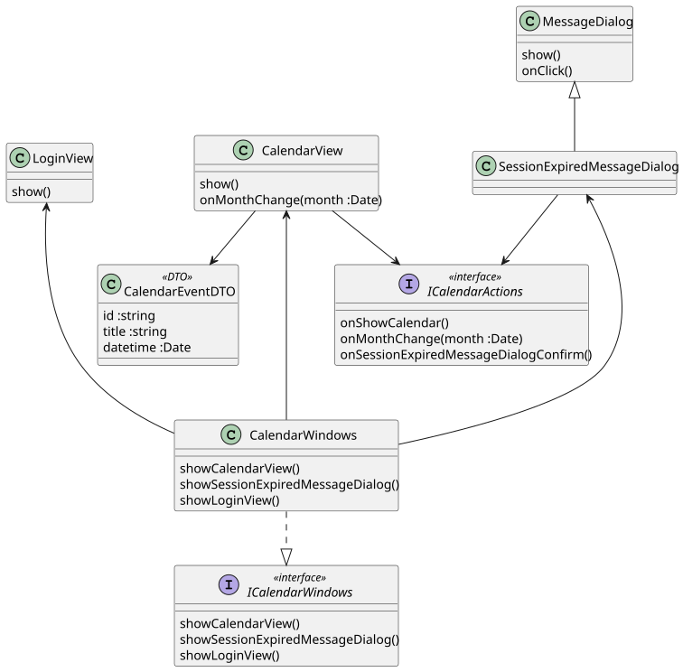

<div hidden>

```
@startuml calendar-view
skinparam classAttributeIconSize 0
skinparam packageStyle rectangle
skinparam shadowing false
skinparam roundcorner 4
skinparam linetype polyline
skinparam nodesep 30
skinparam ranksep 40
hide empty members

title PU1 Wyświetlanie kalendarza - widok

class Layout <<View>> {
    + onCalendarMenuClick()
}

class CalendarView <<View>> {
    + onRetryClick()
    + onBackClick()
}

class Calendar <<Component>> {
    + onMonthChange(month: Date)
}

class CalendarWindows
interface ICalendarWindows <<interface>>
interface ICalendarActions <<interface>>
class CalendarViewModel <<State>>

CalendarWindows .u.|> ICalendarWindows
CalendarWindows --> CalendarView

Layout --> ICalendarActions : "Kalendarz" - onShowCalendar
CalendarView *-- Calendar
CalendarView --> ICalendarActions
CalendarView --> CalendarViewModel
Calendar --> ICalendarActions : onChangeMonth

interface IReservationActions <<interface>>
CalendarView --> IReservationActions : wybór terminu - onOpenReservation (PU2)

note right of Calendar
    FullCalendar (widok miesiąca) - przy zmianie
    miesiąca zgłasza jego pierwszy dzień.
    "Dodaj wydarzenie" jest nieaktywne do czasu PU39.
end note
@enduml
```

</div>


