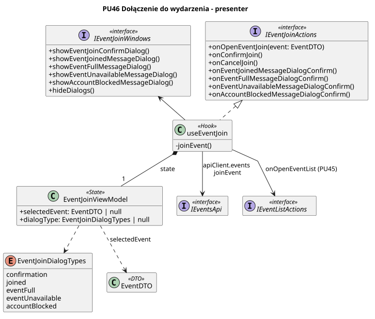

<div hidden>

```
@startuml event-join-presenter
skinparam classAttributeIconSize 0
skinparam packageStyle rectangle
skinparam shadowing false
skinparam roundcorner 4
skinparam linetype polyline
skinparam nodesep 30
skinparam ranksep 40
hide empty members

title PU46 Dołączenie do wydarzenia - presenter

interface IEventJoinActions <<interface>> {
    + onOpenEventJoin(event: CalendarEventDTO)
    + onConfirmJoin()
    + onCancelJoin()
    + onEventJoinedMessageDialogConfirm()
    + onAlreadyJoinedMessageDialogConfirm()
    + onEventFullMessageDialogConfirm()
    + onEventUnavailableMessageDialogConfirm()
    + onAccountBlockedMessageDialogConfirm()
}

interface IEventJoinWindows <<interface>> {
    + showEventJoinConfirmDialog()
    + showEventJoinedMessageDialog()
    + showAlreadyJoinedMessageDialog()
    + showEventFullMessageDialog()
    + showEventUnavailableMessageDialog()
    + showAccountBlockedMessageDialog()
    + hideDialogs()
}

class useEventJoin <<Hook>> {
    - openEventJoin(event: CalendarEventDTO)
    - joinEvent()
}

class EventJoinViewModel <<State>> {
    + selectedEvent: CalendarEventDTO | null
    + eventDetails: EventDTO | null
    + dialogType: EventJoinDialogTypes | null
}

enum EventJoinDialogTypes {
    confirmation
    joined
    alreadyJoined
    eventFull
    eventUnavailable
    accountBlocked
}

interface IEventsApi <<interface>>
class CalendarEventDTO <<DTO>>
class EventDTO <<DTO>>

useEventJoin .u.|> IEventJoinActions
useEventJoin -u-> IEventJoinWindows
useEventJoin *-- "1" EventJoinViewModel : state
EventJoinViewModel ..> EventJoinDialogTypes
EventJoinViewModel ..> CalendarEventDTO : selectedEvent
EventJoinViewModel ..> EventDTO : eventDetails
useEventJoin --> IEventsApi : apiClient.events\ngetEvent, joinEvent
@enduml
```

</div>


