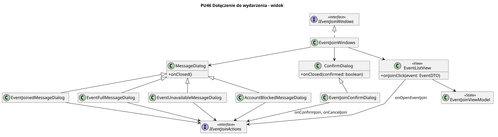

<div hidden>

```
@startuml event-join-view
skinparam classAttributeIconSize 0
skinparam packageStyle rectangle
skinparam shadowing false
skinparam roundcorner 4
skinparam linetype polyline
skinparam nodesep 30
skinparam ranksep 40
hide empty members

title PU46 Dołączenie do wydarzenia - widok

class EventListView <<View>> {
    + onJoinClick(event: EventDTO)
}

class ConfirmDialog {
    + onClosed(confirmed: boolean)
}

class MessageDialog {
    + onClosed()
}

class EventJoinConfirmDialog
class EventJoinedMessageDialog
class EventFullMessageDialog
class EventUnavailableMessageDialog
class AccountBlockedMessageDialog

EventJoinConfirmDialog -u-|> ConfirmDialog
EventJoinedMessageDialog -u-|> MessageDialog
EventFullMessageDialog -u-|> MessageDialog
EventUnavailableMessageDialog -u-|> MessageDialog
AccountBlockedMessageDialog -u-|> MessageDialog

class EventJoinWindows
interface IEventJoinWindows <<interface>>
interface IEventJoinActions <<interface>>

EventJoinWindows .u.|> IEventJoinWindows
EventJoinWindows --> ConfirmDialog
EventJoinWindows --> MessageDialog

EventListView --> IEventJoinActions : onOpenEventJoin
EventJoinConfirmDialog --> IEventJoinActions : onConfirmJoin, onCancelJoin
EventJoinedMessageDialog --> IEventJoinActions
EventFullMessageDialog --> IEventJoinActions
EventUnavailableMessageDialog --> IEventJoinActions
AccountBlockedMessageDialog --> IEventJoinActions

@enduml
```

</div>


