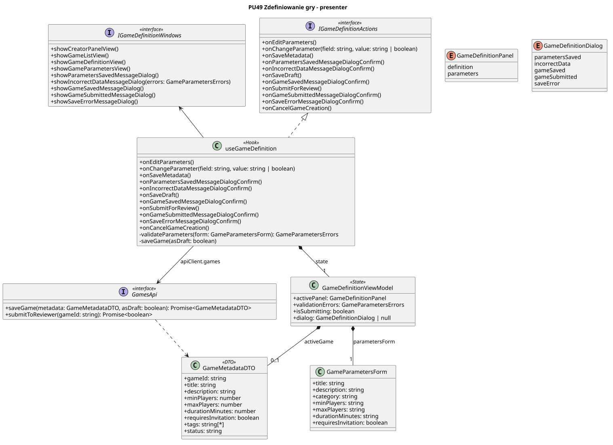

<div hidden>

```
@startuml game-definition-presenter
skinparam classAttributeIconSize 0
skinparam packageStyle rectangle
skinparam shadowing false
skinparam roundcorner 4
skinparam linetype polyline

title PU49 Zdefiniowanie gry - presenter

class useGameDefinition <<Hook>> {
    + onEditParameters()
    + onChangeParameter(field: string, value: string | boolean)
    + onSaveMetadata()
    + onParametersSavedMessageDialogConfirm()
    + onIncorrectDataMessageDialogConfirm()
    + onSaveDraft()
    + onGameSavedMessageDialogConfirm()
    + onSubmitForReview()
    + onGameSubmittedMessageDialogConfirm()
    + onSaveErrorMessageDialogConfirm()
    + onCancelGameCreation()
    - validateParameters(form: GameParametersForm): GameParametersErrors
    - saveGame(asDraft: boolean)
}

interface IGameDefinitionActions <<interface>> {
    + onEditParameters()
    + onChangeParameter(field: string, value: string | boolean)
    + onSaveMetadata()
    + onParametersSavedMessageDialogConfirm()
    + onIncorrectDataMessageDialogConfirm()
    + onSaveDraft()
    + onGameSavedMessageDialogConfirm()
    + onSubmitForReview()
    + onGameSubmittedMessageDialogConfirm()
    + onSaveErrorMessageDialogConfirm()
    + onCancelGameCreation()
}

interface IGameDefinitionWindows <<interface>> {
    + showCreatorPanelView()
    + showGameListView()
    + showGameDefinitionView()
    + showGameParametersView()
    + showParametersSavedMessageDialog()
    + showIncorrectDataMessageDialog(errors: GameParametersErrors)
    + showGameSavedMessageDialog()
    + showGameSubmittedMessageDialog()
    + showSaveErrorMessageDialog()
}

interface GamesApi <<interface>> {
    + saveGame(metadata: GameMetadataDTO, asDraft: boolean): Promise<GameMetadataDTO>
    + submitToReviewer(gameId: string): Promise<boolean>
}

class GameDefinitionViewModel <<State>> {
    + activePanel: GameDefinitionPanel
    + validationErrors: GameParametersErrors
    + isSubmitting: boolean
    + dialog: GameDefinitionDialog | null
}

enum GameDefinitionPanel {
    definition
    parameters
}

enum GameDefinitionDialog {
    parametersSaved
    incorrectData
    gameSaved
    gameSubmitted
    saveError
}

class GameParametersForm {
    + title: string
    + description: string
    + category: string
    + minPlayers: string
    + maxPlayers: string
    + durationMinutes: string
    + requiresInvitation: boolean
}

class GameMetadataDTO <<DTO>> {
    + gameId: string
    + title: string
    + description: string
    + minPlayers: number
    + maxPlayers: number
    + durationMinutes: number
    + requiresInvitation: boolean
    + tags: string[*]
    + status: string
}

useGameDefinition .u.|> IGameDefinitionActions
useGameDefinition -u-> IGameDefinitionWindows
useGameDefinition --> GamesApi : apiClient.games
useGameDefinition *-- "1" GameDefinitionViewModel : state

GameDefinitionViewModel *-- "1" GameParametersForm : parametersForm
GameDefinitionViewModel *-- "0..1" GameMetadataDTO : activeGame
GamesApi ..> GameMetadataDTO
@enduml
```

</div>


