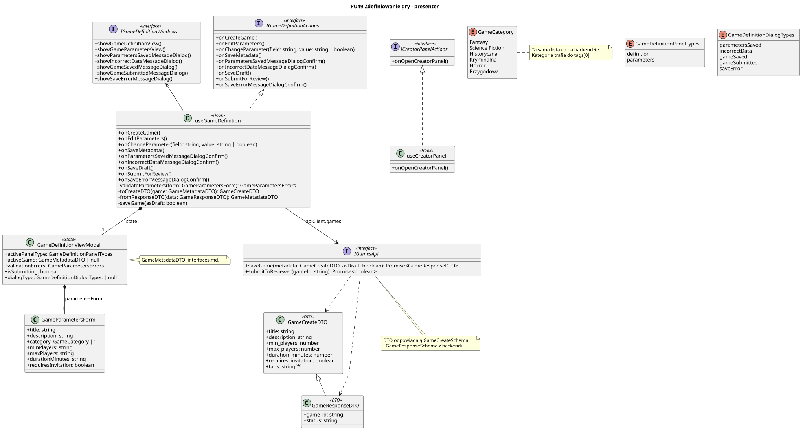

<div hidden>

```
@startuml game-definition-presenter
skinparam classAttributeIconSize 0
skinparam packageStyle rectangle
skinparam shadowing false
skinparam roundcorner 4
skinparam linetype polyline

title PU49 Zdefiniowanie gry - presenter

class useGameDefinition <<Hook>> {
    + onCreateGame()
    + onEditParameters()
    + onChangeParameter(field: string, value: string | boolean)
    + onSaveMetadata()
    + onParametersSavedMessageDialogConfirm()
    + onIncorrectDataMessageDialogConfirm()
    + onSaveDraft()
    + onSubmitForReview()
    + onSaveErrorMessageDialogConfirm()
    - validateParameters(form: GameParametersForm): GameParametersErrors
    - toCreateDTO(game: GameMetadataDTO): GameCreateDTO
    - fromResponseDTO(data: GameResponseDTO): GameMetadataDTO
    - saveGame(asDraft: boolean)
}

interface IGameDefinitionActions <<interface>> {
    + onCreateGame()
    + onEditParameters()
    + onChangeParameter(field: string, value: string | boolean)
    + onSaveMetadata()
    + onParametersSavedMessageDialogConfirm()
    + onIncorrectDataMessageDialogConfirm()
    + onSaveDraft()
    + onSubmitForReview()
    + onSaveErrorMessageDialogConfirm()
}

interface IGameDefinitionWindows <<interface>> {
    + showGameDefinitionView()
    + showGameParametersView()
    + showParametersSavedMessageDialog()
    + showIncorrectDataMessageDialog()
    + showGameSavedMessageDialog()
    + showGameSubmittedMessageDialog()
    + showSaveErrorMessageDialog()
}

interface ICreatorPanelActions <<interface>> {
    + onOpenCreatorPanel()
}

class useCreatorPanel <<Hook>> {
    + onOpenCreatorPanel()
}

interface IGamesApi <<interface>> {
    + saveGame(userId: string, metadata: GameCreateDTO, asDraft: boolean): Promise<GameResponseDTO>
    + editGame(gameId: string, userId: string, metadata: GameCreateDTO, asDraft: boolean): Promise<GameResponseDTO>
    + submitToReviewer(gameId: string, userId: string): Promise<boolean>
}

class GameCreateDTO <<DTO>> {
    + title: string
    + description: string
    + min_players: number
    + max_players: number
    + duration_minutes: number
    + requires_invitation: boolean
    + tags: string[*]
}

class GameResponseDTO <<DTO>> {
    + game_id: string
    + status: string
}

class GameDefinitionViewModel <<State>> {
    + activePanelType: GameDefinitionPanelTypes
    + activeGame: GameMetadataDTO | null
    + validationErrors: GameParametersErrors
    + isSubmitting: boolean
    + dialogType: GameDefinitionDialogTypes | null
}

enum GameDefinitionPanelTypes {
    definition
    parameters
}

enum GameDefinitionDialogTypes {
    parametersSaved
    incorrectData
    gameSaved
    gameSubmitted
    saveError
}

class GameParametersForm {
    + title: string
    + description: string
    + category: GameCategory | ''
    + minPlayers: string
    + maxPlayers: string
    + durationMinutes: string
    + requiresInvitation: boolean
}

enum GameCategory {
    Fantasy
    Science Fiction
    Historyczna
    Kryminalna
    Horror
    Przygodowa
}

useGameDefinition .u.|> IGameDefinitionActions
useGameDefinition -u-> IGameDefinitionWindows
useCreatorPanel .u.|> ICreatorPanelActions
useGameDefinition --> IGamesApi : apiClient.games
useGameDefinition *-- "1" GameDefinitionViewModel : state

GameDefinitionViewModel *-- "1" GameParametersForm : parametersForm
GameResponseDTO -u-|> GameCreateDTO
IGamesApi ..> GameCreateDTO
IGamesApi ..> GameResponseDTO

note right of GameDefinitionViewModel
    GameMetadataDTO: interfaces.md.
end note

note right of GameCategory
    Ta sama lista co na backendzie.
    Kategoria trafia do tags[0].
end note

note bottom of IGamesApi
    DTO odpowiadają GameCreateSchema
    i GameResponseSchema z backendu.
    userId to parametr user_id, do czasu
    logowania brany z ENV (VITE_DEV_USER_ID).
end note
@enduml
```

</div>


