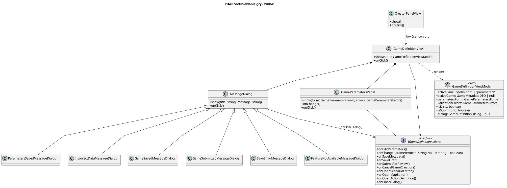

<div hidden>

```
@startuml game-definition-view
skinparam classAttributeIconSize 0
skinparam packageStyle rectangle
skinparam shadowing false
skinparam roundcorner 4
skinparam linetype polyline

title PU49 Zdefiniowanie gry - widok

class CreatorPanelView {
    + show()
    + onClick()
}

class GameDefinitionView {
    + show(state: GameDefinitionViewModel)
    + onClick()
}

class GameParametersPanel {
    + show(form: GameParametersForm, errors: GameParametersErrors)
    + onChange()
    + onClick()
}

class MessageDialog {
    + show(title: string, message: string)
    + onClick()
}

class ParametersSavedMessageDialog
class IncorrectDataMessageDialog
class GameSavedMessageDialog
class GameSubmittedMessageDialog
class SaveErrorMessageDialog
class FeatureNotAvailableMessageDialog

ParametersSavedMessageDialog -u-|> MessageDialog
IncorrectDataMessageDialog -u-|> MessageDialog
GameSavedMessageDialog -u-|> MessageDialog
GameSubmittedMessageDialog -u-|> MessageDialog
SaveErrorMessageDialog -u-|> MessageDialog
FeatureNotAvailableMessageDialog -u-|> MessageDialog

interface IGameDefinitionActions <<interface>> {
    + onEditParameters()
    + onChangeParameter(field: string, value: string | boolean)
    + onSaveMetadata()
    + onSaveDraft()
    + onSubmitForReview()
    + onCancelGameCreation()
    + onOpenScenarioEditor()
    + onOpenMapEditor()
    + onOpenActionDefinition()
    + onCloseDialog()
}

class GameDefinitionViewModel <<State>> {
    + activePanel: "definition" | "parameters"
    + activeGame: GameMetadataDTO | null
    + parametersForm: GameParametersForm
    + validationErrors: GameParametersErrors
    + isDirty: boolean
    + isSubmitting: boolean
    + dialog: GameDefinitionDialog | null
}

CreatorPanelView ..> GameDefinitionView : "Utwórz nową grę"
GameDefinitionView *-- GameParametersPanel
GameDefinitionView *-- MessageDialog
GameDefinitionView ..> GameDefinitionViewModel : renders

GameDefinitionView --> IGameDefinitionActions
GameParametersPanel --> IGameDefinitionActions
MessageDialog --> IGameDefinitionActions : onCloseDialog()
@enduml
```

</div>


