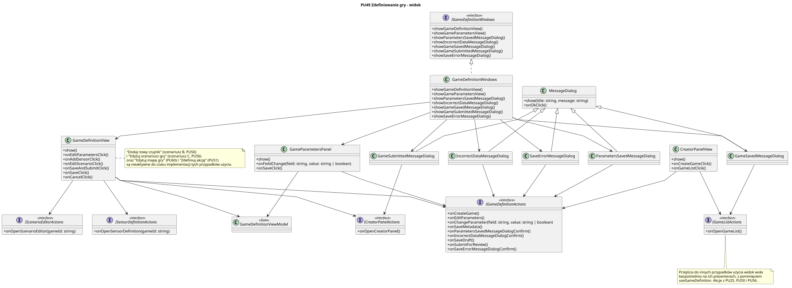

<div hidden>

```
@startuml game-definition-view
skinparam classAttributeIconSize 0
skinparam packageStyle rectangle
skinparam shadowing false
skinparam roundcorner 4
skinparam linetype polyline

title PU49 Zdefiniowanie gry - widok

class CreatorPanelView {
    + show()
    + onCreateGameClick()
    + onGameListClick()
}

class GameDefinitionView {
    + show()
    + onEditParametersClick()
    + onAddSensorClick()
    + onEditScenarioClick()
    + onSaveAndSubmitClick()
    + onSaveClick()
    + onCancelClick()
}

class GameParametersPanel {
    + show()
    + onFieldChange(field: string, value: string | boolean)
    + onSaveClick()
}

class MessageDialog {
    + show(title: string, message: string)
    + onOkClick()
}

class ParametersSavedMessageDialog
class IncorrectDataMessageDialog
class GameSavedMessageDialog
class GameSubmittedMessageDialog
class SaveErrorMessageDialog

ParametersSavedMessageDialog -u-|> MessageDialog
IncorrectDataMessageDialog -u-|> MessageDialog
GameSavedMessageDialog -u-|> MessageDialog
GameSubmittedMessageDialog -u-|> MessageDialog
SaveErrorMessageDialog -u-|> MessageDialog

interface IGameDefinitionActions <<interface>> {
    + onCreateGame()
    + onEditParameters()
    + onChangeParameter(field: string, value: string | boolean)
    + onSaveMetadata()
    + onParametersSavedMessageDialogConfirm()
    + onIncorrectDataMessageDialogConfirm()
    + onSaveDraft()
    + onSubmitForReview()
    + onSaveErrorMessageDialogConfirm()
}

interface ICreatorPanelActions <<interface>> {
    + onOpenCreatorPanel()
}

interface IGameListActions <<interface>> {
    + onOpenGameList()
}

interface IScenarioEditorActions <<interface>> {
    + onOpenScenarioEditor(gameId: string)
}

interface ISensorDefinitionActions <<interface>> {
    + onOpenSensorDefinition(gameId: string)
}

class GameDefinitionViewModel <<State>>

CreatorPanelView --> IGameDefinitionActions
CreatorPanelView --> IGameListActions
GameDefinitionView --> IGameDefinitionActions
GameDefinitionView --> ICreatorPanelActions
GameDefinitionView --> IScenarioEditorActions
GameDefinitionView --> ISensorDefinitionActions
GameDefinitionView --> GameDefinitionViewModel
GameParametersPanel --> IGameDefinitionActions
GameParametersPanel --> GameDefinitionViewModel
ParametersSavedMessageDialog --> IGameDefinitionActions
IncorrectDataMessageDialog --> IGameDefinitionActions
GameSavedMessageDialog --> IGameListActions
GameSubmittedMessageDialog --> ICreatorPanelActions
SaveErrorMessageDialog --> IGameDefinitionActions

interface IGameDefinitionWindows <<interface>> {
    + showGameDefinitionView()
    + showGameParametersView()
    + showParametersSavedMessageDialog()
    + showIncorrectDataMessageDialog()
    + showGameSavedMessageDialog()
    + showGameSubmittedMessageDialog()
    + showSaveErrorMessageDialog()
}

class GameDefinitionWindows {
    + showGameDefinitionView()
    + showGameParametersView()
    + showParametersSavedMessageDialog()
    + showIncorrectDataMessageDialog()
    + showGameSavedMessageDialog()
    + showGameSubmittedMessageDialog()
    + showSaveErrorMessageDialog()
}

GameDefinitionWindows .u.|> IGameDefinitionWindows

GameDefinitionWindows --> GameDefinitionView
GameDefinitionWindows --> GameParametersPanel
GameDefinitionWindows --> ParametersSavedMessageDialog
GameDefinitionWindows --> IncorrectDataMessageDialog
GameDefinitionWindows --> GameSavedMessageDialog
GameDefinitionWindows --> GameSubmittedMessageDialog
GameDefinitionWindows --> SaveErrorMessageDialog

note bottom of IGameListActions
    Przejścia do innych przypadków użycia widok woła
    bezpośrednio na ich prezenterach, z pominięciem
    useGameDefinition. Akcje z PU25, PU50 i PU56.
end note

note right of GameDefinitionView
    "Dodaj nowy czujnik" (scenariusz B, PU50)
    i "Edytuj scenariusz gry" (scenariusz C, PU56)
    oraz "Edytuj mapę gry" (PU60) i "Zdefiniuj akcję" (PU51)
    są nieaktywne do czasu implementacji tych przypadków użycia.
end note
@enduml
```

</div>


