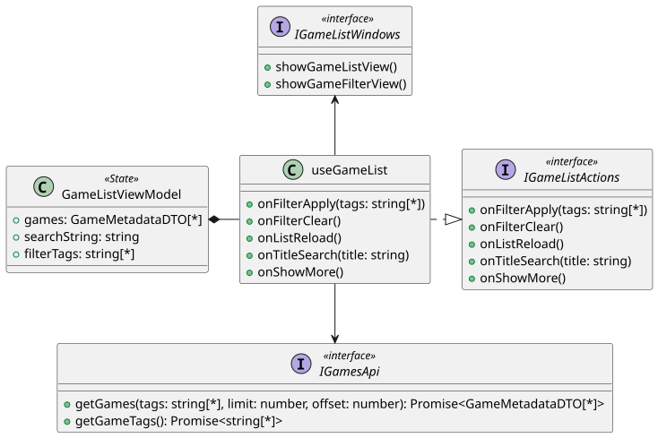

```
@startuml
interface IGameListActions <<interface>> {
    +onFilterApply(tags: string[*])
    +onFilterClear()
    +onListReload()
    +onTitleSearch(title: string)
    +onShowMore()
}

interface IGamesApi <<interface>> {
    +getGames(tags: string[*], limit: number, offset: number): Promise<GameMetadataDTO[*]>
    +getGameTags(): Promise<string[*]>
}

interface IGameListWindows <<interface>> {
    +showGameListView()
    +showGameFilterView()
}

class useGameList {
    +onFilterApply(tags: string[*])
    +onFilterClear()
    +onListReload()
    +onTitleSearch(title: string)
    +onShowMore()
}

class GameListViewModel <<State>> {
    +games: GameMetadataDTO[*]
    +searchString: string
    +filterTags: string[*]
}

useGameList -u-> IGameListWindows
useGameList .|> IGameListActions
useGameList -->  IGamesApi
GameListViewModel *- useGameList

@enduml
```


