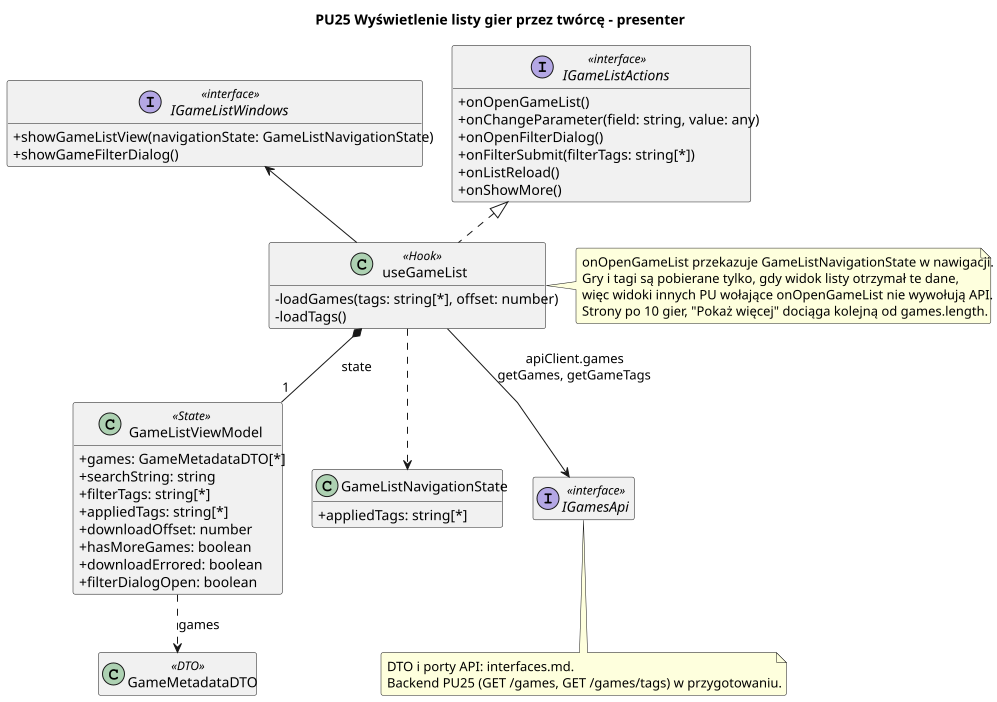

```
@startuml
interface IGameListActions <<interface>> {
    +onChangeParameter(field: string, value: any)
    +onFilterSubmit(filterTags: string[*])
    +onListReload()
    +onShowMore()
    +onOpenGameList()
    +onOpenFilterDialog()
}

interface IGamesApi <<interface>> {
    +getGames(userId: string, tags: string[*], limit: number, offset: number): Promise<GameMetadataDTO[*]>
    +getGameTags(): Promise<string[*]>
}

interface IGameListWindows <<interface>> {
    +showGameListView(navigationState: GameListNavigationState)
    +showGameFilterDialog()
}

class useGameList {
    +onChangeParameter(field: string, value: any)
    +onFilterSubmit(filterTags: string[*])
    +onListReload()
    +onShowMore()
    +onOpenGameList()
    +onOpenFilterDialog()
}

class GameListViewModel <<State>> {
    +games: GameMetadataDTO[*]
    +searchString: string
    +filterTags: string[*]
    +appliedTags: string[*]
    +downloadOffset: number
    +hasMoreGames: boolean
    +downloadErrored: boolean
    +filterDialogOpen: boolean
}

class GameListNavigationState {
    +appliedTags: string[*]
}

useGameList -u-> IGameListWindows
useGameList .|> IGameListActions
useGameList -->  IGamesApi
GameListViewModel *- useGameList
useGameList ..> GameListNavigationState

@enduml
```


