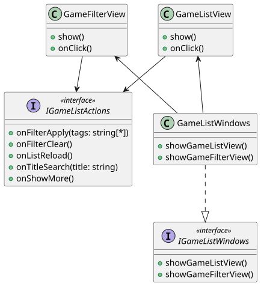

```
@startuml

interface IGameListWindows <<interface>> {
    +showGameListView()
    +showGameFilterView()
}

interface IGameListActions <<interface>> {
    +onFilterApply(tags: string[*])
    +onFilterClear()
    +onListReload()
    +onTitleSearch(title: string)
    +onShowMore()
}

class GameListWindows {
    +showGameListView()
    +showGameFilterView()
}

class GameListView {
    +show()
    +onClick()
}

class GameFilterView {
    +show()
    +onClick()
}

GameListWindows ..|> IGameListWindows
GameListWindows -u-> GameListView
GameListWindows -u-> GameFilterView

GameListView --> IGameListActions
GameFilterView --> IGameListActions

@enduml
```


