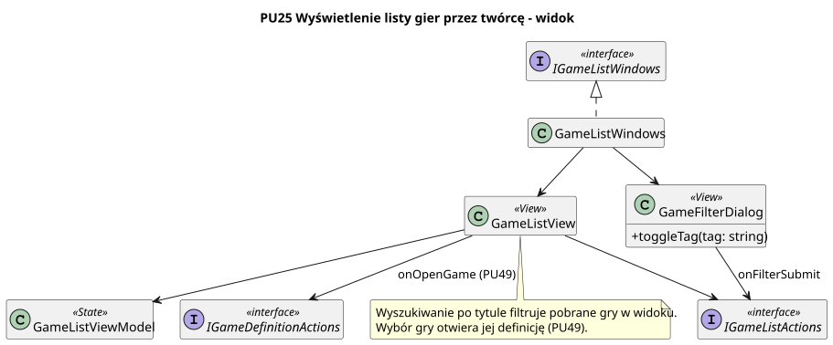

```
@startuml

interface IGameListWindows <<interface>> {
    +showGameListView(navigationState: GameListNavigationState)
    +showGameFilterDialog()
}

interface IGameListActions <<interface>> {
    +onChangeParameter(field: string, value: any)
    +onFilterSubmit(filterTags: string[*])
    +onListReload()
    +onShowMore()
    +onOpenGameList()
    +onOpenFilterDialog()
}

class GameListWindows {
    +showGameListView(navigationState: GameListNavigationState)
    +showGameFilterDialog()
}

class GameListView {
    +show()
    +onClick()
}

class GameFilterDialog {
    +show()
    +onClick()
}

GameListWindows ..|> IGameListWindows
GameListWindows -u-> GameListView
GameListWindows -u-> GameFilterDialog

GameListView --> IGameListActions

interface IGameDefinitionActions <<interface>> {
    +onOpenGame(gameId: string)
}

GameListView --> IGameDefinitionActions : wybór gry (PU49)
GameFilterDialog --> IGameListActions

@enduml
```


