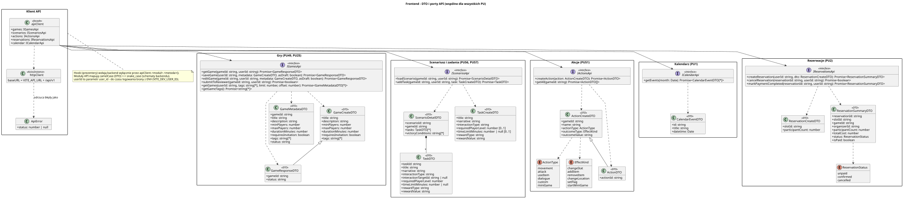

<div hidden>

```
@startuml interfaces
skinparam classAttributeIconSize 0
skinparam packageStyle rectangle
skinparam shadowing false
skinparam roundcorner 4
skinparam linetype polyline
skinparam nodesep 30
skinparam ranksep 40
hide empty members

title Frontend - DTO i porty API (wspólne dla wszystkich PU)

package "Gry (PU49, PU25)" as P_Games {
    class GameCreateDTO <<DTO>> {
        + title: string
        + description: string
        + minPlayers: number
        + maxPlayers: number
        + durationMinutes: number
        + requiresInvitation: boolean
        + tags: string[*]
    }

    class GameResponseDTO <<DTO>> {
        + gameId: string
        + status: string
    }

    class GameMetadataDTO <<DTO>> {
        + gameId: string
        + title: string
        + description: string
        + minPlayers: number
        + maxPlayers: number
        + durationMinutes: number
        + requiresInvitation: boolean
        + tags: string[*]
        + status: string
    }

    interface IGamesApi <<interface>> {
        + getGame(gameId: string, userId: string): Promise<GameResponseDTO>
        + saveGame(userId: string, metadata: GameCreateDTO, asDraft: boolean): Promise<GameResponseDTO>
        + editGame(gameId: string, userId: string, metadata: GameCreateDTO, asDraft: boolean): Promise<GameResponseDTO>
        + submitToReviewer(gameId: string, userId: string): Promise<boolean>
        + getGames(userId: string, tags: string[*], limit: number, offset: number): Promise<GameMetadataDTO[*]>
        + getGameTags(): Promise<string[*]>
    }

    GameResponseDTO -u-|> GameCreateDTO
    IGamesApi ..> GameCreateDTO
    IGamesApi ..> GameResponseDTO
    IGamesApi ..> GameMetadataDTO
}

package "Scenariusz i zadania (PU56, PU57)" as P_Scenario {
    class ScenarioDetailDTO <<DTO>> {
        + scenarioId: string
        + gameId: string
        + tasks: TaskDTO[*]
        + victoryConditions: string[*]
    }

    class TaskDTO <<DTO>> {
        + taskId: string
        + title: string
        + narrative: string
        + interactionType: string
        + interactionTargetId: string | null
        + requiredPlayerLevel: number
        + timeLimitMinutes: number | null
        + rewardType: string
        + rewardValue: string
    }

    class TaskCreateDTO <<DTO>> {
        + title: string
        + narrative: string
        + interactionType: string
        + requiredPlayerLevel: number [0..1]
        + timeLimitMinutes: number | null [0..1]
        + rewardType: string
        + rewardValue: string
    }

    interface IScenariosApi <<interface>> {
        + loadScenario(gameId: string, userId: string): Promise<ScenarioDetailDTO>
        + addTask(gameId: string, userId: string, task: TaskCreateDTO): Promise<TaskDTO>
    }

    ScenarioDetailDTO *-- "*" TaskDTO
    IScenariosApi ..> ScenarioDetailDTO
    IScenariosApi ..> TaskCreateDTO
}

package "Akcje (PU51)" as P_Actions {
    class ActionCreateDTO <<DTO>> {
        + gameId: string
        + name: string
        + actionType: ActionType
        + outcomeType: EffectKind
        + outcomeValue: string
    }

    class ActionDTO <<DTO>> {
        + actionId: string
    }

    enum ActionType {
        movement
        attack
        useItem
        dialogue
        custom
        miniGame
    }

    enum EffectKind {
        changeStat
        addItem
        removeItem
        changeLocation
        setFlag
        startMiniGame
    }

    interface IActionsApi <<interface>> {
        + createAction(action: ActionCreateDTO): Promise<ActionDTO>
        + getAll(gameId: string): Promise<ActionDTO[]>
    }

    ActionDTO -u-|> ActionCreateDTO
    ActionCreateDTO ..> ActionType
    ActionCreateDTO ..> EffectKind
    IActionsApi ..> ActionCreateDTO
    IActionsApi ..> ActionDTO
}

package "Kalendarz (PU1)" as P_Calendar {
    class CalendarEventDTO <<DTO>> {
        + id: string
        + title: string
        + datetime: Date
    }

    interface ICalendarApi <<interface>> {
        + getEvents(month: Date): Promise<CalendarEventDTO[*]>
    }

    ICalendarApi ..> CalendarEventDTO
}

package "Rezerwacje (PU2)" as P_Reservations {
    class ReservationCreateDTO <<DTO>> {
        + slotId: string
        + participantCount: number
    }

    class ReservationSummaryDTO <<DTO>> {
        + reservationId: string
        + slotId: string
        + gameId: string
        + organizerId: string
        + participantCount: number
        + totalCost: number
        + status: ReservationStatus
        + isPaid: boolean
    }

    enum ReservationStatus {
        unpaid
        confirmed
        cancelled
    }

    interface IReservationsApi <<interface>> {
        + createReservation(userId: string, dto: ReservationCreateDTO): Promise<ReservationSummaryDTO>
        + cancelReservation(reservationId: string, userId: string): Promise<boolean>
        + markPaymentCompleted(reservationId: string, userId: string): Promise<ReservationSummaryDTO>
    }

    ReservationSummaryDTO ..> ReservationStatus
    IReservationsApi ..> ReservationCreateDTO
    IReservationsApi ..> ReservationSummaryDTO
}

package "Klient API" as P_Client {
    class apiClient <<facade>> {
        + games: IGamesApi
        + scenarios: IScenariosApi
        + actions: IActionsApi
        + reservations: IReservationsApi
        + calendar: ICalendarApi
    }

    class httpClient <<AxiosInstance>> {
        baseURL = VITE_API_URL + /api/v1
    }

    class ApiError {
        + status: number | null
    }

    apiClient ..> httpClient
    httpClient ..> ApiError : odrzuca błędy jako
}

apiClient --> IGamesApi
apiClient --> IScenariosApi
apiClient --> IActionsApi
apiClient --> IReservationsApi
apiClient --> ICalendarApi

note bottom of P_Client
    Hooki (prezentery) wołają backend wyłącznie przez apiClient.<moduł>.<metoda>().
    Moduły API mapują camelCase (DTO) <-> snake_case (schematy backendu).
    userId to parametr user_id - do czasu logowania brany z ENV (VITE_DEV_USER_ID).
end note
@enduml
```

</div>


