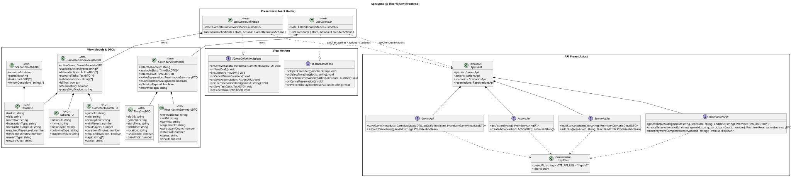

<div hidden>

```
@startuml interfaces
skinparam classAttributeIconSize 0
skinparam packageStyle rectangle
skinparam shadowing false
skinparam roundcorner 4
skinparam nodesep 26
skinparam ranksep 34
skinparam linetype polyline

title Specyfikacja interfejsów (frontend)

package "View Models & DTOs" {
    class GameMetadataDTO <<DTO>> {
        + gameId: string
        + title: string
        + description: string
        + minPlayers: number
        + maxPlayers: number
        + durationMinutes: number
        + requiresInvitation: boolean
        + tags: string[*]
        + status: string
    }

    class TaskDTO <<DTO>> {
        + taskId: string
        + title: string
        + narrative: string
        + interactionType: string
        + interactionTargetId: string
        + requiredPlayerLevel: number
        + timeLimitMinutes: number
        + rewardType: string
        + rewardValue: string
    }

    class ActionDTO <<DTO>> {
        + actionId: string
        + name: string
        + actionType: string
        + outcomeType: string
        + outcomeValue: string
    }

    class TimeSlotDTO <<DTO>> {
        + slotId: string
        + gameId: string
        + startTime: string
        + endTime: string
        + location: string
        + isAvailable: boolean
        + basePrice: number
    }

    class ScenarioDetailDTO <<DTO>> {
        + scenarioId: string
        + gameId: string
        + tasks: TaskDTO[*]
        + victoryConditions: string[*]
    }

    class ReservationSummaryDTO <<DTO>> {
        + reservationId: string
        + slotId: string
        + gameId: string
        + organizerId: string
        + participantCount: number
        + totalCost: number
        + status: string
        + isPaid: boolean
    }

    class GameDefinitionViewModel <<State>> {
        + activeGame: GameMetadataDTO
        + availableActionTypes: string[*]
        + definedActions: ActionDTO[*]
        + scenarioTasks: TaskDTO[*]
        + validationErrors: string[*]
        + isDirty: boolean
        + isSubmitting: boolean
        + statusNotification: string
    }

    class CalendarViewModel <<State>> {
        + selectedGameId: string
        + availableSlots: TimeSlotDTO[*]
        + selectedSlot: TimeSlotDTO
        + activeReservation: ReservationSummaryDTO
        + isConfirmationDialogOpen: boolean
        + isSessionExpired: boolean
        + errorMessage: string
    }
}

package "View Actions" {
    interface IGameDefinitionActions {
        + onSaveMetadata(metadata: GameMetadataDTO): void
        + onSaveDraft(): void
        + onSubmitForReview(): void
        + onCancelGameCreation(): void
        + onSaveAction(action: ActionDTO): void
        + onOpenScenarioEditor(gameId: string): void
        + onSaveTask(task: TaskDTO): void
        + onCancelTaskDefinition(): void
    }

    interface ICalendarActions {
        + onOpenCalendar(gameId: string): void
        + onSelectTimeSlot(slotId: string): void
        + onConfirmReservation(participantCount: number): void
        + onCancelReservation(): void
        + onProceedToPayment(reservationId: string): void
    }
}

package "Presenters (React Hooks)" {
    class useGameDefinition <<Hook>> {
        - state: GameDefinitionViewModel <<useState>>
        + useGameDefinition(): { state, actions: IGameDefinitionActions }
    }

    class useCalendar <<Hook>> {
        - state: CalendarViewModel <<useState>>
        + useCalendar(): { state, actions: ICalendarActions }
    }
}

package "API Proxy (Axios)" {
    class httpClient <<AxiosInstance>> {
        + baseURL: string = VITE_API_URL + "/api/v1"
        + interceptors
    }

    class apiClient <<Singleton>> {
        + games: GamesApi
        + actions: ActionsApi
        + scenarios: ScenariosApi
        + reservations: ReservationsApi
    }

    interface GamesApi {
        + saveGame(metadata: GameMetadataDTO, asDraft: boolean): Promise<GameMetadataDTO>
        + submitToReviewer(gameId: string): Promise<boolean>
    }

    interface ActionsApi {
        + getActionTypes(): Promise<string[*]>
        + createAction(action: ActionDTO): Promise<string>
    }

    interface ScenariosApi {
        + loadScenario(gameId: string): Promise<ScenarioDetailDTO>
        + addTask(scenarioId: string, task: TaskDTO): Promise<boolean>
    }

    interface ReservationsApi {
        + getAvailableSlots(gameId: string, startDate: string, endDate: string): Promise<TimeSlotDTO[*]>
        + createReservation(slotId: string, gameId: string, participantCount: number): Promise<ReservationSummaryDTO>
        + markPaymentCompleted(reservationId: string): Promise<boolean>
    }
}

useGameDefinition ..|> IGameDefinitionActions
useCalendar ..|> ICalendarActions
useGameDefinition *-- GameDefinitionViewModel : owns
useCalendar *-- CalendarViewModel : owns

useGameDefinition ..> apiClient : apiClient.games / actions / scenarios
useCalendar ..> apiClient : apiClient.reservations

apiClient *-- GamesApi
apiClient *-- ActionsApi
apiClient *-- ScenariosApi
apiClient *-- ReservationsApi
GamesApi ..> httpClient
ActionsApi ..> httpClient
ScenariosApi ..> httpClient
ReservationsApi ..> httpClient

GameDefinitionViewModel *-- GameMetadataDTO
GameDefinitionViewModel *-- ActionDTO
GameDefinitionViewModel *-- TaskDTO
ScenarioDetailDTO *-- TaskDTO
CalendarViewModel *-- TimeSlotDTO
CalendarViewModel *-- ReservationSummaryDTO

@enduml
```

</div>


