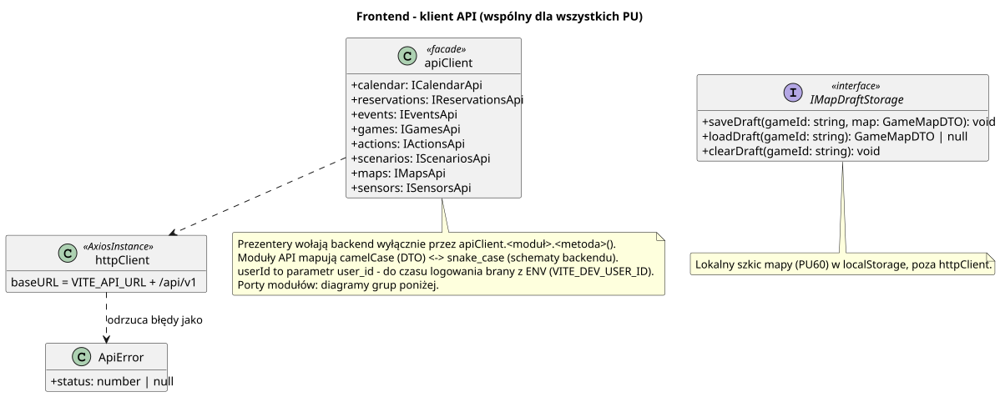
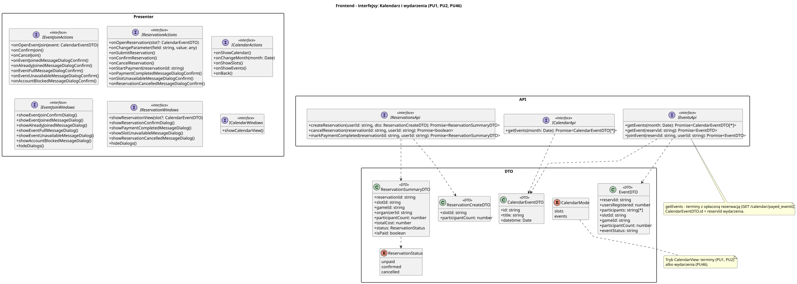
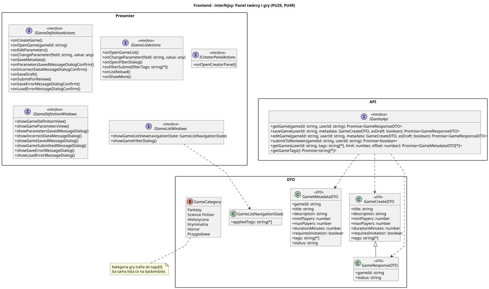
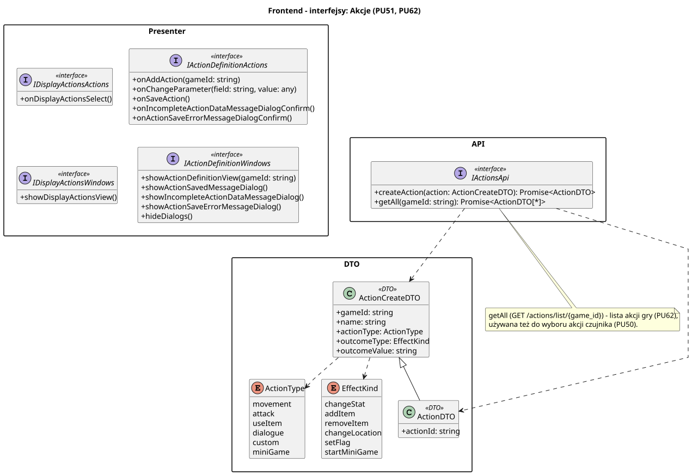
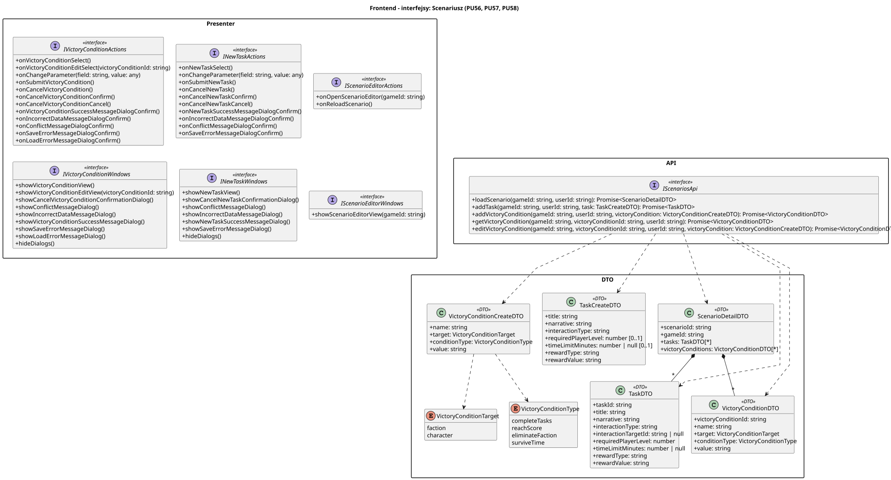
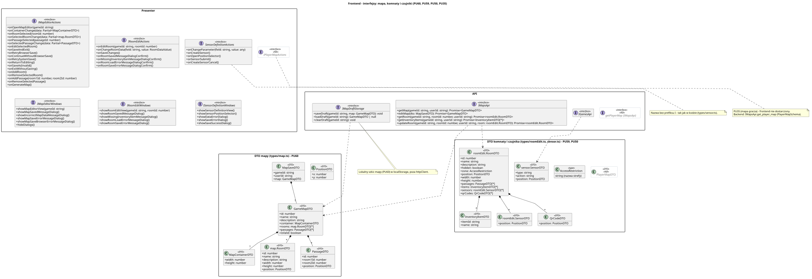

# Interfejsy frontendu

Jedno źródło prawdy dla interfejsów frontendu: akcje prezenterów (`IXxxActions`), okna (`IXxxWindows`), porty API (`IXxxApi`), DTO i enumy - zebrane ze wszystkich PU i pogrupowane jak w [modelu struktury logicznej](../logic_structure_frontend.md).
Stan widoków (`XxxViewModel`) i typy dialogów zostają na diagramach prezenterów PU.

## Klient API

<div hidden>

```
@startuml interfaces
skinparam classAttributeIconSize 0
skinparam packageStyle rectangle
skinparam shadowing false
skinparam roundcorner 4
skinparam linetype polyline
skinparam nodesep 30
skinparam ranksep 40
hide empty members

title Frontend - klient API (wspólny dla wszystkich PU)

class apiClient <<facade>> {
    + calendar: ICalendarApi
    + reservations: IReservationsApi
    + events: IEventsApi
    + games: IGamesApi
    + actions: IActionsApi
    + scenarios: IScenariosApi
    + maps: IMapsApi
    + sensors: ISensorsApi
}
class httpClient <<AxiosInstance>> {
    baseURL = VITE_API_URL + /api/v1
}
class ApiError {
    + status: number | null
}
interface IMapDraftStorage <<interface>> {
    + saveDraft(gameId: string, map: GameMapDTO): void
    + loadDraft(gameId: string): GameMapDTO | null
    + clearDraft(gameId: string): void
}

apiClient ..> httpClient
httpClient ..> ApiError : odrzuca błędy jako

note bottom of apiClient
    Prezentery wołają backend wyłącznie przez apiClient.<moduł>.<metoda>().
    Moduły API mapują camelCase (DTO) <-> snake_case (schematy backendu).
    userId to parametr user_id - do czasu logowania brany z ENV (VITE_DEV_USER_ID).
    Porty modułów: diagramy grup poniżej.
end note

note bottom of IMapDraftStorage
    Lokalny szkic mapy (PU60) w localStorage, poza httpClient.
end note
@enduml
```

</div>



## Kalendarz i wydarzenia (PU1, PU2, PU46)

<div hidden>

```
@startuml interfaces_calendar
skinparam classAttributeIconSize 0
skinparam packageStyle rectangle
skinparam shadowing false
skinparam roundcorner 4
skinparam linetype polyline
skinparam nodesep 30
skinparam ranksep 40
hide empty members

title Frontend - interfejsy: Kalendarz i wydarzenia (PU1, PU2, PU46)

package "Presenter" as P {
    interface ICalendarActions <<interface>> {
        + onShowCalendar()
        + onChangeMonth(month: Date)
        + onShowSlots()
        + onShowEvents()
        + onBack()
    }
    interface ICalendarWindows <<interface>> {
        + showCalendarView()
    }
    interface IReservationActions <<interface>> {
        + onOpenReservation(slot?: CalendarEventDTO)
        + onChangeParameter(field: string, value: any)
        + onSubmitReservation()
        + onConfirmReservation()
        + onCancelReservation()
        + onStartPayment(reservationId: string)
        + onPaymentCompletedMessageDialogConfirm()
        + onSlotUnavailableMessageDialogConfirm()
        + onReservationCancelledMessageDialogConfirm()
    }
    interface IReservationWindows <<interface>> {
        + showReservationView(slot?: CalendarEventDTO)
        + showReservationConfirmDialog()
        + showPaymentCompletedMessageDialog()
        + showSlotUnavailableMessageDialog()
        + showReservationCancelledMessageDialog()
        + hideDialogs()
    }
    interface IEventJoinActions <<interface>> {
        + onOpenEventJoin(event: CalendarEventDTO)
        + onConfirmJoin()
        + onCancelJoin()
        + onEventJoinedMessageDialogConfirm()
        + onAlreadyJoinedMessageDialogConfirm()
        + onEventFullMessageDialogConfirm()
        + onEventUnavailableMessageDialogConfirm()
        + onAccountBlockedMessageDialogConfirm()
    }
    interface IEventJoinWindows <<interface>> {
        + showEventJoinConfirmDialog()
        + showEventJoinedMessageDialog()
        + showAlreadyJoinedMessageDialog()
        + showEventFullMessageDialog()
        + showEventUnavailableMessageDialog()
        + showAccountBlockedMessageDialog()
        + hideDialogs()
    }
}

package "API" as A {
    interface ICalendarApi <<interface>> {
        + getEvents(month: Date): Promise<CalendarEventDTO[*]>
    }
    interface IReservationsApi <<interface>> {
        + createReservation(userId: string, dto: ReservationCreateDTO): Promise<ReservationSummaryDTO>
        + cancelReservation(reservationId: string, userId: string): Promise<boolean>
        + markPaymentCompleted(reservationId: string, userId: string): Promise<ReservationSummaryDTO>
    }
    interface IEventsApi <<interface>> {
        + getEvents(month: Date): Promise<CalendarEventDTO[*]>
        + getEvent(reservId: string): Promise<EventDTO>
        + joinEvent(reservId: string, userId: string): Promise<EventDTO>
    }
}

package "DTO" as D {
    class CalendarEventDTO <<DTO>> {
        + id: string
        + title: string
        + datetime: Date
    }
    enum CalendarMode {
        slots
        events
    }
    class ReservationCreateDTO <<DTO>> {
        + slotId: string
        + participantCount: number
    }
    class ReservationSummaryDTO <<DTO>> {
        + reservationId: string
        + slotId: string
        + gameId: string
        + organizerId: string
        + participantCount: number
        + totalCost: number
        + status: ReservationStatus
        + isPaid: boolean
    }
    enum ReservationStatus {
        unpaid
        confirmed
        cancelled
    }
    class EventDTO <<DTO>> {
        + reservId: string
        + usersRegistered: number
        + participants: string[*]
        + slotId: string
        + gameId: string
        + participantCount: number
        + eventStatus: string
    }
}

ICalendarApi ..> CalendarEventDTO
IReservationsApi ..> ReservationCreateDTO
IReservationsApi ..> ReservationSummaryDTO
ReservationSummaryDTO ..> ReservationStatus
IEventsApi ..> CalendarEventDTO
IEventsApi ..> EventDTO

note bottom of IEventsApi
    getEvents - terminy z opłaconą rezerwacją (GET /calendar/payed_events),
    CalendarEventDTO.id = reservId wydarzenia.
end note
note bottom of CalendarMode
    Tryb CalendarView: terminy (PU1, PU2)
    albo wydarzenia (PU46).
end note

P -[hidden]d- A
A -[hidden]d- D
ICalendarActions -[hidden]d- ICalendarWindows
IReservationActions -[hidden]d- IReservationWindows
IEventJoinActions -[hidden]d- IEventJoinWindows
@enduml
```

</div>



## Panel twórcy i gry (PU25, PU49)

<div hidden>

```
@startuml interfaces_games
skinparam classAttributeIconSize 0
skinparam packageStyle rectangle
skinparam shadowing false
skinparam roundcorner 4
skinparam linetype polyline
skinparam nodesep 30
skinparam ranksep 40
hide empty members

title Frontend - interfejsy: Panel twórcy i gry (PU25, PU49)

package "Presenter" as P {
    interface ICreatorPanelActions <<interface>> {
        + onOpenCreatorPanel()
    }
    interface IGameListActions <<interface>> {
        + onOpenGameList()
        + onChangeParameter(field: string, value: any)
        + onOpenFilterDialog()
        + onFilterSubmit(filterTags: string[*])
        + onListReload()
        + onShowMore()
    }
    interface IGameListWindows <<interface>> {
        + showGameListView(navigationState: GameListNavigationState)
        + showGameFilterDialog()
    }
    interface IGameDefinitionActions <<interface>> {
        + onCreateGame()
        + onOpenGame(gameId: string)
        + onEditParameters()
        + onChangeParameter(field: string, value: any)
        + onSaveMetadata()
        + onParametersSavedMessageDialogConfirm()
        + onIncorrectDataMessageDialogConfirm()
        + onSaveDraft()
        + onSubmitForReview()
        + onSaveErrorMessageDialogConfirm()
        + onLoadErrorMessageDialogConfirm()
    }
    interface IGameDefinitionWindows <<interface>> {
        + showGameDefinitionView()
        + showGameParametersView()
        + showParametersSavedMessageDialog()
        + showIncorrectDataMessageDialog()
        + showGameSavedMessageDialog()
        + showGameSubmittedMessageDialog()
        + showSaveErrorMessageDialog()
        + showLoadErrorMessageDialog()
    }
}

package "API" as A {
    interface IGamesApi <<interface>> {
        + getGame(gameId: string, userId: string): Promise<GameResponseDTO>
        + saveGame(userId: string, metadata: GameCreateDTO, asDraft: boolean): Promise<GameResponseDTO>
        + editGame(gameId: string, userId: string, metadata: GameCreateDTO, asDraft: boolean): Promise<GameResponseDTO>
        + submitToReviewer(gameId: string, userId: string): Promise<boolean>
        + getGames(userId: string, tags: string[*], limit: number, offset: number): Promise<GameMetadataDTO[*]>
        + getGameTags(): Promise<string[*]>
    }
}

package "DTO" as D {
    class GameCreateDTO <<DTO>> {
        + title: string
        + description: string
        + minPlayers: number
        + maxPlayers: number
        + durationMinutes: number
        + requiresInvitation: boolean
        + tags: string[*]
    }
    class GameResponseDTO <<DTO>> {
        + gameId: string
        + status: string
    }
    class GameMetadataDTO <<DTO>> {
        + gameId: string
        + title: string
        + description: string
        + minPlayers: number
        + maxPlayers: number
        + durationMinutes: number
        + requiresInvitation: boolean
        + tags: string[*]
        + status: string
    }
    class GameListNavigationState {
        + appliedTags: string[*]
    }
    enum GameCategory {
        Fantasy
        Science Fiction
        Historyczna
        Kryminalna
        Horror
        Przygodowa
    }
}

GameResponseDTO -u-|> GameCreateDTO
IGamesApi ..> GameCreateDTO
IGamesApi ..> GameResponseDTO
IGamesApi ..> GameMetadataDTO
IGameListWindows ..> GameListNavigationState

note bottom of GameCategory
    Kategoria gry trafia do tags[0]
    (ta sama lista co na backendzie).
end note

P -[hidden]d- A
A -[hidden]d- D
IGameListActions -[hidden]d- IGameListWindows
IGameDefinitionActions -[hidden]d- IGameDefinitionWindows
@enduml
```

</div>



## Akcje (PU51, PU62)

<div hidden>

```
@startuml interfaces_actions
skinparam classAttributeIconSize 0
skinparam packageStyle rectangle
skinparam shadowing false
skinparam roundcorner 4
skinparam linetype polyline
skinparam nodesep 30
skinparam ranksep 40
hide empty members

title Frontend - interfejsy: Akcje (PU51, PU62)

package "Presenter" as P {
    interface IActionDefinitionActions <<interface>> {
        + onAddAction(gameId: string)
        + onChangeParameter(field: string, value: any)
        + onSaveAction()
        + onIncompleteActionDataMessageDialogConfirm()
        + onActionSaveErrorMessageDialogConfirm()
    }
    interface IActionDefinitionWindows <<interface>> {
        + showActionDefinitionView(gameId: string)
        + showActionSavedMessageDialog()
        + showIncompleteActionDataMessageDialog()
        + showActionSaveErrorMessageDialog()
        + hideDialogs()
    }
    interface IDisplayActionsActions <<interface>> {
        + onDisplayActionsSelect()
    }
    interface IDisplayActionsWindows <<interface>> {
        + showDisplayActionsView()
    }
}

package "API" as A {
    interface IActionsApi <<interface>> {
        + createAction(action: ActionCreateDTO): Promise<ActionDTO>
        + getAll(gameId: string): Promise<ActionDTO[*]>
    }
}

package "DTO" as D {
    class ActionCreateDTO <<DTO>> {
        + gameId: string
        + name: string
        + actionType: ActionType
        + outcomeType: EffectKind
        + outcomeValue: string
    }
    class ActionDTO <<DTO>> {
        + actionId: string
    }
    enum ActionType {
        movement
        attack
        useItem
        dialogue
        custom
        miniGame
    }
    enum EffectKind {
        changeStat
        addItem
        removeItem
        changeLocation
        setFlag
        startMiniGame
    }
}

ActionDTO -u-|> ActionCreateDTO
ActionCreateDTO ..> ActionType
ActionCreateDTO ..> EffectKind
IActionsApi ..> ActionCreateDTO
IActionsApi ..> ActionDTO

note bottom of IActionsApi
    getAll (GET /actions/list/{game_id}) - lista akcji gry (PU62),
    używana też do wyboru akcji czujnika (PU50).
end note

P -[hidden]d- A
A -[hidden]d- D
IActionDefinitionActions -[hidden]d- IActionDefinitionWindows
IDisplayActionsActions -[hidden]d- IDisplayActionsWindows
@enduml
```

</div>



## Scenariusz (PU56, PU57, PU58)

<div hidden>

```
@startuml interfaces_scenario
skinparam classAttributeIconSize 0
skinparam packageStyle rectangle
skinparam shadowing false
skinparam roundcorner 4
skinparam linetype polyline
skinparam nodesep 30
skinparam ranksep 40
hide empty members

title Frontend - interfejsy: Scenariusz (PU56, PU57, PU58)

package "Presenter" as P {
    interface IScenarioEditorActions <<interface>> {
        + onOpenScenarioEditor(gameId: string)
        + onReloadScenario()
    }
    interface IScenarioEditorWindows <<interface>> {
        + showScenarioEditorView(gameId: string)
    }
    interface INewTaskActions <<interface>> {
        + onNewTaskSelect()
        + onChangeParameter(field: string, value: any)
        + onSubmitNewTask()
        + onCancelNewTask()
        + onCancelNewTaskConfirm()
        + onCancelNewTaskCancel()
        + onNewTaskSuccessMessageDialogConfirm()
        + onIncorrectDataMessageDialogConfirm()
        + onConflictMessageDialogConfirm()
        + onSaveErrorMessageDialogConfirm()
    }
    interface INewTaskWindows <<interface>> {
        + showNewTaskView()
        + showCancelNewTaskConfirmationDialog()
        + showConflictMessageDialog()
        + showIncorrectDataMessageDialog()
        + showNewTaskSuccessMessageDialog()
        + showSaveErrorMessageDialog()
        + hideDialogs()
    }
    interface IVictoryConditionActions <<interface>> {
        + onVictoryConditionSelect()
        + onVictoryConditionEditSelect(victoryConditionId: string)
        + onChangeParameter(field: string, value: any)
        + onSubmitVictoryCondition()
        + onCancelVictoryCondition()
        + onCancelVictoryConditionConfirm()
        + onCancelVictoryConditionCancel()
        + onVictoryConditionSuccessMessageDialogConfirm()
        + onIncorrectDataMessageDialogConfirm()
        + onConflictMessageDialogConfirm()
        + onSaveErrorMessageDialogConfirm()
        + onLoadErrorMessageDialogConfirm()
    }
    interface IVictoryConditionWindows <<interface>> {
        + showVictoryConditionView()
        + showVictoryConditionEditView(victoryConditionId: string)
        + showCancelVictoryConditionConfirmationDialog()
        + showConflictMessageDialog()
        + showIncorrectDataMessageDialog()
        + showVictoryConditionSuccessMessageDialog()
        + showSaveErrorMessageDialog()
        + showLoadErrorMessageDialog()
        + hideDialogs()
    }
}

package "API" as A {
    interface IScenariosApi <<interface>> {
        + loadScenario(gameId: string, userId: string): Promise<ScenarioDetailDTO>
        + addTask(gameId: string, userId: string, task: TaskCreateDTO): Promise<TaskDTO>
        + addVictoryCondition(gameId: string, userId: string, victoryCondition: VictoryConditionCreateDTO): Promise<VictoryConditionDTO>
        + getVictoryCondition(gameId: string, victoryConditionId: string, userId: string): Promise<VictoryConditionDTO>
        + editVictoryCondition(gameId: string, victoryConditionId: string, userId: string, victoryCondition: VictoryConditionCreateDTO): Promise<VictoryConditionDTO>
    }
}

package "DTO" as D {
    class ScenarioDetailDTO <<DTO>> {
        + scenarioId: string
        + gameId: string
        + tasks: TaskDTO[*]
        + victoryConditions: VictoryConditionDTO[*]
    }
    class TaskDTO <<DTO>> {
        + taskId: string
        + title: string
        + narrative: string
        + interactionType: string
        + interactionTargetId: string | null
        + requiredPlayerLevel: number
        + timeLimitMinutes: number | null
        + rewardType: string
        + rewardValue: string
    }
    class TaskCreateDTO <<DTO>> {
        + title: string
        + narrative: string
        + interactionType: string
        + requiredPlayerLevel: number [0..1]
        + timeLimitMinutes: number | null [0..1]
        + rewardType: string
        + rewardValue: string
    }
    class VictoryConditionCreateDTO <<DTO>> {
        + name: string
        + target: VictoryConditionTarget
        + conditionType: VictoryConditionType
        + value: string
    }
    class VictoryConditionDTO <<DTO>> {
        + victoryConditionId: string
        + name: string
        + target: VictoryConditionTarget
        + conditionType: VictoryConditionType
        + value: string
    }
    enum VictoryConditionTarget {
        faction
        character
    }
    enum VictoryConditionType {
        completeTasks
        reachScore
        eliminateFaction
        surviveTime
    }
}

ScenarioDetailDTO *-- "*" TaskDTO
ScenarioDetailDTO *-- "*" VictoryConditionDTO
VictoryConditionCreateDTO ..> VictoryConditionTarget
VictoryConditionCreateDTO ..> VictoryConditionType
IScenariosApi ..> ScenarioDetailDTO
IScenariosApi ..> TaskCreateDTO
IScenariosApi ..> TaskDTO
IScenariosApi ..> VictoryConditionCreateDTO
IScenariosApi ..> VictoryConditionDTO

P -[hidden]d- A
A -[hidden]d- D
IScenarioEditorActions -[hidden]d- IScenarioEditorWindows
INewTaskActions -[hidden]d- INewTaskWindows
IVictoryConditionActions -[hidden]d- IVictoryConditionWindows
@enduml
```

</div>



## Mapa, komnaty i czujniki (PU60, PU59, PU50, PU35)

`<<ND>>` - nie dostarczone (not delivered): PU35 ma tylko backend, frontend mapy gracza nie powstał.

<div hidden>

```
@startuml interfaces_map
skinparam classAttributeIconSize 0
skinparam packageStyle rectangle
skinparam shadowing false
skinparam roundcorner 4
skinparam linetype polyline
skinparam nodesep 30
skinparam ranksep 40
hide empty members
skinparam class<<ND>> {
    BackgroundColor #FFFFFF
    BorderColor #9AA7B8
    BorderStyle dashed
    FontColor #777777
}

title Frontend - interfejsy: mapa, komnaty i czujniki (PU60, PU59, PU50, PU35)

package "Presenter" as P {
    interface IMapEditorActions <<interface>> {
        + onOpenMapEditor(gameId: string)
        + onContainerChange(data: Partial<MapContainerDTO>)
        + onRoomSelected(roomId: number)
        + onSelectedRoomChange(data: Partial<map.RoomDTO>)
        + onPassageSelected(passageId: number)
        + onSelectedPassageChange(data: Partial<PassageDTO>)
        + onEditSelectedRoom()
        + onSaveAndExit()
        + onRetryBrowserSave()
        + onContinueWithoutBrowserSave()
        + onRetrySystemSave()
        + onReturnToEditing()
        + onSaveAsInvalid()
        + onExitWithoutSaving()
        + onAddRoom()
        + onRemoveSelectedRoom()
        + onAddPassage(room1Id: number, room2Id: number)
        + onRemoveSelectedPassage()
        + onGenerateMap()
    }
    interface IMapEditorWindows <<interface>> {
        + showMapEditorView(gameId: string)
        + showMapSavedMessageDialog()
        + showIncorrectMapDataMessageDialog()
        + showMapSaveErrorMessageDialog()
        + showMapSaveBrowserErrorMessageDialog()
        + hideDialogs()
    }
    interface IRoomEditActions <<interface>> {
        + onEditRoom(gameId: string, roomId: number)
        + onChangeRoomData(field: string, value: RoomDataValue)
        + onSaveChanges()
        + onRoomSavedMessageDialogConfirm()
        + onMissingInventoryItemMessageDialogConfirm()
        + onRoomLoadErrorMessageDialogConfirm()
        + onRoomSaveErrorMessageDialogConfirm()
    }
    interface IRoomEditWindows <<interface>> {
        + showRoomEditView(gameId: string, roomId: number)
        + showRoomSavedMessageDialog()
        + showMissingInventoryItemMessageDialog()
        + showRoomLoadErrorMessageDialog()
        + showRoomSaveErrorMessageDialog()
    }
    interface SensorDefinitionActions <<interface>> {
        + onChangeParameter(field: string, value: any)
        + onCreateSensor()
        + onOpenPositionSelector()
        + onSensorSubmit()
        + onCreateSensorCancel()
    }
    interface ISensorDefinitionWindows <<interface>> {
        + showSensorDefinitionView()
        + showSensorPositionSelector()
        + showDataErrorDialog()
        + showSaveErrorDialog()
        + showSaveSuccessDialog()
    }
    interface IPlayerMapActions <<interface>> <<ND>>
}

package "API" as A {
    interface IMapsApi <<interface>> {
        + getMap(gameId: string, userId: string): Promise<GameMapDTO>
        + editMap(dto: MapSaveDTO): Promise<GameMapDTO>
        + getRoom(gameId: string, roomId: number, userId: string): Promise<roomEdit.RoomDTO>
        + getInventoryItems(gameId: string, userId: string): Promise<InventoryItemDTO[*]>
        + updateRoom(gameId: string, roomId: number, userId: string, room: roomEdit.RoomDTO): Promise<roomEdit.RoomDTO>
    }
    interface ISensorsApi <<interface>> {
        + getSensorTypes(): Promise<string[*]>
        + addSensor(gameId: string, userId: string, sensor: sensor.SensorDTO): Promise<sensor.SensorDTO>
    }
    interface IMapDraftStorage <<interface>> {
        + saveDraft(gameId: string, map: GameMapDTO): void
        + loadDraft(gameId: string): GameMapDTO | null
        + clearDraft(gameId: string): void
    }
    interface "getPlayerMap (IMapsApi)" as IPlayerMapApi <<interface>> <<ND>>
}

package "DTO mapy (types/map.ts) - PU60" as D1 {
    class GameMapDTO <<DTO>> {
        + id: number
        + name: string
        + description: string
        + container: MapContainerDTO
        + rooms: map.RoomDTO[*]
        + passages: PassageDTO[*]
        + isValid: boolean
    }
    class MapSaveDTO <<DTO>> {
        + gameId: string
        + userId: string
        + map: GameMapDTO
    }
    class MapContainerDTO <<DTO>> {
        + width: number
        + height: number
    }
    class "map.RoomDTO" as MapRoom <<DTO>> {
        + id: number
        + name: string
        + description: string
        + width: number
        + height: number
        + position: PositionDTO
    }
    class PassageDTO <<DTO>> {
        + id: number
        + room1Id: number
        + room2Id: number
        + position: PositionDTO
    }
    class PositionDTO <<DTO>> {
        + x: number
        + y: number
    }
}

package "DTO komnaty i czujnika (types/roomEdit.ts, sensor.ts) - PU59, PU50" as D2 {
    class "roomEdit.RoomDTO" as EditRoom <<DTO>> {
        + id: number
        + name: string
        + description: string
        + hidden: boolean
        + zone: AccessRestriction
        + position: PositionDTO
        + width: number
        + height: number
        + passages: PassageDTO[*]
        + items: InventoryItemDTO[*]
        + sensors: roomEdit.SensorDTO[*]
        + qrCodes: QrCodeDTO[*]
    }
    class InventoryItemDTO <<DTO>> {
        + itemId: string
        + name: string
    }
    class "roomEdit.SensorDTO" as EditSensor <<DTO>> {
        + position: PositionDTO
    }
    class QrCodeDTO <<DTO>> {
        + position: PositionDTO
    }
    class "sensor.SensorDTO" as SensorDef <<DTO>> {
        + type: string
        + action: string
        + position: PositionDTO
    }
    class AccessRestriction <<type>> {
        string (nazwa strefy)
    }
    class PlayerMapDTO <<DTO>> <<ND>>
}

GameMapDTO *-- "1" MapContainerDTO
GameMapDTO *-- "*" MapRoom
GameMapDTO *-- "*" PassageDTO
MapSaveDTO *-- "1" GameMapDTO
EditRoom *-- "*" InventoryItemDTO
EditRoom *-- "*" EditSensor
EditRoom *-- "*" QrCodeDTO
IMapsApi ..> GameMapDTO
IMapsApi ..> EditRoom
ISensorsApi ..> SensorDef
IMapDraftStorage ..> GameMapDTO

note bottom of IMapDraftStorage
    Lokalny szkic mapy (PU60) w localStorage, poza httpClient.
end note
note bottom of IPlayerMapActions
    PU35 (mapa gracza) - frontend nie dostarczony.
    Backend: IMapsApi.get_player_map (PlayerMapSchema).
end note
note bottom of SensorDefinitionActions
    Nazwa bez prefiksu I - tak jak w kodzie (types/sensor.ts).
end note

P -[hidden]d- A
A -[hidden]d- D1
D1 -[hidden]r- D2
IMapEditorActions -[hidden]d- IMapEditorWindows
IRoomEditActions -[hidden]d- IRoomEditWindows
SensorDefinitionActions -[hidden]d- ISensorDefinitionWindows
@enduml
```

</div>


