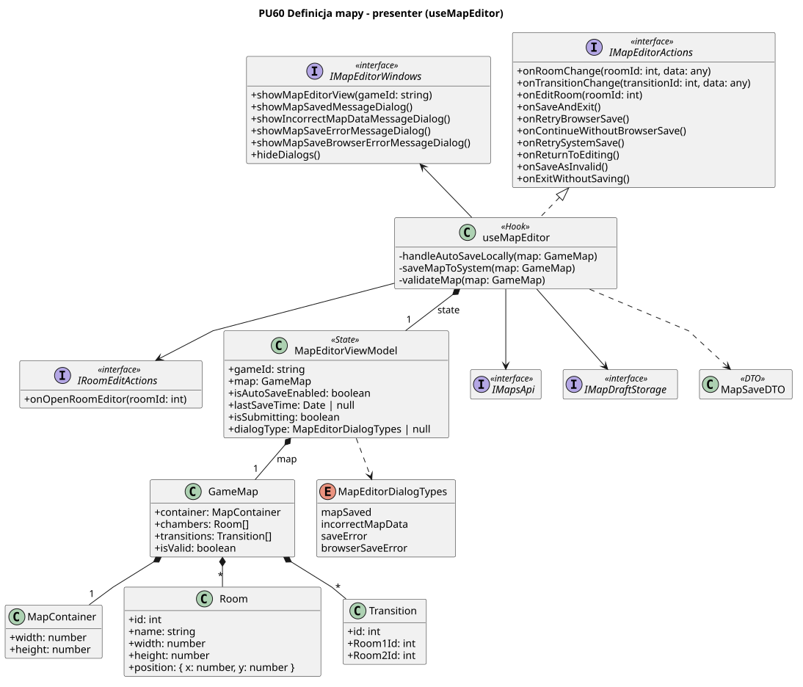

<div hidden>

```

@startuml map-editor-presenter
skinparam classAttributeIconSize 0
skinparam packageStyle rectangle
skinparam shadowing false
skinparam roundcorner 4
skinparam linetype polyline
skinparam nodesep 30
skinparam ranksep 40
hide empty members

title PU60 Definicja mapy - prezenter

interface IMapEditorActions <<interface>> {
    + onRoomChange(roomId: int, data: any)
    + onTransitionChange(transitionId: int, data: any)
    + onEditRoom(roomId: int)
    + onSaveAndExit()
    + onRetryBrowserSave()
    + onContinueWithoutBrowserSave()
    + onRetrySystemSave()
    + onReturnToEditing()
    + onSaveAsInvalid()
    + onExitWithoutSaving()
}

interface IRoomEditActions <<interface>> {
    + onOpenRoomEditor(roomId: int)
}

interface IMapEditorWindows <<interface>> {
    + showMapEditorView(gameId: string)
    + showMapSavedMessageDialog()
    + showIncorrectMapDataMessageDialog()
    + showMapSaveErrorMessageDialog()
    + showMapSaveBrowserErrorMessageDialog()
    + hideDialogs()
}

class useMapEditor <<Hook>> {
    - handleAutoSaveLocally(map: GameMap) 
    - saveMapToSystem(map: GameMap)
    - validateMap(map: GameMap)
}

class MapEditorViewModel <<State>> {
    + gameId: string
    + map: GameMap
    + isAutoSaveEnabled: boolean
    + lastSaveTime: Date | null
    + isSubmitting: boolean
    + dialogType: MapEditorDialogTypes | null
}

class GameMap {
    + container: MapContainer
    + chambers: Room[]
    + transitions: Transition[]
    + isValid: boolean
}

class MapContainer {
    + width: number
    + height: number
}

class Room {
    + id: int
    + name: string
    + width: number 
    + height: number
    + position: { x: number, y: number }
}

class Transition {
    + id: int
    + Room1Id: int
    + Room2Id: int
}

enum MapEditorDialogTypes {
    mapSaved
    incorrectMapData
    saveError
    browserSaveError
}

interface IMapsApi <<interface>> {

}

interface IMapDraftStorage <<interface>> {

}

class MapSaveDTO <<DTO>>

useMapEditor .u.|> IMapEditorActions
useMapEditor -u-> IMapEditorWindows
useMapEditor --> IRoomEditActions 
useMapEditor *-- "1" MapEditorViewModel : state
MapEditorViewModel *-- "1" GameMap : map
GameMap *-- "1" MapContainer
GameMap *-- "*" Room
GameMap *-- "*" Transition 
MapEditorViewModel ..> MapEditorDialogTypes
useMapEditor ..> MapSaveDTO
useMapEditor --> IMapsApi
useMapEditor --> IMapDraftStorage 

@enduml

```

<\div>


