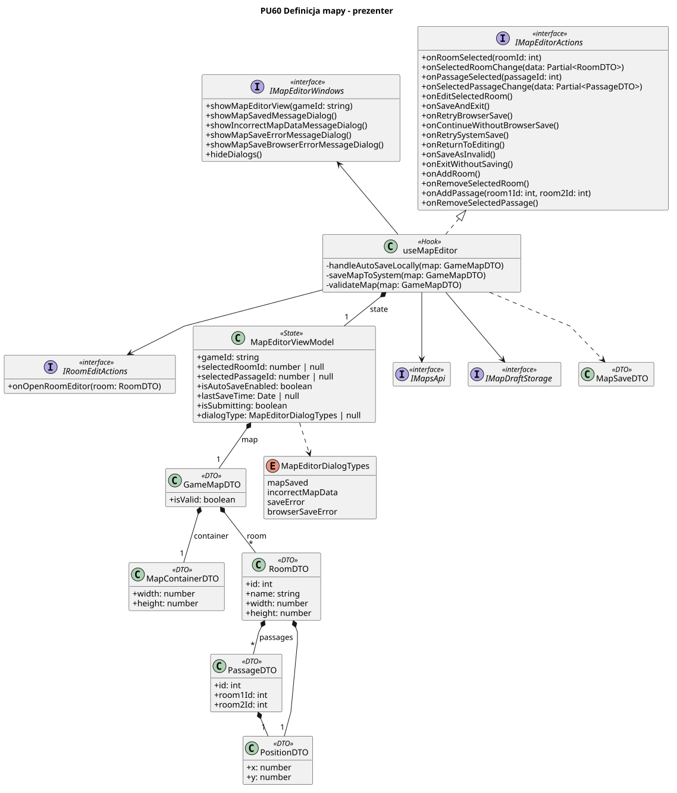

<div hidden>

```
@startuml map-editor-presenter
skinparam classAttributeIconSize 0
skinparam packageStyle rectangle
skinparam shadowing false
skinparam roundcorner 4
skinparam linetype polyline
skinparam nodesep 30
skinparam ranksep 40
hide empty members

title PU60 Definicja mapy - prezenter

interface IMapEditorActions <<interface>> {
    + onRoomSelected(roomId: int)
    + onSelectedRoomChange(data: Partial<RoomDTO>)
    + onPassageSelected(passageId: int)
    + onSelectedPassageChange(data: Partial<PassageDTO>)
    + onEditSelectedRoom()
    + onSaveAndExit()
    + onRetryBrowserSave()
    + onContinueWithoutBrowserSave()
    + onRetrySystemSave()
    + onReturnToEditing()
    + onSaveAsInvalid()
    + onExitWithoutSaving()
}

interface IRoomEditActions <<interface>> {
    + onOpenRoomEditor(room: RoomDTO)
}

interface IMapEditorWindows <<interface>> {
    + showMapEditorView(gameId: string)
    + showMapSavedMessageDialog()
    + showIncorrectMapDataMessageDialog()
    + showMapSaveErrorMessageDialog()
    + showMapSaveBrowserErrorMessageDialog()
    + hideDialogs()
}

class useMapEditor <<Hook>> {
    - handleAutoSaveLocally(map: GameMapDTO)
    - saveMapToSystem(map: GameMapDTO)
    - validateMap(map: GameMapDTO)
}

class MapEditorViewModel <<State>> {
    + gameId: string
    + selectedRoomId: number | null
    + selectedPassageId: number | null
    + isAutoSaveEnabled: boolean
    + lastSaveTime: Date | null
    + isSubmitting: boolean
    + dialogType: MapEditorDialogTypes | null
}

class GameMapDTO <<DTO>> {
    + isValid: boolean
}

class MapContainerDTO <<DTO>> {
    + width: number
    + height: number
}

class RoomDTO <<DTO>> {
    + id: int
    + name: string
    + width: number
    + height: number
}

class PassageDTO <<DTO>> {
    + id: int
    + room1Id: int
    + room2Id: int
}

class PositionDTO <<DTO>> {
    + x: number
    + y: number
}

enum MapEditorDialogTypes {
    mapSaved
    incorrectMapData
    saveError
    browserSaveError
}

interface IMapsApi <<interface>> {

}

interface IMapDraftStorage <<interface>> {

}

class MapSaveDTO <<DTO>>

useMapEditor .u.|> IMapEditorActions
useMapEditor -u-> IMapEditorWindows
useMapEditor --> IRoomEditActions
useMapEditor *-- "1" MapEditorViewModel : state
MapEditorViewModel *-- "1" GameMapDTO : map
GameMapDTO *-- "1" MapContainerDTO : container
GameMapDTO *-- "*" RoomDTO : room
RoomDTO *-- "*" PassageDTO : passages
RoomDTO *-- "1" PositionDTO
PassageDTO *-- "1" PositionDTO
MapEditorViewModel ..> MapEditorDialogTypes
useMapEditor ..> MapSaveDTO
useMapEditor --> IMapsApi
useMapEditor --> IMapDraftStorage

@enduml

```

<\div>


