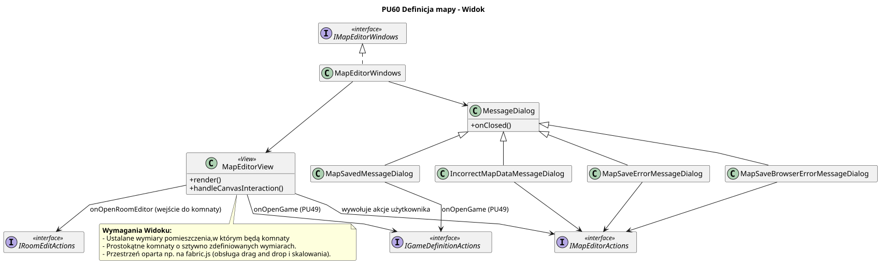

<div hidden>

```

@startuml map-editor-view
skinparam classAttributeIconSize 0
skinparam packageStyle rectangle
skinparam shadowing false
skinparam roundcorner 4
skinparam linetype polyline
skinparam nodesep 30
skinparam ranksep 40
hide empty members

title PU60 Definicja mapy - Widok (MapEditorView)

class MapEditorView <<View>> {
    + render()
    + handleCanvasInteraction()
}

class MessageDialog {
    + onClosed()
}

class MapSavedMessageDialog
class IncorrectMapDataMessageDialog
class MapSaveErrorMessageDialog
class MapSaveBrowserErrorMessageDialog

MapSavedMessageDialog -u-|> MessageDialog
IncorrectMapDataMessageDialog -u-|> MessageDialog
MapSaveErrorMessageDialog -u-|> MessageDialog
MapSaveBrowserErrorMessageDialog -u-|> MessageDialog

class MapEditorWindows
interface IMapEditorWindows <<interface>>
interface IMapEditorActions <<interface>>
interface IGameDefinitionActions <<interface>>
interface IRoomDefinitionActions <<interface>>

MapEditorWindows .u.|> IMapEditorWindows
MapEditorWindows --> MapEditorView
MapEditorWindows --> MessageDialog

MapEditorView --> IMapEditorActions : wywołuje akcje użytkownika
MapEditorView --> IGameDefinitionActions : onOpenGame (PU49)
MapEditorView --> IRoomDefinitionActions : onOpenRoomEditor (wejście do komnaty)

MapSavedMessageDialog --> IGameDefinitionActions : onOpenGame (PU49)
IncorrectMapDataMessageDialog --> IMapEditorActions
MapSaveErrorMessageDialog --> IMapEditorActions
MapSaveBrowserErrorMessageDialog --> IMapEditorActions

note bottom of MapEditorView
    **Wymagania Widoku:**
    - Ustalane wymiary pomieszczenia,w którym będą komnaty
    - Prostokątne komnaty o sztywno zdefiniowanych wymiarach.
    - Przestrzeń oparta np. na fabric.js (obsługa drag and drop i skalowania).
end note

@enduml
```

<\div>

