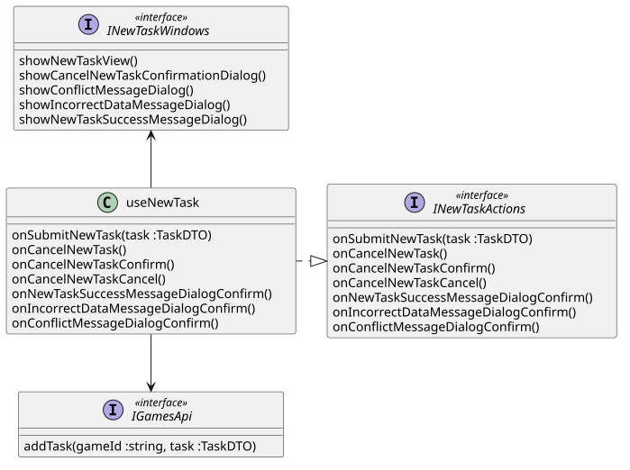

```
@startuml
class useNewTask {
    onSubmitNewTask(task :TaskDTO)
    onCancelNewTask()
    onConfirmCancelNewTask()
    onCancelCancelNewTask()
    onNewTaskSuccessMessageDialogConfirm()
    onIncorrectDataMessageDialogConfirm()
    onConflictMessageDialogConfirm()
}

interface INewTaskActions <<interface>> {
    onSubmitNewTask(task :TaskDTO)
    onCancelNewTask()
    onConfirmCancelNewTask()
    onCancelCancelNewTask()
    onNewTaskSuccessMessageDialogConfirm()
    onIncorrectDataMessageDialogConfirm()
    onConflictMessageDialogConfirm()
}

useNewTask .|> INewTaskActions

useNewTask --> IGamesApi
useNewTask -u-> INewTaskWindows

interface IGamesApi <<interface>> {
    addTask(gameId :string, task :TaskDTO)
}

interface INewTaskWindows <<interface>> {
    showNewTaskView()
    showNewTaskCancelConfirmationDialog()
    showConflictMessageDialog()
    showIncorrectDataMessageDialog()
    showNewTaskSuccessMessageDialog()
}
@enduml
```


