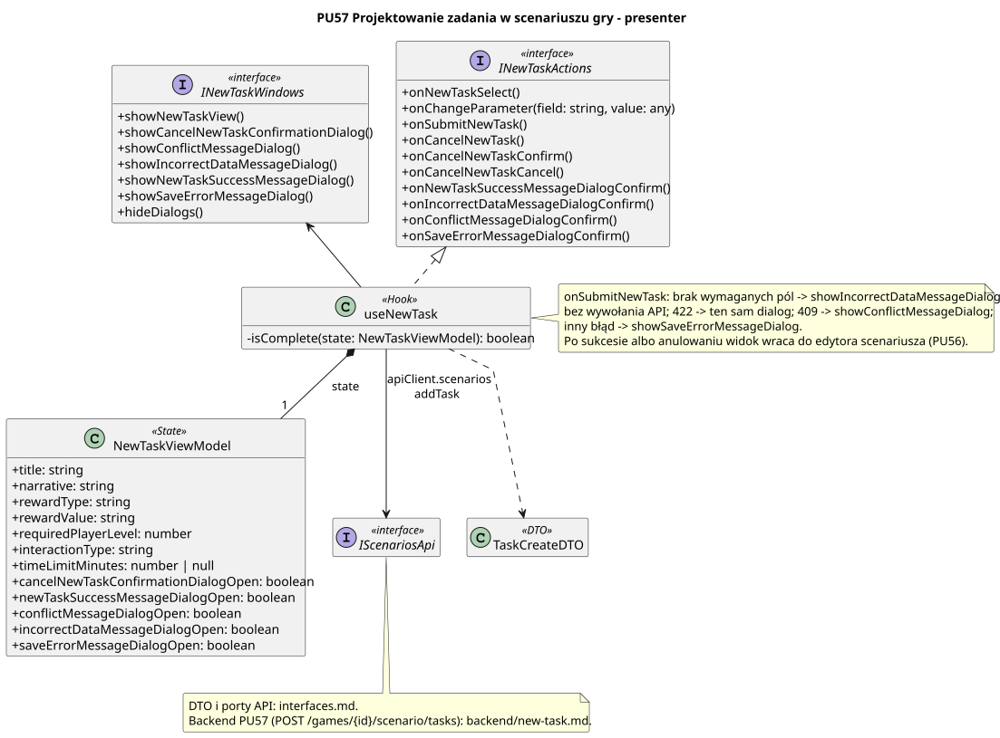

```
@startuml
class useNewTask {
    onNewTaskSelect()
    onSubmitNewTask()
    onCancelNewTask()
    onCancelNewTaskConfirm()
    onCancelNewTaskCancel()
    onNewTaskSuccessMessageDialogConfirm()
    onIncorrectDataMessageDialogConfirm()
    onConflictMessageDialogConfirm()
    onSaveErrorMessageDialogConfirm()
    onChangeParameter(field: string, value: string | number)
}

interface INewTaskActions <<interface>> {
    onNewTaskSelect()
    onSubmitNewTask()
    onCancelNewTask()
    onCancelNewTaskConfirm()
    onCancelNewTaskCancel()
    onNewTaskSuccessMessageDialogConfirm()
    onIncorrectDataMessageDialogConfirm()
    onConflictMessageDialogConfirm()
    onSaveErrorMessageDialogConfirm()
    onChangeParameter(field: string, value: string | number)
}

useNewTask .|> INewTaskActions

useNewTask --> IScenarioApi
useNewTask -u-> INewTaskWindows

interface IScenarioApi <<interface>> {
    addTask(gameId :string, userId :string, task :TaskCreateDTO)
}

interface INewTaskWindows <<interface>> {
    showNewTaskView()
    showCancelNewTaskConfirmationDialog()
    showConflictMessageDialog()
    showIncorrectDataMessageDialog()
    showNewTaskSuccessMessageDialog()
    showSaveErrorMessageDialog()
    hideDialogs()
}

class NewTaskViewModel {
    title: string
    narrative: string
    rewardType: string
    rewardValue: string
    requiredPlayerLevel: number
    interactionType: string
    timeLimitMinutes: number | null
    cancelNewTaskConfirmationDialogOpen: boolean
    newTaskSuccessMessageDialogOpen: boolean
    conflictMessageDialogOpen: boolean
    incorrectDataMessageDialogOpen: boolean
    saveErrorMessageDialogOpen: boolean
}

useNewTask *-l- NewTaskViewModel :state
@enduml
```


