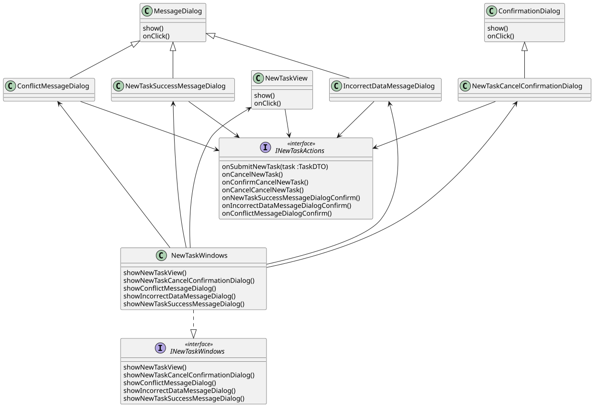

```
@startuml
class NewTaskView {
    show()
    onClick()
}

class ConfirmationDialog {
    show()
    onClick()
}

class MessageDialog {
    show()
    onClick()
}

class CancelNewTaskConfirmationDialog
CancelNewTaskConfirmationDialog -u-|> ConfirmationDialog

class ConflictMessageDialog
class IncorrectDataMessageDialog
class NewTaskSuccessMessageDialog

ConflictMessageDialog -u-|> MessageDialog
IncorrectDataMessageDialog -u-|> MessageDialog
NewTaskSuccessMessageDialog -u-|> MessageDialog

interface INewTaskActions <<interface>> {
    onSubmitNewTask(task :TaskDTO)
    onCancelNewTask()
    onCancelNewTaskConfirm()
    onCancelNewTaskCancel()
    onNewTaskSuccessMessageDialogConfirm()
    onIncorrectDataMessageDialogConfirm()
    onConflictMessageDialogConfirm()
}

INewTaskActions <-u- CancelNewTaskConfirmationDialog
INewTaskActions <-u- ConflictMessageDialog
INewTaskActions <-u- IncorrectDataMessageDialog
INewTaskActions <-u- NewTaskSuccessMessageDialog
INewTaskActions <-u- NewTaskView

NewTaskWindows --u-> CancelNewTaskConfirmationDialog
NewTaskWindows --u-> ConflictMessageDialog
NewTaskWindows --u-> IncorrectDataMessageDialog
NewTaskWindows --u-> NewTaskSuccessMessageDialog
NewTaskWindows --u-> NewTaskView

interface INewTaskWindows <<interface>> {
    showNewTaskView()
    showCancelNewTaskConfirmationDialog()
    showConflictMessageDialog()
    showIncorrectDataMessageDialog()
    showNewTaskSuccessMessageDialog()
}

class NewTaskWindows {
    showNewTaskView()
    showCancelNewTaskConfirmationDialog()
    showConflictMessageDialog()
    showIncorrectDataMessageDialog()
    showNewTaskSuccessMessageDialog()
}

NewTaskWindows .d.|> INewTaskWindows
@enduml
```


